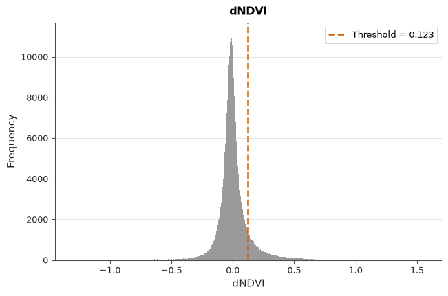

Change detection
================

Change detection compares images of the same place from two dates to find
where the land surface has changed. This guide follows a typical scenario,
mapping **forest loss** (deforestation, or equally mangrove loss) between two
Sentinel-2 surface reflectance images, and shows the main families of methods
in ``rsgispy.changedetect``:

* **image algebra** — the difference or ratio of a band or spectral index
  (:func:`~rsgispy.changedetect.imgchngmthds.image_difference`,
  :func:`~rsgispy.changedetect.imgchngmthds.image_ratio`), followed by a
  threshold chosen with :mod:`rsgispy.tools.thresholding`;
* **multi-band change magnitude** — change vector analysis
  (:func:`~rsgispy.changedetect.imgchngmthds.change_vector_analysis`), and the
  statistical transforms slow feature analysis
  (:func:`~rsgispy.changedetect.imgchngmthds.slow_feature_analysis`) and
  iteratively reweighted multivariate alteration detection (IR-MAD;
  :func:`~rsgispy.changedetect.imgchngmthds.multivariate_alteration_detection`);
* **class-based change** — using an earlier land cover map and looking for
  pixels of a class that no longer look like that class
  (:mod:`rsgispy.changedetect.pxloutlierchng`);

and finishes with the **accuracy assessment** of the change map, which needs
more care than for a land cover map because change is usually rare.

Which method? Index differencing is simple and easy to interpret when you know
which index responds to the change of interest (NDVI or NBR for vegetation
loss). CVA uses several bands at once and detects any kind of change. SFA and
IR-MAD are designed to ignore differences that affect the whole image in the
same way (atmosphere, illumination, sensor calibration), and so are useful
when the two images are not perfectly radiometrically consistent. Class-based
methods answer the question "which of the pixels mapped as forest are no
longer forest?" directly and give the change *from* class for free.

.. contents:: Contents
   :local:
   :depth: 1

Installation
------------

Image differencing, ratioing, CVA and the class-based Otsu and Li methods need
only the core package. SFA, IR-MAD and the kurtosis/skewness method need
``scipy``; K-means thresholding (``use_kmeans=True``) and the accuracy
assessment need ``scikit-learn``. Both come with the ``stats`` (or
``classification``) extra. The class-based PyOD method needs ``pyod``, which
is not an rsgispy extra:

.. code-block:: bash

   pip install "rsgispy[stats,classification]"
   pip install pyod  # optional, for find_class_pyod_outliers

Overview
--------

.. code-block:: text

   S2 SREF date 1 + date 2 (same grid)        land cover map of date 1
            │                                          │
            ▼                                          │
   1. Valid mask + NDVI/NBR per date                    │
            │                                          │
            ├─► 2. Difference / ratio ──► indices_diff.tif (dNDVI, dNBR)
            │        │                                 │
            │        ▼                                 │
            │   3. Threshold (Otsu/Yen/Li) ─► dndvi_change.tif (0/1/2)
            │                                          │
            ├─► 4. CVA ─────────────────► cva_change.tif, magnitude, direction
            ├─► 5. SFA / IR-MAD ────────► sfa_change.tif, irmad_change.tif
            │                                          ▼
            └─► 6. Class-based outliers (forest only) ─► forest_loss_otsu.tif
                     │
                     ▼
            7. Stratified sample + area-adjusted accuracy

The code in this guide comes from the example script
``docs/examples/change_detection.py`` (included below step by step), which is
run by the rsgispy test suite on synthetic data. The inputs are:

* two co-registered surface reflectance images on the **same pixel grid**,
  for example the 10-band Sentinel-2 stacks (B2, B3, B4, B5, B6, B7, B8, B8A,
  B11, B12; reflectance × 10,000; no data value 0) created by
  :func:`~rsgispy.imagecalibration.sensorlvl2data.create_stacked_sen2_esa_l2a_img`,
  ideally from the same season to limit phenological differences;
* a land cover map of the first date on the same grid, for example the output
  of the :doc:`pixel_classification_workflow` guide, in which forest has the
  value ``forest_id`` (here 2).

If the images are not on the same grid, resample one to the other with
:func:`rsgispy.imageutils.warp.resample_img_to_match`; if they are
misregistered by a fraction of a pixel or more, co-register them first with
:func:`rsgispy.imageregistration.warping.coregister_images`. Misregistration
creates false change along every edge (field boundaries, roads, rivers).

Step 1 — Valid data and spectral indices
----------------------------------------

Change can only be measured where **both** images have valid data. Without a
mask, the change functions skip any pixel that is no data on either date
(``base_img_no_data`` / ``chng_img_no_data``, default ``0``), but an explicit
valid-data mask (``1`` where both dates have data, ``0`` elsewhere) made with
:func:`rsgispy.imagecalc.maths.band_maths` is still the first step: it is where
the cloud and shadow masks go, and the same mask is reused below to extract
the values for the threshold and to mark no data in the change maps. In real
data, combine it with the cloud and shadow masks of both dates (e.g. by adding
``&& (cloud1 == 0) && (cloud2 == 0)`` with the cloud masks as extra bands),
because clouds and shadows that are not set to no data are the main source of
false change.

Spectral indices concentrate the change of interest into one band.
:func:`rsgispy.imagecalc.calcindices.calc_indices` computes them for each date
from the reflectance (``in_gain=10000`` converts the scaled integers to 0–1
reflectance); here NDVI (vegetation greenness) and NBR (the normalised burn
ratio, NIR against SWIR2, which is sensitive to the loss of canopy and to
exposed soil). The index images are ``float32`` with no data ``-999``.

.. literalinclude:: ../examples/change_detection.py
   :language: python
   :start-after: # [step-1-prepare]
   :end-before: # [end-step-1-prepare]
   :dedent: 4

Step 2 — Image differencing and ratioing
----------------------------------------

:func:`~rsgispy.changedetect.imgchngmthds.image_difference` computes
``date 1 − date 2`` for every band (or for the bands listed in
``img_base_bands`` / ``img_chng_bands``) and
:func:`~rsgispy.changedetect.imgchngmthds.image_ratio` computes
``date 1 / date 2``. Both are streamed block by block, so image size is not
limited by memory.

* With the index images, the difference has one band per index: dNDVI and
  dNBR. Because date 1 comes first, **vegetation loss gives positive values**
  (typically 0.2 to 0.8 for clearing), unchanged pixels are close to 0, and
  regrowth is negative.
* The SWIR1 ratio is below 1 where SWIR reflectance rose after clearing.
  Ratios reduce the effect of multiplicative differences (e.g. illumination),
  but are unstable for dark targets (water) and are asymmetric (a doubling
  gives 0.5, a halving 2); use their logarithm if you threshold both
  directions.

Pass the valid mask as ``vld_msk_img`` and set ``no_data_val``: without an
output no data value, invalid pixels are written as ``0``, which cannot be
told apart from "no change".

.. literalinclude:: ../examples/change_detection.py
   :language: python
   :start-after: # [step-2-difference]
   :end-before: # [end-step-2-difference]
   :dedent: 4

``apply_std=True`` standardises each band of each date (zero mean, unit
standard deviation) before differencing. That removes overall brightness
differences between the dates, but also changes the units, so a threshold in
NDVI units no longer applies; it is mainly useful for raw reflectance bands.

Step 3 — Choosing a change threshold
------------------------------------

The difference image is continuous; a change map needs a threshold. The
functions in :mod:`rsgispy.tools.thresholding` choose one automatically from
the histogram of the valid pixels (extracted here with
:func:`rsgispy.imageutils.sampling.extract_img_pxl_vals_in_msk`):

* :func:`~rsgispy.tools.thresholding.calc_otsu_threshold` maximises the
  between-class variance. It works well when the histogram is bimodal and the
  two classes are of similar size, but when change is rare (a few per cent of
  the image, as is normal) it tends to split the large no-change peak and
  produce too low a threshold.
* :func:`~rsgispy.tools.thresholding.calc_yen_threshold` maximises the entropy
  of the two classes and also often gives low thresholds with a dominant peak.
* :func:`~rsgispy.tools.thresholding.calc_li_threshold` minimises the cross
  entropy between the image and its thresholded version, and usually copes
  better with a small change class in a long tail.

There is no universally best method: compute several, plot them on the
histogram (:func:`rsgispy.tools.plotting.plot_histogram_threshold`), look at
the change map over areas you know, and check it against reference data
(step 7). A threshold from the literature or a pilot area (for example
dNDVI > 0.2 for clearing), or the no-change mean plus *k* standard deviations,
are reasonable alternatives. The chosen threshold is then applied with
:func:`~rsgispy.imagecalc.maths.band_maths` to give a ``uint8`` thematic map
(``0`` no data, ``1`` no change, ``2`` vegetation loss), and
:func:`~rsgispy.imagecalc.maths.calc_prop_true_exp` gives the proportion of
the valid area that changed.

.. literalinclude:: ../examples/change_detection.py
   :language: python
   :start-after: # [step-3-threshold]
   :end-before: # [end-step-3-threshold]
   :dedent: 4

.. code-block:: text

   {'otsu': 0.126, 'yen': 0.072, 'li': 0.316}
   Vegetation loss in 4.4 % of the valid area

   Histogram of dNDVI for the synthetic scene with the Li threshold. The large
   peak at 0 is unchanged land; the small group around 0.7 is cleared forest.
   (Regenerate it by running the example script; it is written to
   ``dndvi_hist.png`` in the output directory.)

In the synthetic data the change is very distinct, so all three thresholds
separate it; note how Otsu and Yen are pulled down towards the no-change peak,
which in real data, with a continuum of small changes, would add many false
detections. To check the step: the changed proportion should be plausible
(deforestation rarely affects more than a few per cent of a scene per year),
and the change map should not follow image edges, cloud edges or
illumination patterns.

Step 4 — Change vector analysis
-------------------------------

:func:`~rsgispy.changedetect.imgchngmthds.change_vector_analysis` treats the
selected bands of each date as a vector and computes the length of the
difference vector (the change magnitude) for every pixel, so a change in any
band counts. It writes two outputs:

* ``out_chng_dist_img`` — the magnitude minus the automatic threshold, so
  values above 0 are change; useful for ranking or for choosing your own
  threshold;
* ``out_chng_img`` — a ``uint8`` change mask (``1`` change, ``0`` no change,
  ``255`` no data), thresholded with Otsu's method, or with 2-class K-means
  (``use_kmeans=True``).

Choose bands that respond to the change of interest (for vegetation loss red,
NIR and both SWIR bands) and leave out noisy or redundant ones; every band adds
noise to the magnitude. The magnitude has no direction, so the example
combines the CVA mask with the sign of dNDVI to separate vegetation loss
(``2``) from other change (``3``).

.. literalinclude:: ../examples/change_detection.py
   :language: python
   :start-after: # [step-4-cva]
   :end-before: # [end-step-4-cva]
   :dedent: 4

Step 5 — Slow feature analysis and IR-MAD
-----------------------------------------

Both methods find linear combinations of the bands of the two dates that are
as similar as possible for unchanged pixels, then measure how far each pixel
is from "unchanged" with a chi-square statistic. They are iterated: each
iteration down-weights pixels that look changed, so the transform is fitted
to the unchanged background. Because a linear transform absorbs gains and
offsets between the dates, both methods are largely insensitive to
differences in atmosphere, illumination or sensor calibration, which makes
them suitable for images that were not (or not identically) corrected to
surface reflectance, or from different sensors.

* :func:`~rsgispy.changedetect.imgchngmthds.slow_feature_analysis` (ISFA,
  Wu et al. 2014) needs at least 3 bands. Its outputs are a binary change mask
  (Otsu or K-means) and a threshold-centred distance image.
* :func:`~rsgispy.changedetect.imgchngmthds.multivariate_alteration_detection`
  (IR-MAD, Nielsen 2007) also writes the MAD variates (one band per input
  band, ordered by increasing canonical correlation, so the first variates
  usually contain most of the change) and the square root of the chi-square
  distance. ``use_kmeans`` defaults to ``True``; the example uses
  Otsu instead.

``sfa_max_iter`` / ``mad_max_iter`` (default 50) limit the iterations, and the
iteration stops earlier once the transform changes by less than
``sfa_epsilon`` / ``mad_epsilon``. Both methods need at least 50 valid pixels.
Both return a dictionary of diagnostics: the threshold and how it was found,
the numbers of valid and changed pixels, the final eigenvalues (ISFA) or
canonical correlations (IR-MAD), the number of iterations, whether they
converged and the last change. When the iterations stop at the maximum without
converging a ``UserWarning`` is given: over a varied scene the reweighting can
lock on to one land cover, so that most of the rest is labelled change.
Restricting ``vld_msk_img`` to areas of comparable land cover is the usual
remedy; ``mad_regularisation`` (regularised IR-MAD, Nielsen 2007) stabilises
the canonical correlations when bands are nearly collinear.
They detect *any* change, so, as for CVA, combine them with an index
difference to label the type of change.

.. literalinclude:: ../examples/change_detection.py
   :language: python
   :start-after: # [step-5-sfa-mad]
   :end-before: # [end-step-5-sfa-mad]
   :dedent: 4

Step 6 — Class-based change with an earlier land cover map
----------------------------------------------------------

If a land cover map of the first date exists (for example from the
:doc:`pixel_classification_workflow` guide), the question "where has forest
been lost?" can be answered by looking only at the pixels that were forest,
and finding those that no longer look like forest on the second date. Within
one class the image values are much more homogeneous than over the whole
scene, and the proportion of change is higher, so the histogram is more
clearly bimodal and automatic thresholds work better. It also needs only one
index image of the second date, so the two dates do not have to come from the
same sensor.

The functions in :mod:`rsgispy.changedetect.pxloutlierchng` read the pixels
where ``in_msk_img == img_mask_val`` (here the land cover map equal to
``forest_id``), find a threshold, and write a ``uint8`` map with ``0`` outside
the class (or no data), ``1`` class pixels that are not outliers, and ``2``
outliers (here forest loss), with a colour table (green and red):

* :func:`~rsgispy.changedetect.pxloutlierchng.find_class_otsu_outliers` and
  :func:`~rsgispy.changedetect.pxloutlierchng.find_class_li_outliers` use the
  Otsu and Li thresholds of the class histogram, and return the threshold.
  ``low_thres=True`` makes values *below* the threshold the outliers (low
  NDVI in former forest); use ``False`` for indices that increase with the
  change. ``plot_thres_file`` saves the class histogram with the threshold.
* :func:`~rsgispy.changedetect.pxloutlierchng.find_class_kurt_skew_outliers`
  moves the threshold until the remaining distribution is as close to normal
  as possible (needs ``scipy`` and a valid range and initial threshold).
* :func:`~rsgispy.changedetect.pxloutlierchng.find_class_pyod_outliers` uses
  any PyOD outlier detector (e.g. an isolation forest) on several bands at
  once; ``contamination`` sets the expected proportion of outliers, which you
  must estimate (here 10 %).

.. literalinclude:: ../examples/change_detection.py
   :language: python
   :start-after: # [step-6-class-outliers]
   :end-before: # [end-step-6-class-outliers]
   :dedent: 4

.. code-block:: text

   Forest NDVI thresholds: Otsu 0.229, Li 0.463

The result is only as good as the land cover map: forest omitted from the
date 1 map can never be detected as lost, and non-forest wrongly mapped as
forest (e.g. dense grassland) can appear as loss. Errors of the earlier map
propagate into the change map. If the class is not homogeneous (e.g. a
"forest" class covering both evergreen and deciduous forest), run the
method separately for each sub-class.

Step 7 — Accuracy of the change map
-----------------------------------

A change map must be assessed against independent reference data, and the
usual approach (Olofsson et al. 2014) differs from simple confusion-matrix
accuracy in two ways:

* **Stratified sampling.** Change is rare, so a simple random sample would
  contain very few change points and the accuracy of the change class would
  be unknown. Sample each class of the map separately, with at least 50
  (better 75–100) points in the change stratum, and the rest allocated to the
  no-change stratum.
  :func:`rsgispy.classification.classrefpts.create_stratified_random_ref_smpls_darts`
  creates such a sample (``min_cls_smpls`` sets the minimum per class) with an
  ``img_cls`` column (the map class) and an empty ``cls_ref`` column for the
  reference label. Label every point by interpreting both dates of higher
  resolution imagery (or field data) **without looking at the map class**.
* **Area-adjusted estimates.** Because the strata are sampled at different
  rates, the points must be weighted by the mapped area of their stratum.
  :func:`rsgispy.classification.classaccuracymetrics.calc_acc_stats_img`
  takes the labelled points and the change map and returns the error matrix
  in proportions of area (``norm_confusion_matrix``; rows are map classes,
  columns reference classes), the area-weighted overall accuracy
  (``quantity_metrics['Proportion Correct (C)']``), the estimated proportion
  of each class (``est_prop_cls_area``, corrected for the map errors) and the
  mapped class areas (``class_area``, in map units, here m²). Its
  ``accuracy``, ``user_accuracy`` and ``producer_accuracy`` are calculated
  from the point counts without weighting; with change over-sampled, the
  producer's accuracy of the change class is then too high, so calculate the
  area-weighted producer's accuracy from ``norm_confusion_matrix`` (diagonal
  divided by the column sum).
  :func:`~rsgispy.classification.classaccuracymetrics.calc_acc_stats_img_bootstrap_conf`
  adds bootstrap confidence intervals (use ``sample_frac=1.0``; the default
  resamples only 20 % of the points).

In the example, points that were already labelled (``acc_pts_vec``, with the
reference class name in ``ref_col``) get the map class with
:func:`rsgispy.classification.classrefpts.pop_class_info_accuracy_pts`; points
on no data are dropped.

.. literalinclude:: ../examples/change_detection.py
   :language: python
   :start-after: # [step-7-accuracy]
   :end-before: # [end-step-7-accuracy]
   :dedent: 4

The estimated area of change from the sample (``est_prop_cls_area`` × total
area) is the number to report, with its confidence interval: pixel counting
on the map is biased by the omission and commission errors. Commission errors
of the change class (false change) are usually caused by clouds, shadows,
phenology and misregistration; omission errors by partial clearing,
degradation and changes smaller than a pixel. If the producer's accuracy of
the change class is low, lower the threshold (step 3); if the user's accuracy
is low, raise it or improve the masks.

Performance and large datasets
------------------------------

* **Streaming versus in-memory.** ``image_difference`` and ``image_ratio`` and
  the class-based outlier functions process the images block by block, so
  they work on images of any size. ``change_vector_analysis``,
  ``slow_feature_analysis`` and ``multivariate_alteration_detection`` read all
  the selected bands of both images into memory as ``float64``: roughly
  ``2 × n_bands × n_pixels × 8`` bytes plus working copies (about 8 GB for 4
  bands of a 10,980 × 10,980 Sentinel-2 tile, plus overheads). For larger
  areas, run them on tiles
  (:func:`rsgispy.imageutils.tiling.create_tiles_multi_core`), on fewer bands,
  or on a coarser resolution; note that the automatic threshold is then
  computed separately for each tile.
* **Threshold estimation** reads all valid values of the difference band;
  for very large images, threshold a random subset (e.g.
  :func:`rsgispy.imageutils.sampling.extract_img_pxl_sample`), since the
  thresholds depend only on the shape of the histogram.
* **Outputs** — use COG creation options
  (:mod:`rsgispy.imageutils.envopts`) for large outputs; set
  ``calc_stats=False`` to skip statistics and overviews for intermediate
  files.

Common problems
---------------

* **"Input base and change images do not match"** — the two images differ in
  size, extent or CRS. Resample one to the other with
  :func:`rsgispy.imageutils.warp.resample_img_to_match`.
* **Huge change values in cloud or no data areas** — without a valid mask, a
  pixel is processed only where both dates have data, but "data" is judged
  with ``base_img_no_data`` / ``chng_img_no_data`` (default ``0``): set them to
  the images' real no data values, and pass a valid mask (``vld_msk_img``)
  that includes the cloud and shadow masks, since clouds that still have
  reflectance values give large false changes.
* **Change along edges** — misregistration; co-register the images, or apply
  a minimum mapping unit to the change map
  (:func:`rsgispy.classification.classpostprocess.apply_sieve_filter`).
* **Too much change everywhere** — seasonal or illumination differences;
  use images from the same season, a phenology-insensitive index (NBR is less
  sensitive than NDVI), IR-MAD, or a stricter threshold.
* **"There are fewer than 50 valid pixels"** — CVA, SFA and IR-MAD need at
  least 50 valid pixels in the mask.
* **"There must be at least 3 bands"** — SFA needs three or more bands.
* **No data in the index images** — ``calc_indices`` writes ``-999`` where the
  input is no data, and the change functions take the input no data values
  through ``base_img_no_data`` / ``chng_img_no_data`` (default ``0``); with a
  valid mask this does not matter.
* **Optional dependencies** — SFA and IR-MAD raise an exception naming
  ``scipy`` if it is missing, K-means thresholding needs ``scikit-learn``,
  and ``find_class_pyod_outliers`` needs ``pyod``.

Related guides
--------------

* :doc:`analysis_ready_data`
* :doc:`image_coregistration`
* :doc:`pixel_classification_workflow`
* :doc:`making_maps`
