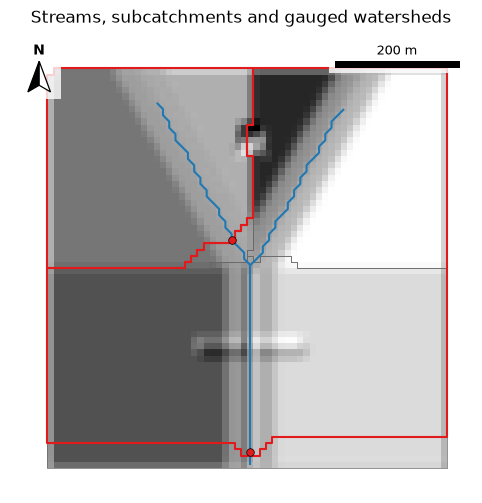

Hydrological analysis from a DEM
================================

This guide walks through a catchment analysis with
:mod:`rsgispy.elevation.hydrology`, starting from a raw digital elevation
model (DEM) and ending with a stream network, gauged catchments with summary
statistics, flood extents for several water levels, terrain wetness and
erosion indices, and a map.

Why each stage is needed:

* A raw DEM is not hydrologically correct. Pits (noise, holes in the data),
  bridges and road embankments across valleys stop water flowing downhill in
  the model, so every flow path that reaches one of them ends there. The DEM
  must be **conditioned** first.
* **Flow direction** and **flow accumulation** say where water goes from
  each pixel and how much area drains through it. Everything else (streams,
  catchments, HAND, wetness indices) is derived from them.
* **Streams** and **catchments** are the units most hydrological questions
  are asked about: how big is the catchment above a gauge, what is its land
  cover, how steep is it?
* **HAND** (height above nearest drainage) gives a quick, physically based
  first estimate of flood extent, and **terrain indices** (TWI, SPI, LS)
  describe where the landscape is wet or prone to erosion.

.. important::

   All functions in :mod:`rsgispy.elevation.hydrology` require rasters in a
   **projected coordinate reference system with linear units in metres**
   (e.g. UTM). Geographic (latitude/longitude) rasters raise
   :class:`~rsgispy.RSGISPyException`. Step 1 shows how to reproject.

.. contents:: Contents
   :local:
   :depth: 1

Installation
------------

The hydrology functions use only the core dependencies, but most of their
kernels are compiled with ``numba``; without it those functions raise an
exception unless ``allow_pure_python=True`` is passed (the pure-Python
fallback is very slow). ``scipy`` (the ``stats`` extra) is required by
:func:`~rsgispy.elevation.hydrology.identify_sinks` (Step 2) and by stream
burning with a smooth buffer (``buffer_dist``). The maps use
``matplotlib``, which is a core dependency.

.. code-block:: bash

   pip install "rsgispy[numba,stats]"

Overview
--------

.. code-block:: text

   Raw DEM (any CRS) ──► 1. reproject_image ──► DEM in metres (UTM)
                                                   │
                         2. identify_sinks ◄───────┤  what will change?
                                                   ▼
                         3. condition_dem (burn rivers, breach, fill)
                            + check with band_maths / resolve_flats
                                                   │
                                                   ▼  dem_cond.tif
                         4. flow_direction (D8, D-Inf, MFD)
                            flow_accumulation, flow_length
                                                   │
               ┌───────────────────────────────────┼───────────────────┐
               ▼                                   ▼                   ▼
   5. extract_streams                   6. snap_pour_points    9. specific catchment
      stream_link / stream_order           delineate_watersheds    area (band_maths)
      vectorise_streams                    delineate_basins        + slope ──► calc_twi
      flow_distance                        delineate_subcatchments  calc_spi
               │                           polygonise_watersheds    calc_ls_factor
               │                           trace_flow_path
               │                                   │
               ▼                                   ▼
   8. calc_hand ──► flood_inundation_from_hand   7. calc_label_zonal_stats
                    (several stages)                (slope, land cover per catchment)
                                                   │
                                                   ▼
                                  10. hillshade + streams + catchments map

The code in this guide comes from the example script
``docs/examples/hydrology_workflow.py`` (included below step by step), which
the rsgispy test suite runs end to end on a small synthetic DEM
(``tests/hydro_scene.py``: two tributary valleys joining a main valley, a
road embankment that dams the main valley, and a closed pit). The scenario
is a DEM delivered in geographic coordinates, such as the Copernicus GLO-30
or SRTM DEMs, a vector file of river gauges (with an integer ``gauge_id``
column), optionally a vector file of mapped rivers and a land cover raster.
Run it on your own data with:

.. code-block:: bash

   python docs/examples/hydrology_workflow.py --dem copernicus_glo30.tif \
       --out-epsg 32630 --out-res 30 --gauges gauges.gpkg \
       --rivers mapped_rivers.gpkg --landcover landcover.tif \
       --stream-threshold 500000 --out-dir hydro_out

Step 1 — Preparing the DEM
--------------------------

The hydrology functions measure slopes, distances and areas in metres, so
the DEM must be in a projected CRS with metre units. Choose a CRS that suits
the area: the UTM zone covering the catchment (e.g. EPSG:32630 for UTM 30N)
or a national grid (e.g. EPSG:27700, British National Grid). Reproject with
:func:`rsgispy.imageutils.warp.reproject_image`:

* use **bilinear** (or cubic) interpolation. Nearest neighbour copies pixels
  and creates steps and artificial flats that disturb flow routing;
* keep the pixel size close to the source resolution (e.g. 30 m for GLO-30).
  A finer pixel size does not add detail; it only makes everything slower.
  Give the size in metres (``out_pxl_res``); the default ``'image'`` copies
  the input pixel size in the input's units, which for a geographic DEM is
  in degrees (about 0.0003), so the example uses ``'auto'`` (keep roughly the
  input number of pixels) when no size is given.

:func:`~rsgispy.imageutils.warp.reproject_image` snaps the output grid to
multiples of the pixel size and adds a margin of five no data pixels around
the data, so expect the reprojected image to be slightly larger than the
input.

Then check the DEM before going further: is the CRS projected and in metres,
is the no data value set (otherwise voids and the sea are treated as real
elevations), and is the elevation range plausible?

.. literalinclude:: ../examples/hydrology_workflow.py
   :language: python
   :start-after: # [step-1-prepare]
   :end-before: # [end-step-1-prepare]
   :dedent: 4

For the synthetic DEM this prints:

.. code-block:: text

   CRS: EPSG:32630, size: 74 x 74, nodata: -9999.0
   Pixel size: 10.0 x 10.0 m; elevation 120.1 to 215.2 m (mean 159.6 m)

Optional preparation:

* **Noise and artefacts** — radar DEMs (SRTM, TanDEM-X, GLO-30) contain
  speckle-like noise and stripes, and vegetation or buildings raise the
  surface (they are surface models). Mild smoothing before conditioning
  reduces the number of spurious pits.
  :func:`rsgispy.elevation.filtering.dtm_aspect_median_filter` is a median
  filter that only uses neighbours facing the same way (aspect within
  ``aspect_range`` degrees), so it removes noise without flattening ridges
  and valleys.
* **Trend surfaces** —
  :func:`rsgispy.elevation.filtering.plane_fit_detrend_dem` (local
  least-squares planes) and
  :func:`rsgispy.elevation.filtering.resampling_detrend_dem` (down-sample
  then up-sample) produce a smoothed trend surface. Subtracting it from the
  DEM with :func:`~rsgispy.imagecalc.maths.band_maths` gives local relief,
  which is useful to map small channels and levees on flat floodplains. Do
  not route flow over a detrended DEM: the regional slope that drives the
  flow has been removed.
* **Fusing DEMs** — :func:`rsgispy.elevation.fusion.fft_dem_fusion` combines
  two DEMs on the same grid in the frequency domain: the low frequencies
  (the broad shape; a central square of half-width ``c_size`` of the
  shifted spectrum) come from the first DEM and the higher frequencies (the
  detail) from the second. Pixels that are no data in either DEM are no
  data in the output, so it does not fill voids. Resample both DEMs to the
  same grid first with
  :func:`rsgispy.imageutils.warp.resample_img_to_match`.

Step 2 — Finding the sinks
--------------------------

Before changing the DEM, look at what conditioning will change.
:func:`rsgispy.elevation.hydrology.identify_sinks` labels every closed
depression (sink) with an ID (``1..K``; ``0`` elsewhere and ``-1`` on no
data) and, with ``output_depth_img``, writes how deep each pixel lies below
its spill level (``filled - original``, metres).

.. literalinclude:: ../examples/hydrology_workflow.py
   :language: python
   :start-after: # [step-2-sinks]
   :end-before: # [end-step-2-sinks]
   :dedent: 4

.. code-block:: text

   3 sinks covering 53 pixels; deepest 2.40 m

How to read the result: thousands of tiny, shallow sinks are normal in a
30 m DEM and are noise. A few large, deep sinks need a closer look: they may
be real (lakes, quarries, karst depressions that really do not drain) or
artefacts such as an embankment or a bridge deck blocking a river. Overlay
the sink raster on imagery to decide. Long, narrow sinks upstream of a road
are the typical case for breaching rather than filling (Step 3).

Step 3 — Conditioning the DEM
-----------------------------

There are two ways to remove a sink:

* **Filling** (:func:`rsgispy.elevation.hydrology.fill_depressions`, the
  Barnes et al. (2014) Priority-Flood) raises every pixel in the sink to the
  level of its lowest outlet. The DEM is only ever raised, and the result is
  a flat "lake" surface. Large fills turn valleys upstream of an embankment
  into flats where the flow path is arbitrary.
* **Breaching** (:func:`rsgispy.elevation.hydrology.breach_depressions`, the
  Lindsay (2016) least-cost method) cuts a channel through the barrier from
  the bottom of the sink to lower ground. Few pixels change, and the change
  is usually where the real river crosses the embankment, but unconstrained
  breaching can cut deep, long trenches through real barriers.

:func:`rsgispy.elevation.hydrology.condition_dem` with
``method='breach_and_fill'`` (the default) combines them: it breaches only
where the cut is at most ``max_breach_depth`` metres deep and at most
``max_breach_length`` pixels long, then fills whatever is left. Choose the
limits from the barriers you expect: road and rail embankments are typically
2–10 m high and a few pixels wide, so ``max_breach_depth=5`` and
``max_breach_length`` of about 10–20 pixels at 30 m (more at finer
resolution) are reasonable starting points. ``method='fill'`` and
``method='breach'`` run one method only.

If mapped rivers are available (national hydrography, OpenStreetMap
waterways), pass them as ``streams_vec`` to **burn** them into the DEM before
breaching (the AGREE method of Hellweger, 1997, also available on its own as
:func:`rsgispy.elevation.hydrology.burn_streams`). The pixels under the river
lines are lowered by ``burn_depth`` metres (and, with ``buffer_dist``, the
surrounding pixels are lowered smoothly towards the river). Burning forces
the modelled streams onto the mapped ones, which helps on flat floodplains
and where the DEM is poor, but it only makes sense if the mapped rivers are
accurate and in the same place as the DEM's valleys; otherwise it creates
parallel trenches. Use a ``burn_depth`` a little larger than the DEM's
vertical error (here 2 m).

The example creates a filled and a breached DEM for comparison, and the DEM
used from here on with :func:`~rsgispy.elevation.hydrology.condition_dem`:

.. literalinclude:: ../examples/hydrology_workflow.py
   :language: python
   :start-after: # [step-3-condition]
   :end-before: # [end-step-3-condition]
   :dedent: 4

**Checking the conditioning.** Compare the conditioned and raw DEMs with
:func:`~rsgispy.imagecalc.maths.band_maths` (difference image: positive
where pixels were raised, negative where they were lowered) and count the
changed pixels with :func:`~rsgispy.imagecalc.maths.calc_prop_true_exp`.
:func:`rsgispy.elevation.hydrology.resolve_flats` shows where the flat
surfaces created by filling are: it writes the Barnes et al. (2014) flat
gradient (``0`` on sloping pixels, positive integers on flats, decreasing
towards the flat's outlet). You do not need to apply it yourself:
:func:`~rsgispy.elevation.hydrology.flow_direction` routes across flats in
the same way (``flat_routing=True``).

.. literalinclude:: ../examples/hydrology_workflow.py
   :language: python
   :start-after: # [step-3b-check-condition]
   :end-before: # [end-step-3b-check-condition]
   :dedent: 4

.. code-block:: text

   fill: 0.95% of pixels changed, from 0.00 to 2.40 m
   breach: 0.13% of pixels changed, from -3.00 to 0.00 m
   condition_dem: 0.66% of pixels changed, from -5.00 to 0.00 m
   Filled DEM: 53 flat pixels

(The percentages are of all the pixels in the image.) Breaching changed far
fewer pixels than filling, and the combined method lowered pixels only (by up
to 5 m, the 3 m breach through the embankment plus the 2 m burn). On real
data, look at the difference image: large raised areas mean big fills (check
whether they are real lakes), and long negative lines away from the mapped
rivers mean breach limits that are too generous.

Step 4 — Flow routing
---------------------

:func:`rsgispy.elevation.hydrology.flow_direction` supports three routing
methods:

* ``'d8'`` — all the water of a pixel goes to the steepest of its eight
  neighbours. Output: ``uint8`` codes ``1`` (east), ``2`` (south-east),
  ``4`` (south), ``8``, ``16``, ``32``, ``64`` (north), ``128``
  (north-east), and ``0`` where water leaves the DEM or cannot flow. D8
  gives one, well-defined path from every pixel, so it is needed for
  streams, catchments, flow lengths and HAND (Steps 5–8), and all those
  functions require it.
* ``'dinf'`` — D-Infinity (Tarboton, 1997): the flow direction is a
  continuous angle (radians anticlockwise from east; ``-1`` on flats) and
  the water is split between the two neighbours either side of it.
* ``'mfd'`` — multiple flow direction (Quinn et al., 1991): the water is
  split between all downslope neighbours in proportion to
  ``slope ** mfd_exponent``; the output has 8 bands of fractions. Larger
  exponents (e.g. 5–10) concentrate the flow towards the steepest neighbour,
  smaller ones (the default 1.1) spread it more.

D8 concentrates flow onto single lines; on open hillslopes this makes
unrealistic parallel lines. D-Infinity and MFD spread the flow and give
smoother, more realistic contributing areas on hillslopes, so use them for
wetness and erosion indices (Step 9). Use D8 for anything that needs a
network or catchment boundaries.

:func:`rsgispy.elevation.hydrology.flow_accumulation` detects the routing
method from its input and counts the upslope pixels draining through each
pixel (``out_units='cells'``) or their area in m² (``out_units='area'``);
with ``weight_img`` it sums a per-pixel weight instead (e.g. rainfall or
runoff). :func:`rsgispy.elevation.hydrology.flow_length` gives, for each
pixel, the flow path length in metres downstream to the edge of the DEM or
sink (``direction='downstream'``) or the longest flow path upstream
(``direction='upstream'``; its value at a gauge is the catchment's longest
flow path, used in time-of-concentration formulas).

.. literalinclude:: ../examples/hydrology_workflow.py
   :language: python
   :start-after: # [step-4-flow-routing]
   :end-before: # [end-step-4-flow-routing]
   :dedent: 4

.. code-block:: text

   D8: largest contributing area 0.410 km2
   Dinf: largest contributing area 0.410 km2
   MFD: largest contributing area 0.410 km2

All three methods agree at the outlet, as they must: the whole DEM drains
through it. How to check routing worked: display the accumulation raster
with a logarithmic stretch; the valleys should appear as continuous bright
lines that end at the DEM edge or at real sinks. Lines that stop in the
middle of a valley show a sink that was not removed.

Step 5 — Extracting the stream network
--------------------------------------

:func:`rsgispy.elevation.hydrology.extract_streams` marks as channel every
pixel whose contributing area is at least ``threshold`` (``uint8``: ``1``
stream, ``0`` hillslope, ``255`` no data). Give the threshold as an area in
m² with ``threshold_units='area'`` so it does not depend on the pixel size.
The accumulation can be in cells or in m²:
:func:`~rsgispy.elevation.hydrology.flow_accumulation` records its units in
the output (the ``RSGISPY_FLOW_ACC_UNITS`` metadata tag and the band
description), and :func:`~rsgispy.elevation.hydrology.extract_streams`
converts the threshold with the pixel area when the units differ. An
accumulation raster without the tag (written by an older version of rsgispy
or by another program) is assumed to be in cells; give its units with
``acc_units='cells'`` or ``acc_units='area'``.

**Choosing the threshold.** The threshold sets where channels begin, and
hence the drainage density. There is no single right value: small
thresholds (e.g. 1–5 ha) give dense networks including ephemeral gullies;
larger ones (0.5–1 km², ``500000``–``1000000`` m²) approximate the rivers
on 1:50,000 maps. Compare the result with mapped rivers or imagery and
adjust: if the modelled network has many more first-order streams than the
map, increase the threshold. The threshold also controls the number and
size of subcatchments (Step 6) and the HAND values (Step 8).

The other stream functions use the binary stream raster and the D8
directions:

* :func:`rsgispy.elevation.hydrology.stream_link` gives each reach (the
  stretch from a source or a confluence to the next confluence or outlet)
  a unique ID (``int32``, ``1..K``);
* :func:`rsgispy.elevation.hydrology.stream_order` gives the Strahler order
  (``method='strahler'``: two streams of order *n* make order *n* + 1) or
  the Shreve magnitude (``'shreve'``: orders add up at each confluence);
* :func:`rsgispy.elevation.hydrology.vectorise_streams` writes the reaches
  as lines with the columns ``link_id``, ``down_link_id`` (``-1`` at the
  outlet), ``order``, ``length_m`` and, with ``dem_img`` and
  ``flow_acc_img``, ``elev_start``, ``elev_end``, ``drop_m``, ``slope``
  (m/m) and ``max_acc`` (in the accumulation's units). Each line ends on
  the first vertex of the reach downstream of it, so the lines meet exactly
  and the network can be used for network analysis;
* :func:`rsgispy.elevation.hydrology.flow_distance` gives the distance along
  the flow path from each pixel to the stream it drains into (metres,
  ``distance_type='horizontal'``), or the drop in elevation to it
  (``'vertical'``, which needs ``dem_img``; compare HAND in Step 8).

.. literalinclude:: ../examples/hydrology_workflow.py
   :language: python
   :start-after: # [step-5-streams]
   :end-before: # [end-step-5-streams]
   :dedent: 4

.. code-block:: text

   3 reaches, 954 m of channel, maximum Strahler order 2

The stream table for the synthetic DEM (two first-order tributaries joining
the second-order main channel):

.. code-block:: text

      link_id  down_link_id  order  length_m  elev_start  elev_end  drop_m  slope  max_acc
   0        1             3      1    322.13      137.43    129.66    7.77   0.02   1041.0
   1        2             3      1    312.13      137.26    129.66    7.60   0.02    986.0
   2        3            -1      2    320.00      129.66    118.06   11.60   0.04   4095.0

Step 6 — Catchments
-------------------

There are three ways to divide the DEM into catchments, all from the D8
directions:

* :func:`rsgispy.elevation.hydrology.delineate_basins` labels every complete
  drainage basin: all the pixels that drain to the same outlet on the DEM
  edge or into the same sink. Use it for a whole region (e.g. all the
  coastal catchments on a DEM tile).
* :func:`rsgispy.elevation.hydrology.delineate_subcatchments` labels, for
  every reach of :func:`~rsgispy.elevation.hydrology.stream_link`, the area
  that drains directly into that reach (not through another reach). These are
  the units of semi-distributed hydrological models.
* :func:`rsgispy.elevation.hydrology.delineate_watersheds` delineates the
  catchment upstream of given points, such as river gauges or the outlet of
  a lake. When gauges are nested (one upstream of another), each pixel is
  given to the nearest gauge downstream, so the downstream catchment is the
  **incremental** area between the gauges. The total area above a gauge is
  the sum of its watershed and all watersheds upstream of it, or the
  ``snapped_acc`` value of the snapped gauge multiplied by the pixel area.
  With ``id_field`` the raster values are the gauges' IDs.

**Snapping the gauges first.** Gauge coordinates are rarely exactly on the
modelled stream: a gauge 20 m from the channel delineates the catchment of
a hillslope of a few pixels. :func:`rsgispy.elevation.hydrology.snap_pour_points`
moves each point to the pixel with the largest flow accumulation within
``snap_dist`` metres (only stream pixels if ``streams_img`` is given) and
records the distance moved (``snap_dist_m``) and the accumulation there
(``snapped_acc``). Choose ``snap_dist`` with care: about 1–3 pixels, or the
positional error of the gauge coordinates. Because the point moves to the
*largest* accumulation in the search radius, a large radius moves gauges
downstream along the river, and near a confluence it can move a gauge on a
tributary onto the main river. Always check ``snapped_acc`` against the
catchment area published for the gauge.

:func:`rsgispy.elevation.hydrology.polygonise_watersheds` converts any of
these rasters to polygons with ``watershed_id``, ``area_m2``,
``perimeter_m`` and, with ``dem_img``, ``elev_min``, ``elev_mean`` and
``elev_max`` columns (``simplify_tol`` simplifies the stair-step pixel
edges). :func:`rsgispy.elevation.hydrology.trace_flow_path` traces lines
from points: downstream to the outlet (``direction='downstream'``, e.g. the
path of a pollutant from a spill site), or upstream along the largest
accumulation (``direction='upstream'``, which needs ``flow_acc_img``), which
gives the main stem of the river above each gauge with its
``path_length_m``.

.. literalinclude:: ../examples/hydrology_workflow.py
   :language: python
   :start-after: # [step-6-catchments]
   :end-before: # [end-step-6-catchments]
   :dedent: 4

.. code-block:: text

      watershed_id   area_m2  perimeter_m    elev_min   elev_mean    elev_max
   0             1  281600.0       2540.0  118.537605  160.158118  215.177948
   1             2  100300.0       1320.0  130.938766  157.951259  214.477188

Gauge 2 is on a tributary upstream of gauge 1, so watershed 1 is the
incremental area (2816 pixels): its snapped accumulation is 3819 pixels,
which is 2816 plus the 1003 pixels of watershed 2.

Step 7 — Summarising the catchments
-----------------------------------

The watershed raster is a label image, so
:func:`rsgispy.zonalstats.labels.calc_label_zonal_stats` summarises any
raster on the same grid for every catchment in one pass (much faster than
polygon zonal statistics when there are many catchments). Each input is a
:class:`~rsgispy.ml.stack.BandSpec`:

* continuous rasters (slope, distance to stream, rainfall, soil depth) get
  the requested ``stats``, in columns named ``<band name>_<stat>``;
* categorical rasters (``data_type=rsgispy.VAR_TYPE_CATEGORICAL``) such as
  land cover get the most common class (``<name>_mode``) and the proportion
  of each class (``<name>_prop_<value>``), which the example renames to
  class names.

All the rasters must be on the DEM grid: resample them first with
:func:`rsgispy.imageutils.warp.resample_img_to_match`, with nearest
neighbour for categorical data (land cover) and bilinear or average for
continuous data (e.g. a rainfall grid, for which ``stats=['mean']`` gives
the catchment-average rainfall). The label raster's background (``0``) is
left out (``label_no_data_val=0``, the default), but its no data value
(``-1``) is reported as a zone; drop it before joining the table to the
polygons.

.. literalinclude:: ../examples/hydrology_workflow.py
   :language: python
   :start-after: # [step-7-catchment-stats]
   :end-before: # [end-step-7-catchment-stats]
   :dedent: 4

.. code-block:: text

      watershed_id  pxl_count  slope_mean  slope_max  dist_stream_mean  dist_stream_max  lc_mode  prop_forest  prop_grassland  prop_urban
   1             1       2816      14.478     30.444           143.663          336.569      1.0        0.775           0.189       0.036
   2             2       1003      14.564     26.127           110.296          294.558      1.0        0.784           0.216       0.000

Slopes are in degrees and distances in metres; the land cover proportions
of each catchment add up to 1. The same approach works for the
subcatchment or basin rasters of Step 6.

Step 8 — HAND and flood mapping
-------------------------------

**Height above nearest drainage** (HAND; Nobre et al., 2011) is, for every
pixel, its elevation above the stream pixel it drains to along the D8 flow
path. :func:`rsgispy.elevation.hydrology.calc_hand` writes it in metres
(``0`` on the streams). Low HAND values mark valley floors that flood when
the river rises; high values mark hillslopes and terraces that do not.

:func:`rsgispy.elevation.hydrology.flood_inundation_from_hand` turns HAND
into a flood depth map for a water level (stage) ``h`` above the channel
bed: ``depth = max(0, h - HAND)``. The stage can be one value for the whole
DEM or, for long rivers, a raster of stages on the DEM grid (e.g. from
rating curves at several gauges interpolated along the network). Running it
for several stages and measuring the flooded area gives a stage–area curve
for the valley.

This is a static, "bathtub along the river" model: it does not account for
the volume of water, embankments that protect the floodplain or backwater
at confluences, and it depends on the stream threshold (a lower threshold
adds small streams, and floods along them). Use it for screening and first
estimates, not as a replacement for a hydraulic model.

.. literalinclude:: ../examples/hydrology_workflow.py
   :language: python
   :start-after: # [step-8-hand-flood]
   :end-before: # [end-step-8-hand-flood]
   :dedent: 4

.. code-block:: text

   Stage 0.5 m: 1.44 ha inundated
   Stage 1 m: 2.46 ha inundated
   Stage 2 m: 4.01 ha inundated
   Stage 5 m: 8.53 ha inundated

The flooded area is the proportion of pixels with a depth greater than zero
(:func:`~rsgispy.imagecalc.maths.calc_prop_true_exp`) multiplied by the
number of pixels and the pixel area. To report it per catchment instead,
pass a 0/1 flood mask (made with
:func:`~rsgispy.imagecalc.maths.band_maths`) to
:func:`~rsgispy.zonalstats.labels.calc_label_zonal_stats` with
``stats=['sum']``. Check the result against a mapped flood extent (e.g. a
Sentinel-1 flood map) if one is available.

Step 9 — Terrain indices
------------------------

Three indices combine the upslope area with the local slope :math:`\beta`:

* the **Topographic Wetness Index**,
  :math:`\mathrm{TWI} = \ln(a / \tan\beta)`
  (:func:`rsgispy.elevation.hydrology.calc_twi`): where water accumulates
  and soils stay wet. Typical values are 2–8 on hillslopes and above 10 on
  valley floors. ``min_slope`` is the smallest :math:`\tan\beta` used, so
  flat pixels do not divide by zero;
* the **Stream Power Index**, :math:`\mathrm{SPI} = a\tan\beta`
  (:func:`rsgispy.elevation.hydrology.calc_spi`): the erosive power of
  flowing water (gullies, channel heads). It is very skewed, so map it with
  a logarithmic stretch;
* the RUSLE **slope length and steepness factor**
  :math:`LS = (m+1)\,(a/22.13)^m\,(\sin\beta/0.0896)^n`
  (:func:`rsgispy.elevation.hydrology.calc_ls_factor`), used with the other
  RUSLE factors to estimate soil loss. The exponents ``m=0.4`` and ``n=1.3``
  (the defaults) are those of Moore and Burch (1986); the :math:`(m+1)`
  term is the unit-stream-power form of Mitasova et al. (1996), so the
  values are 1.4 times those of Moore and Burch's original equation.

All three use the **specific catchment area** :math:`a`, the upslope area
per unit width of contour (m²/m), not the contributing area. It is the
contributing area in m² (``out_units='area'``) divided by the width the flow
crosses, usually taken as the pixel size; the example computes it with
:func:`~rsgispy.imagecalc.maths.band_maths`, passing ``no_data_val`` so the
index functions skip the no data pixels. Passing the flow
accumulation itself raises an exception.
:func:`~rsgispy.elevation.hydrology.calc_twi` also raises :math:`a` to at
least the pixel size, so the values on ridges are not extreme. Use
D-Infinity or MFD accumulation (Step 4) for these indices: with D8,
:math:`a` jumps from
pixel to pixel on hillslopes and the indices are noisy. The slope comes
from :func:`rsgispy.elevation.terrain.slope` on the conditioned DEM; give
its units with ``slope_units``.

.. literalinclude:: ../examples/hydrology_workflow.py
   :language: python
   :start-after: # [step-9-terrain-indices]
   :end-before: # [end-step-9-terrain-indices]
   :dedent: 4

.. code-block:: text

   TWI: 3.18 to 15.34 (mean 6.06)
   SPI: 0.23 to 2898.81 (mean 40.75)
   LS: 0.17 to 29.62 (mean 9.93)

Step 10 — Mapping the results
-----------------------------

A hillshade (:func:`rsgispy.elevation.illumination.hillshade`; the sun at
``azimuth`` 315°, from the north-west, and ``zenith`` 45°) is the usual
background for hydrological maps. Draw it with
:func:`rsgispy.mapping.raster.create_raster_img_map` and add the vector
layers on top with :func:`rsgispy.mapping.vector.create_vec_lyr_map`. The
vector layers are drawn in order with the ``plot_zorders`` given. Lines are
drawn in the line colour, and a fill colour of ``'none'`` draws polygons as
outlines only.

.. literalinclude:: ../examples/hydrology_workflow.py
   :language: python
   :start-after: # [step-10-map]
   :end-before: # [end-step-10-map]
   :dedent: 4

         river, reach subcatchments, two gauged watersheds and the snapped
         gauges.
   :width: 70%

   The synthetic catchment: streams (blue), reach subcatchments (grey),
   gauged watersheds (red) and snapped gauges (red points). The
   embankment across the main valley and the pit between the tributaries
   are visible in the hillshade. The figure is written by Step 10 when the
   example is run on the test scene (``tests/hydro_scene.py``); copy
   ``hydrology_map.png`` from the output directory to
   ``docs/guides/images/`` to regenerate it.

For a thematic map of a raster output (e.g. the Strahler orders or the
watershed IDs), :func:`rsgispy.mapping.raster.create_thematic_raster_map`
uses the image's colour table, and
:func:`rsgispy.mapping.raster.create_raster_cmap_img_map` draws continuous
outputs such as HAND, flood depth or TWI with a colour map.

Performance and large datasets
------------------------------

* **numba** — install the ``numba`` extra. The first call of each function
  in a Python session compiles its kernel (a few seconds); later calls are
  fast. Most kernels run in parallel on all cores.
* **Memory** — the hydrology functions read the **whole raster into
  memory** (flow routing is not local, so it cannot be done in blocks) and
  work in 64-bit floats, with several arrays per step, so allow tens of
  bytes per pixel: a 10,000 x 10,000 pixel DEM (100 million pixels) needs
  several GB, and the 8-band MFD directions alone take 32 bytes per pixel. For very large
  areas, process each river basin separately: delineate the basins on a
  coarser DEM, then clip the fine DEM to each basin (plus a margin) and run
  the workflow per basin. Do not cut a basin into tiles: the flow and
  accumulation would be wrong at the tile edges.
* **Resolution** — the run time grows with the number of pixels, so do not
  use a finer pixel size than the DEM's real resolution; halving the pixel
  size quadruples the run time.
* **Outputs** — set ``calc_stats=False`` to skip the statistics and
  overviews written for every output raster when they are not needed (e.g.
  intermediate files), and use ``gdalformat`` / ``datatype`` to change the
  output format and type. The vector outputs support any vector format (e.g.
  ``.gpkg``, ``.parquet``).
* **Avoid unneeded routings** — D-Infinity and MFD are only needed for the
  terrain indices; skip them if you only need streams and catchments.

Common problems
---------------

* **"non-projected/geographic CRS" exception** — the DEM is in geographic coordinates (or
  in feet). Reproject it (Step 1). All the inputs (DEM, gauges, mapped
  rivers, land cover) should end up in the same CRS; the vector inputs are
  reprojected on the fly when their CRS is set.
* **"Raster dimensions ... do not match" or "CRS mismatch"** — the zonal statistics,
  HAND, TWI and other functions that take two rasters need them on exactly
  the same grid. Resample other rasters to the conditioned DEM with
  :func:`~rsgispy.imageutils.warp.resample_img_to_match`.
* **No data** — a DEM without a no data value treats voids (often
  ``-32768``) and the sea (often ``0``) as real elevations: the sea becomes
  a huge flat that everything drains into. Set the value with
  :func:`rsgispy.imageutils.metadata.set_img_no_data_value` before
  conditioning. Outputs of :func:`~rsgispy.imagecalc.maths.band_maths` have
  no no data value unless you pass ``no_data_val``, as the example does.
* **Streams everywhere, or none** — adjust ``threshold`` and check
  ``threshold_units`` (Step 5). An accumulation raster in m² that was not
  made by :func:`~rsgispy.elevation.hydrology.flow_accumulation` has no
  units tag and is assumed to be in cells, which makes almost every pixel a
  stream: pass ``acc_units='area'``.
* **Streams that stop or run in straight parallel lines** — a sink was not
  removed (stops) or a large filled flat (straight lines): check the sink
  and difference images (Steps 2 and 3), and consider breaching with larger
  limits or burning mapped rivers.
* **Tiny or wrong gauged catchments** — the gauge was not snapped to the
  stream, or it was snapped to the wrong river. Check ``snap_dist_m`` and
  ``snapped_acc`` in the snapped gauge file (Step 6).
* **Catchments cut at the DEM edge** — the DEM does not cover the whole
  catchment. Use a DEM that extends beyond the catchment divide.
* **Slow first run, or "numba is not available"** — the first call compiles
  the kernels; install ``numba`` (``pip install "rsgispy[numba]"``) instead
  of using ``allow_pure_python=True``.

References
----------

* Barnes, R., Lehman, C., Mulla, D. (2014). Priority-flood: An optimal
  depression-filling and watershed-labeling algorithm for digital elevation
  models. *Computers & Geosciences*, 62, 117–127.
* Barnes, R., Lehman, C., Mulla, D. (2014). An efficient assignment of
  drainage direction over flat surfaces in raster digital elevation models.
  *Computers & Geosciences*, 62, 128–135.
* Hellweger, F. (1997). AGREE — DEM surface reconditioning system.
  University of Texas.
* Lindsay, J. B. (2016). Efficient hybrid breaching-filling sink removal
  methods for flow path enforcement in digital elevation models.
  *Hydrological Processes*, 30(6), 846–857.
* Mitasova, H., Hofierka, J., Zlocha, M., Iverson, L. R. (1996). Modelling
  topographic potential for erosion and deposition using GIS.
  *International Journal of Geographical Information Systems*, 10(5),
  629–641.
* Moore, I. D., Burch, G. J. (1986). Physical basis of the length-slope
  factor in the Universal Soil Loss Equation. *Soil Science Society of
  America Journal*, 50(5), 1294–1298.
* Nobre, A. D., et al. (2011). Height Above the Nearest Drainage — a
  hydrologically relevant new terrain model. *Journal of Hydrology*,
  404(1–2), 13–29.
* Quinn, P., Beven, K., Chevallier, P., Planchon, O. (1991). The prediction
  of hillslope flow paths for distributed hydrological modelling using
  digital terrain models. *Hydrological Processes*, 5(1), 59–79.
* Tarboton, D. G. (1997). A new method for the determination of flow
  directions and upslope areas in grid digital elevation models. *Water
  Resources Research*, 33(2), 309–319.

Related guides
--------------

* :doc:`zonal_stats_and_vectors`
* :doc:`multi_criteria_analysis`
* :doc:`making_maps`
* :doc:`large_rasters`
