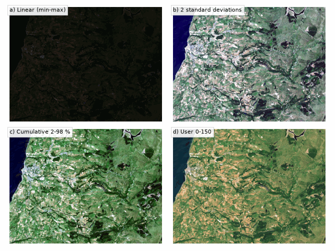
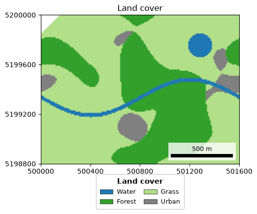
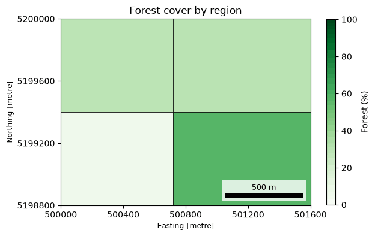

Making maps
===========

Most analyses end with a map: a true colour image of the study area, a land
cover classification, a continuous score, or statistics summarised by region.
:doc:`rsgispy.mapping <../rsgispy_mapping>` draws rasters and vectors onto ordinary Matplotlib
axes, and adds the cartographic elements a figure for a report or paper needs
(scale bars, north arrows, legends, inset overview maps and basemaps).

This guide shows how to make each type of map, how to choose stretches,
colour maps and legends, and how to export a figure at publication quality.
It uses the outputs of the other guides: the land cover map from
:doc:`pixel_classification_workflow`, a continuous score such as the
restoration potential from :doc:`multi_criteria_analysis`, and vector layers
such as the streams and catchments from :doc:`hydrology_workflow`.

Why use ``rsgispy.mapping`` rather than plain Matplotlib?

* Rasters are read at the right place in map coordinates (only the part
  inside the bounding box you ask for), stretched for display, and drawn with
  the correct extent, so raster and vector layers line up.
* Scale bars are computed from the coordinate reference system (CRS), so they
  are correct in metres even for maps in degrees.
* Thematic rasters are drawn with the colour table stored in the file, and the
  legend can be built from the same colour table and your class names.
* Every function draws onto an axis you created, so you keep full control of
  the figure layout and can mix rsgispy layers with any other Matplotlib
  plotting.

.. contents:: Contents
   :local:
   :depth: 1

Installation
------------

The mapping functions need ``matplotlib`` (and ``geopandas`` for vector
layers). Basemaps from web tile services need ``contextily``, and point
density maps need ``mpl-scatter-density``; both are in the ``mapping`` extra:

.. code-block:: bash

   pip install "rsgispy[mapping]"

The basemap and WMTS steps need an internet connection. All other steps work
offline.

Overview
--------

.. code-block:: text

   1. Layout: extent, figure size, ticks
            │
            ├─► 2. RGB image (s2_sref.tif) ──────────► stretch comparison, RGB map
            ├─► 3. continuous raster (score.tif) ────► map + colour bar
            ├─► 4. thematic raster (land_cover.tif) ─► map + categorical legend
            ├─► 5. vectors (regions, rivers) ────────► overlay map, choropleth
            │
            ▼
   6. Composed map: scale bar, north arrow, zoom box
            │
            ▼
   7. Inset overview map (overview.gpkg)
            │
            ▼
   8. Export: PNG at 300 dpi, PDF; zoomed panel
            │
            ▼
   9. Basemaps: contextily tiles, WMTS  [optional, needs the internet]

The code in this guide comes from the example script
``docs/examples/making_maps.py`` (included below step by step), which the
rsgispy test suite runs on synthetic data. The inputs are:

* ``s2_sref.tif`` — a Sentinel-2 surface reflectance stack (reflectance x
  10000, no data 0), for example from
  :func:`~rsgispy.imagecalibration.sensorlvl2data.create_stacked_sen2_esa_l2a_img`;
* ``land_cover.tif`` — a classification with a colour table, as written by
  :func:`~rsgispy.classification.classsklearn.apply_sklearn_classifier`;
* ``score.tif`` — any continuous single-band raster, for example a 0–1 score;
* ``regions.gpkg`` and ``rivers.gpkg`` — polygon and line layers in the same
  CRS as the rasters;
* ``overview.gpkg`` — a small-scale layer (e.g. country outlines, in any CRS)
  for the inset map.

The figures on this page were made from the synthetic scene in
``tests/maps_scene.py`` (see `Regenerating the figures`_).

A short note on Matplotlib: a *figure* is the whole image and holds one or
more *axes* (map panels). Every rsgispy mapping function takes the axis to
draw on as its first argument, and you save the figure with
``fig.savefig()``.

Step 1 — Layout: extent, figure size and ticks
----------------------------------------------

Maps are drawn in the CRS of the data, so the extent is a bounding box
``(MinX, MaxX, MinY, MaxY)`` in map units (metres for a projected CRS).
:func:`~rsgispy.imageutils.metadata.get_img_bbox` returns the extent of an
image as a ``rsgispy.BBox``, a tuple that also records the EPSG code
(``bbox.epsg``).

To avoid white space around the map, the figure should have the same aspect
ratio as the area mapped. Fix the figure width (the width of the page or
column it will be printed in: about 6.7 inches for the full text width of an
A4 journal page, 3.3 inches for one column) and let
:func:`~rsgispy.mapping.layout.calc_y_fig_size` work out the height.

The tick spacing (in map units) sets where the coordinate labels go;
:func:`~rsgispy.mapping.layout.define_map_tick_spacing` applies it after a
layer has been drawn. Here it defaults to about a quarter of the map width,
rounded to one significant figure. For maps of a sub-area (a zoom panel), use
a smaller bounding box; every drawing function takes a ``bbox`` argument and
:func:`~rsgispy.mapping.layout.define_axis_extent` sets an axis to a given
box with an equal aspect ratio.

.. literalinclude:: ../examples/making_maps.py
   :language: python
   :start-after: # [step-1-layout]
   :end-before: # [end-step-1-layout]
   :dedent: 4

The printed line is a quick check that the extent is in metres (a width of a
few degrees means the data are in a geographic CRS; see `Common problems`_):

.. code-block:: text

   Map extent 1600 m wide; figure 6.7 x 5.03 in; ticks every 400 m

Step 2 — RGB images and stretches
---------------------------------

:func:`~rsgispy.mapping.raster.create_raster_img_map` draws one band (in
grey) or three bands (as red, green and blue). Reflectance values must be
*stretched* to the 0–1 display range, and the choice of stretch changes the
look of the image a lot:

``rsgispy.IMG_STRETCH_LINEAR``
   The band minimum and maximum map to black and white
   (:func:`~rsgispy.tools.plotting.linear_stretch_np_arr`). A few very bright
   pixels (cloud, roofs) make the rest of the image dark.
``rsgispy.IMG_STRETCH_STDEV``
   Mean ± ``stch_n_stdevs`` standard deviations
   (:func:`~rsgispy.tools.plotting.stdev_stretch_np_arr`); 2 is a good start,
   use more for less contrast.
``rsgispy.IMG_STRETCH_CUMULATIVE``
   The 2nd and 98th percentiles
   (:func:`~rsgispy.tools.plotting.cumulative_stretch_np_arr`). Robust to
   outliers and usually the best default for a single image.
``rsgispy.IMG_STRETCH_USER``
   Fixed ``min``/``max`` values for each band
   (:func:`~rsgispy.tools.plotting.manual_stretch_np_arr`). Use this to compare
   images: the same reflectance has the same colour in every map, which is not
   true of the statistical stretches. For Sentinel-2 surface reflectance x
   10000, 0–1500 (visible bands) or 0–3000 (with NIR/SWIR) are typical.
``rsgispy.IMG_STRETCH_NONE``
   No stretch; for data already scaled to 0–1 (or 0–255 integers).

The statistics are computed from the pixels inside the bounding box only, so
a zoomed-in map is stretched for its own area. No data pixels (the image's no
data value, or ``no_data_val``) are excluded from the statistics and drawn in
``no_data_out_clr`` (white here); otherwise they are transparent.

For band combinations, use the band numbers of your stack: ``(3, 2, 1)`` is
true colour for a Blue, Green, Red, NIR stack; NIR, Red, Green (``(4, 3, 2)``)
is the standard false colour composite in which vegetation is red. Panel labels
are added with :func:`~rsgispy.mapping.elements.add_axis_label`.

.. literalinclude:: ../examples/making_maps.py
   :language: python
   :start-after: # [step-2-rgb]
   :end-before: # [end-step-2-rgb]
   :dedent: 4

   The same image with four stretches. The linear stretch is dominated by
   the brightest pixels; the fixed user stretch keeps colours comparable
   between images.

Step 3 — Continuous single-band maps
------------------------------------

:func:`~rsgispy.mapping.raster.create_raster_cmap_img_map` draws one band
with a Matplotlib colour map. Pixels equal to the band's no data value are
transparent. ``show_colour_bar=True`` (with ``cbar_label``) adds a colour bar
beside the map. The function returns the image artist
(``matplotlib.image.AxesImage``), so you can also draw the colour bar
yourself, e.g. one bar for several panels with ``fig.colorbar(img, ax=axs)``.
Every map function returns the artist it drew (see
:ref:`plotting_conventions`).

The map functions draw in the rsgispy house style (one box style for the
scale bar, north arrow and legends, and readable tick labels) without
changing your Matplotlib settings; see the :doc:`plot_gallery`.

Choosing a colour map:

* **Sequential** data (a fraction, a score, elevation): use a perceptually
  uniform map such as ``viridis``, ``cividis`` (also safe for red–green colour
  blindness) or a single-hue map such as ``YlGn`` or ``Blues``.
* **Diverging** data with a meaningful centre (a change, an anomaly, a
  residual): ``RdBu`` or ``BrBG``, with ``norm_vmin = -norm_vmax`` so the
  centre is zero.
* Avoid ``jet`` and ``rainbow``: they create false boundaries.

Set ``norm_img_vals=True`` with fixed ``norm_vmin``/``norm_vmax`` (here 0 and
1) so the colours have the same meaning in every map and the colour bar shows
the full range. Without ``norm_vmin``/``norm_vmax`` the range is the data
minimum and maximum. The normalisation (and so ``use_log_norm`` and the
returned ``norm``) is only used when ``norm_img_vals=True``; with the default
``False`` the function returns ``None`` for the normalisation, so set it to
``True`` whenever you add a colour bar. ``use_log_norm=True`` suits strongly
skewed data (e.g. flow accumulation), and ``vals_under_white=True`` draws
values below ``norm_vmin`` in white.

.. literalinclude:: ../examples/making_maps.py
   :language: python
   :start-after: # [step-3-continuous]
   :end-before: # [end-step-3-continuous]
   :dedent: 4

.. figure:: images/maps_score.png
   :width: 80%
   :alt: A continuous score drawn with the viridis colour map and a colour bar.

   A continuous 0–1 score with a fixed colour bar range. Water (no data) is
   transparent.

Step 4 — Thematic maps and categorical legends
----------------------------------------------

:func:`~rsgispy.mapping.raster.create_thematic_raster_map` draws a
classification with the **colour table stored in the image**; pixel value 0
is transparent (``alpha_backgd=True``). If an image has no colour table, add
one first, e.g. with :func:`rsgispy.imageutils.colourtable.define_colour_table`
(the classification functions in rsgispy write it for you from the class
colours in the configuration).

With ``show_legend=True`` a categorical legend is built from the colour table
and ``classes_info``, which gives the class names and can be:

* a ``{pixel value: name}`` dictionary (as here);
* a ``{pixel value: (name, colour)}`` dictionary, to override the colours;
* a :class:`~rsgispy.classification.classdata.ClassificationConfig` or the
  path of its JSON file, so the legend uses exactly the names and colours of
  the classification.

Where the legend goes:

* ``legend_position='right'`` (default), ``'bottom'``, ``'left'`` or
  ``'top'`` adds a separate legend axis next to the map, so the legend never
  hides part of the map. ``'bottom'`` suits wide maps and many classes.
* ``legend_overlay=True`` puts the legend inside the map at ``legend_loc``,
  for maps with an empty corner.
* ``legend_ax=`` writes the legend into an axis you created, for multi-panel
  figures that share one legend.

The number of rows and columns is chosen from the space available and the
label lengths (or set ``legend_ncols``/``legend_nrows``). Further options go
in ``legend_kwargs`` and are passed to
:func:`~rsgispy.mapping.legend.add_categorical_legend`; for example
``only_present_in_img=True`` leaves out classes that do not occur in the
mapped area (useful for zoomed maps), and ``show_pxl_vals=True`` adds the
pixel values to the labels. For a legend on its own, e.g. for slides or a
poster, use :func:`~rsgispy.mapping.legend.save_categorical_legend_img`.

.. literalinclude:: ../examples/making_maps.py
   :language: python
   :start-after: # [step-4-thematic]
   :end-before: # [end-step-4-thematic]
   :dedent: 4

   A thematic map with its legend in a companion axis below the map.

Step 5 — Vector layers and choropleth maps
------------------------------------------

:func:`~rsgispy.mapping.vector.create_vec_lyr_map` draws one or more
GeoDataFrames (all in the CRS of the map). Give one value per layer for the
fill colours, line colours, widths, transparency (``vec_fill_alphas``) and
``plot_zorders``. The z-order sets the drawing order: rasters are drawn at
z-order 1 by default, so vectors over an image need a higher value.
Polygons and points are filled with ``vec_fill_clrs`` and outlined with
``vec_line_clrs``; use a fill colour of ``'none'`` to draw polygon outlines
only. Lines are drawn in ``vec_line_clrs``, and a layer that mixes geometry
types is split by type, so each part gets the right colours.

A **choropleth** colours each polygon by an attribute.
:func:`~rsgispy.mapping.vector.create_choropleth_vec_lyr_map` takes the column
name, a colour map and an optional normalisation (use a fixed range, e.g. 0
to 100 % with ``matplotlib.colors.Normalize``, so the colour bar matches
the map). Here the attribute is the percentage of forest pixels in each
region, counted from the land cover map with
:func:`~rsgispy.zonalstats.polygon.calc_zonal_band_pxl_counts`; any column
works, e.g. mean values from
:func:`~rsgispy.zonalstats.polygon.calc_zonal_band_stats` or the area of each
restoration potential class from :doc:`multi_criteria_analysis`.

Choropleths should show **rates or proportions** (percentage forest, people
per km²), not totals, because large polygons would otherwise dominate the
map. Use a sequential colour map for one-sided values and a diverging one for
values around a reference.

.. literalinclude:: ../examples/making_maps.py
   :language: python
   :start-after: # [step-5-vectors]
   :end-before: # [end-step-5-vectors]
   :dedent: 4

The printed table is a check that the zonal statistics worked (percentages
between 0 and 100, and different between regions):

.. code-block:: text

            name  forest_pct
   0  North West   28.888889
   1  North East   29.431818
   2  South West    5.578704
   3  South East   57.329545

   Choropleth of the percentage of forest per region.

To show point density (e.g. thousands of observations), use
:func:`~rsgispy.mapping.vector.create_vec_pt_density_map`, which needs an axis
created with ``projection='scatter_density'`` (``mpl-scatter-density``
package).

Step 6 — Scale bars, north arrows and zoom boxes
------------------------------------------------

Every drawing function adds a scale bar by default (``show_scale_bar``,
``scale_bar_loc``, ``scale_bar_style``, ``scale_bar_units``) and can add a north
arrow (``show_north_arrow``). When several layers are drawn on one axis, turn
these off in the layer functions and add them once with the element functions,
which have more options:

* :func:`~rsgispy.mapping.elements.add_scale_bar` — the length is chosen as
  a "nice" number close to ``length_fraction`` (default a quarter) of the map
  width, or set with ``fixed_value``. Styles are
  ``SCALEBAR_STYLE_SOLID``, ``SCALEBAR_STYLE_ALTERNATING`` (black and white
  segments; ``n_segments``) and ``SCALEBAR_STYLE_TICKS``; units are metres or
  kilometres (chosen from the map width if ``units=None``). Pass the map's
  ``epsg_code``: for a geographic CRS (degrees) the bar is converted to
  metres at the centre latitude.
* :func:`~rsgispy.mapping.elements.add_north_arrow` — styles
  ``NORTH_ARROW_STYLE_TRIANGLE``, ``_ARROW``, ``_COMPASS`` and ``_SIMPLE``.
  In a projected CRS grid north and true north differ slightly away from the
  central meridian; ``rotation`` (degrees) can correct this for large areas.
* :func:`~rsgispy.mapping.elements.draw_bboxes_to_axis` — rectangles (with
  optional labels), for example to show where zoomed-in panels or field
  sites are.

The constants are defined in :mod:`rsgispy.mapping.elements`. Locations use
the Matplotlib legend names (``'upper left'``, ``'lower right'`` …).

.. literalinclude:: ../examples/making_maps.py
   :language: python
   :start-after: # [step-6-elements]
   :end-before: # [end-step-6-elements]
   :dedent: 4

Step 7 — Inset overview maps
----------------------------

An overview (locator) map shows where the study area is.
:func:`~rsgispy.mapping.layout.get_overview_info` takes the map's bounding box
and EPSG code and returns the extent of the overview (the centre of the
study area ± ``overview_buf``, in the units of the overview CRS, so degrees
for an EPSG:4326 layer of countries) and the centre point.
:func:`~rsgispy.mapping.layout.add_overview_maps` then adds an inset axis
(size and offsets in fractions of the main axis, placed with ``loc`` like a
legend) with the overview layer and a marker at the study area. It returns
the inset axis, so you can add more to it (e.g. a rectangle with
:func:`~rsgispy.mapping.elements.draw_bboxes_to_axis` instead of a point for
larger study areas). Choose ``overview_buf`` so the inset shows a recognisable
area: a country for a local study, a continent for a national one.

.. literalinclude:: ../examples/making_maps.py
   :language: python
   :start-after: # [step-7-overview]
   :end-before: # [end-step-7-overview]
   :dedent: 4

Step 8 — Exporting at publication resolution
--------------------------------------------

* Set the **figure size in inches at the final printed size** (Step 1) and
  keep font sizes at 8–10 points; do not resize the image afterwards, or the
  text size changes.
* **PNG/TIFF** (raster): use ``dpi=300`` for print (600 or more for line art
  with thin lines), 100–150 for web pages and slides. File size grows with
  the square of the dpi.
* **PDF/SVG** (vector): lines, text and vector layers stay sharp at any
  zoom, and journals often prefer them. Raster layers in the figure are
  embedded at the figure's ``dpi``.
* ``bbox_inches='tight'`` removes white space around the figure (and makes
  sure companion legend axes are included); ``pad_inches`` sets the margin.
* Close figures you have saved with ``plt.close(fig)``, especially in loops,
  or memory use grows.

A zoomed-in panel uses the same functions with a smaller ``bbox``; the
stretch is then computed for the zoomed area.

.. literalinclude:: ../examples/making_maps.py
   :language: python
   :start-after: # [step-8-export]
   :end-before: # [end-step-8-export]
   :dedent: 4

.. figure:: images/maps_final.png
   :width: 80%
   :alt: Land cover map with a river, compass, scale bar, zoom box and inset.

   The composed map from Steps 6–8: thematic raster, river, alternating scale
   bar, compass north arrow, zoom box and inset overview map.

Several maps side by side
-------------------------

To compare maps of the same area (an image and its classification, two
classifications, a change distance and the change over the image), use
:func:`~rsgispy.mapping.layout.create_map_panels`. It takes a list of panels,
each a ``dict`` (or a :class:`~rsgispy.mapping.layout.MapPanel`) naming the
panel type (``'rgb'``, ``'cmap'``, ``'thematic'`` or ``'vector'``), its data and
a title, and draws them with the functions of Steps 2–5 over one ``bbox``.
A panel can have a ``base_img`` drawn below it (e.g. a change mask over the
image); ``map_kw`` passes other arguments to the drawing function. The
thematic panels share one legend (``legend_position`` ``'right'`` or
``'bottom'``), ``'cmap'`` panels can have a colour bar, and one scale bar and
north arrow are drawn on the first panel. ``ncols`` sets the panels per row.
It returns ``(fig, axs)``, with one axis per panel.

.. literalinclude:: ../examples/making_maps.py
   :language: python
   :start-after: # [step-panels]
   :end-before: # [end-step-panels]
   :dedent: 4

.. figure:: images/maps_panels.png
   :width: 100%
   :alt: Three map panels: the image, the land cover and the score.

   The zoom area as three panels, with one legend and one scale bar.

Step 9 — Basemaps (optional, online)
------------------------------------

Basemaps give context (roads, place names, terrain) behind vector data or a
semi-transparent raster. Two sources are supported:

* :func:`~rsgispy.mapping.basemaps.add_contextily_basemap` adds web map tiles
  (OpenStreetMap, OpenTopoMap, Esri imagery and many others in
  ``contextily.providers``) *under* the layers already on the axis. Draw your
  layers first so the axis extent is set, and give the map's EPSG code; the
  tiles are reprojected to it. ``cx_zoom_lvl='auto'`` picks the tile zoom from
  the extent; a fixed level gives a consistent look across maps. Respect the
  provider's attribution (shown by default) and usage policy.
* :func:`~rsgispy.mapping.basemaps.create_wmts_img_map` reads an image from a
  WMTS service (for example a national aerial photography service or a
  satellite mosaic) for the bounding box, reprojects it if needed and draws
  it like an RGB image. ``wmts_zoom_level`` controls the resolution.

Both need the internet, so they are optional in the example (the tests
replace them with stand-ins). For maps that must be reproducible, prefer your
own imagery (Step 2), as tile services change over time.

.. literalinclude:: ../examples/making_maps.py
   :language: python
   :start-after: # [step-9-basemap]
   :end-before: # [end-step-9-basemap]
   :dedent: 4

Regenerating the figures
------------------------

The figures on this page are made by running the example on the synthetic
scene used by the tests, at 100 dpi, and reducing the PNGs to 128 colours to
keep them small. From the repository root:

.. code-block:: python

   import sys
   sys.path[:0] = ["tests", "docs/examples"]
   import matplotlib
   matplotlib.use("Agg")
   from PIL import Image
   from maps_scene import CLASS_NAMES, make_maps_scene
   import making_maps

   sc = make_maps_scene("/tmp/maps_data")
   making_maps.run_workflow(sc["s2"], sc["cls"], sc["score"], sc["regions"],
                            sc["rivers"], sc["overview"], "/tmp/maps",
                            CLASS_NAMES, dpi=100)
   for name in ["maps_rgb_stretches", "maps_score", "maps_land_cover",
                "maps_choropleth", "maps_final", "maps_panels"]:
       img = Image.open(f"/tmp/maps/{name}.png").convert("RGB")
       img.quantize(colors=128).save(f"docs/guides/images/{name}.png",
                                     optimize=True)

Performance and large datasets
------------------------------

* **Only the bounding box is read.** The raster functions read the window
  inside ``bbox``, so maps of a small area of a large image are fast. For a
  map of a whole large image every pixel is read at full resolution (image
  overviews/pyramids are not used), which needs a lot of memory and gives no
  visible benefit. Make a reduced-resolution copy first, close to the display
  resolution (a 6.7 inch map at 300 dpi is about 2000 pixels wide), e.g. with
  :func:`rsgispy.imageutils.warp.gdal_translate` (``out_size`` or
  ``target_res``, with ``resample_alg=rsgispy.INTERP_AVERAGE`` for continuous
  data and nearest neighbour for thematic data).
* **VRTs** work as inputs, so a mosaic of tiles can be mapped without copying
  (:mod:`rsgispy.imageutils.vrt`).
* **Large vector layers** — pass ``sub_in_vec=True`` to
  :func:`~rsgispy.mapping.vector.create_vec_lyr_map` to drop features outside
  the bounding box before drawing, simplify geometries for small-scale maps
  (``gdf.simplify(tolerance)``), or rasterise very dense layers.
* **Many maps in a loop** (e.g. one per region or date) — create one figure
  per map, save it, and close it with ``plt.close(fig)``; use the ``Agg``
  backend (``matplotlib.use("Agg")``) on servers without a display.
* **PDF/SVG with large rasters** can become very large files; use PNG for
  image-heavy maps, or lower the ``dpi`` of the embedded rasters.

Common problems
---------------

* **Layers do not line up / a layer is missing** — all rasters and vectors on
  one axis must be in the same CRS. Reproject vectors with
  ``gdf.to_crs(epsg)`` and rasters with
  :func:`rsgispy.imageutils.warp.reproject_image`. A layer drawn outside the
  axis extent is simply not visible.
* **The scale bar is wrong or very long** — the map is in a geographic CRS
  (degrees) and the EPSG code is unknown, so degrees were treated as metres.
  Make sure the image or GeoDataFrame has a CRS (or pass ``epsg_code`` to
  :func:`~rsgispy.mapping.elements.add_scale_bar`), or better, map in a
  projected CRS.
* **The image is black, white or washed out** — wrong stretch or no data not
  set. Set the image no data value (or ``no_data_val``) so fill values (e.g.
  0 or -9999) are excluded from the stretch statistics, and try
  ``IMG_STRETCH_CUMULATIVE``.
* **"Do not recognise stretch method"** — ``img_stch`` must be one of the
  ``rsgispy.IMG_STRETCH_*`` constants; ``IMG_STRETCH_USER`` also needs
  ``stch_min_max_vals`` (one ``{'min': …, 'max': …}`` dictionary per band).
* **A thematic image raises an exception about the colour table** — the image
  has no colour table; add one (Step 4).
* **Legend labels are numbers or classes are missing** — give
  ``classes_info`` with the names. Classes without a colour table entry, and
  class 0 (``ignore_zero=True``), are left out.
* **"contextily is required"** — install the ``mapping`` extra; basemaps
  also need an internet connection (and some providers need an API key).

Related guides
--------------

* :doc:`pixel_classification_workflow`
* :doc:`multi_criteria_analysis`
* :doc:`hydrology_workflow`
