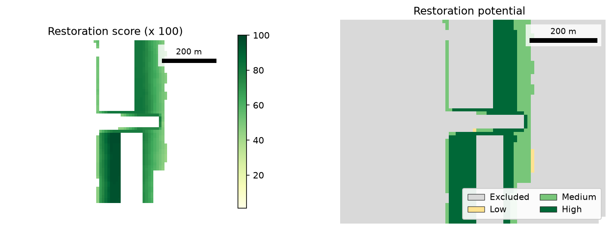

Multi-criteria analysis with band maths: mangrove restoration potential
=======================================================================

This guide shows how to build a **multi-criteria analysis** (MCA, also called
multi-criteria evaluation or suitability analysis) in rsgispy. Several
layers of evidence (elevation, distances, land use, past land cover, and so
on) are turned into comparable scores and combined into a single decision
surface. Most of the work is done by
:func:`~rsgispy.imagecalc.maths.band_maths`, which evaluates a muParser
expression over any number of input bands, block by block, so the same few
lines work for a small test area and for a whole coastline.

The scenario is **mangrove restoration**: where is restoration biophysically
feasible, and where is it most likely to succeed? Mangroves only grow in a
narrow band of the intertidal zone, they need a supply of propagules (seeds)
from nearby mangroves and regular tidal flooding, and sites where mangroves
grew in the past (for example, abandoned aquaculture ponds) are often the
best places to restore them.

.. important::

   The criteria, thresholds and weights in this guide are **illustrative
   only**. They show how to set up the analysis, not what the right values
   are. A real study must justify every criterion, threshold and weight from
   the literature, from local knowledge (tidal datums, sediment supply, land
   tenure, community needs) and, ideally, from field data on where past
   restoration succeeded or failed.

Why band maths?

* Every step is an expression you can read: a constraint is a ternary
  (``elev >= 0 && elev <= 1.5 ? 1 : 0``), a fuzzy membership is a formula, and
  the weighted combination is a sum. There is no hidden logic.
* Many outputs can be written in one pass over the data (multi-output
  expressions), so all the factors, or the score and its classes, are
  computed together.
* The data are processed in blocks, so memory use does not grow with the
  image size.

.. seealso::

   The rsgispy tutorials show the building blocks of this guide in notebooks
   you can run:
   :tutorial:`rule-based classification <04_image_classification/01_rule_based_classification.ipynb>`
   (spectral indices and a rule base written for ``band_maths``, section 4),
   :tutorial:`preparing the datasets for a species distribution model <11_case_study_species_distribution/01_prepare_datasets.ipynb>`
   (rasterising vector layers and distance images, section 11) and
   :tutorial:`map-to-map change <06_change_detection/02_map_to_map_change.ipynb>`
   (mapping mangrove gain and loss between two dates, section 6). The
   tutorial data has no DEM, aquaculture ponds or protected areas for a
   mangrove coast, so the figures on this page come from the synthetic
   scene of the test suite. See :doc:`../tutorials` for how to get the
   tutorials and their data.

.. contents:: Contents
   :local:
   :depth: 1

Installation
------------

The core install provides band maths, rasterising, resampling, zonal
statistics, polygonising and the maps. The distance calculation needs
``scipy`` (the ``stats`` extra); downloading OpenStreetMap data (optional)
needs ``osmnx`` (the ``dataaccess`` extra):

.. code-block:: bash

   pip install "rsgispy[stats]"
   # optional, for OpenStreetMap downloads
   pip install "rsgispy[stats,dataaccess]"

Concepts
--------

**Constraints and factors.** A *constraint* is a yes/no rule: a pixel is
either a candidate or it is excluded, whatever its other properties (for
example, land that is already mangrove, built-up land, or ground outside the
intertidal elevation range). Constraints are Boolean masks (1 = feasible,
0 = excluded) and are applied by *multiplication* at the end. A *factor* is a
criterion that makes a site more or less suitable by degree (for example,
the distance to the nearest existing mangroves). Factors are combined by a
weighted sum, so a weakness in one factor can be compensated by strength in
another. Deciding whether a criterion is a constraint or a factor is one of
the most important choices in an MCA: use a constraint only when there is
no realistic trade-off.

**Fuzzy standardisation.** Factors come in different units (metres,
degrees, categories), so each one is first converted to a *membership*
between 0 (unsuitable) and 1 (fully suitable). The shape of the conversion
expresses what you know about the criterion:

* *linear* — suitability changes steadily between two values (e.g. 1 at the
  water's edge, falling to 0 at 1 km);
* *sigmoid* — suitability changes most around a threshold and levels off on
  both sides (e.g. propagule supply drops sharply beyond a few hundred
  metres);
* *trapezoidal* — suitability rises, stays at 1 over an optimum range, then
  falls (e.g. elevation within the tidal frame);
* *categorical* — a score for each class of a categorical layer (e.g. IUCN
  protected area category).

**Weights.** Weights express the relative importance of the factors and
sum to 1. They can be set directly, but it is easier to defend them if they
are derived from *pairwise comparisons* (the Analytic Hierarchy Process,
AHP): for each pair of factors, an expert (or a group) says how much more
important one is than the other. Step 4 shows this in a few lines of numpy.

**Sensitivity.** Weights are a judgement, so the result should be tested
by changing them and measuring how much of the map changes (Step 6). Areas
that are classed as high potential under every reasonable weight set are a
robust result; areas that change class easily need more evidence.

Overview
--------

.. code-block:: text

   S2 SREF stack (10 m grid) ── DEM ── mangrove extent (now, baseline)
            │                     │           │
            ▼                     ▼           ▼
   1. Inputs on one grid: resample_img_to_match, calc_indices
      (MVI, CMRI, MNDWI), slope
            │
            ▼
   2. Constraints ── ponds, settlements (vectors → rasters)
      layers.tif (valid, mangrove, water) ─► feasible.tif (0/1)
            │
            ▼
   3. Factors (0–1) ── distances, rescale, vector attribute scores
      factors.tif (7 bands: f_elev, f_loss, f_dmng, f_water,
                   f_pond, f_prot, f_slope)
            │
            ▼
   4. Weights (AHP, numpy) ─► weights, consistency ratio
            │
            ▼
   5. Combine: one band_maths call ─► restoration_potential.tif
      band 1: class (0 no data, 1 excluded, 2 low, 3 medium, 4 high)
      band 2: score × 100 (0–100, 255 = no data)
            │
            ├─► 6. Sensitivity of the weights (table)
            ├─► 7. Summaries per admin unit, high-potential polygons
            └─► 8. Maps

The code in this guide comes from the example script
``docs/examples/multi_criteria_analysis.py`` (included below step by step),
which is run by the rsgispy test suite on a small synthetic coastal scene.
The script is written for real data:

* a Sentinel-2 surface reflectance stack (e.g. from
  :func:`~rsgispy.imagecalibration.sensorlvl2data.create_stacked_sen2_esa_l2a_img`;
  reflectance × 10000, no data value 0) — it defines the 10 m analysis grid;
* a DEM in metres relative to mean sea level (MSL), in a projected CRS. Global
  DEMs are rarely accurate enough in the intertidal zone; a LiDAR DEM, an
  intertidal elevation model derived from the waterline at many tide heights,
  or survey data are much better. Ideally, express elevation relative to
  local tidal datums (e.g. MSL and highest astronomical tide, HAT);
* current and baseline mangrove extent rasters, e.g. Global Mangrove Watch
  (GMW) for 2020 and 1996 (1 = mangrove);
* aquaculture ponds with the number of years since they were abandoned
  (``yrs_aband``, 0 = active), settlements, protected areas with a WDPA
  ``IUCN_CAT`` column, and administrative units (or estuaries) for reporting.

Run it on your own data with:

.. code-block:: bash

   python multi_criteria_analysis.py --s2 s2_sref_10m.tif --dem dem_msl.tif \
       --mng-now gmw_2020.tif --mng-hist gmw_1996.tif --ponds ponds.gpkg \
       --settlements settlements.gpkg --protected wdpa.gpkg \
       --admin admin_units.gpkg --out-dir outputs

Step 1 — Inputs on one grid
---------------------------

:func:`~rsgispy.imagecalc.maths.band_maths` combines bands pixel by pixel, so
**every input must be on exactly the same grid** (CRS, pixel size and
alignment). Inputs that only partly overlap are cut to their common extent,
but inputs with different pixel sizes cannot be combined. Here the
Sentinel-2 image defines the grid and the other rasters are resampled to it
with :func:`~rsgispy.imageutils.warp.resample_img_to_match`. Choose the
resampling method by data type:

* **continuous** data (elevation, reflectance, distances): bilinear (or cubic)
  interpolation gives a smooth surface;
* **categorical** data (masks, classes, codes): nearest neighbour, so no
  in-between values are invented (bilinear resampling of a 0/1 mask gives
  0.25, 0.5, …, which are not valid classes).

The mangrove and water indices are calculated with
:func:`~rsgispy.imagecalc.calcindices.calc_indices`: ``MVI`` (Mangrove
Vegetation Index, Baloloy et al. 2020, ``(nir - green) / (swir1 - green)``),
``CMRI`` (Combined Mangrove Recognition Index, ``NDVI - NDWI``) and ``MNDWI``
(``(green - swir1) / (green + swir1)``, positive over open water).
``in_gain=10000`` converts the stored values to reflectance. Slope (degrees)
comes from :func:`~rsgispy.elevation.terrain.slope` on the resampled DEM.

.. literalinclude:: ../examples/multi_criteria_analysis.py
   :language: python
   :start-after: # [step-1-inputs]
   :end-before: # [end-step-1-inputs]
   :dedent: 4

**Check:** open the resampled rasters over the Sentinel-2 image in a GIS and
make sure they line up; check that the mangrove masks only contain 0 and 1
(e.g. with :func:`~rsgispy.imagecalc.stats.get_unique_values`), and that the
DEM values in the intertidal zone are plausible (a few metres either side of
0 m). The index image has the no data value ``-9999`` (the ``calc_indices``
default for ``float32``).

Step 2 — Constraints
--------------------

The vector layers are put onto the same grid first:

* :func:`~rsgispy.imageutils.rasterise.rasterise_vec_lyr` burns the
  settlements as 1 (0 elsewhere);
* :func:`~rsgispy.imageutils.rasterise.create_vec_range_lut_score_img`
  recodes the numeric ``yrs_aband`` attribute of the ponds with a
  ``{code: (low, high)}`` look-up table (``low <= value < high``) and
  rasterises the codes: 1 = active, 2 = abandoned for less than five years,
  3 = abandoned for five years or more, 0 = no pond.

Then a multi-output :func:`~rsgispy.imagecalc.maths.band_maths` expression
derives three intermediate layers in one pass. The first sub-expression
assigns ``valid`` (both the Sentinel-2 image and the DEM have data) and the
other two reuse it:

* ``mangrove`` — current mangrove: the GMW map, *or* pixels that look like
  mangrove in the recent image (``MVI >= 4.5`` and ``CMRI >= 1``). GMW maps
  are a few years old and miss recent gains, so updating them from the image
  avoids "restoring" mangroves that are already there. The thresholds must be
  checked for your area;
* ``water`` — open water (``MNDWI > 0``), but not active ponds, which are
  water-filled but are not tidal channels.

Finally the **constraint mask** is a single ternary expression: a pixel is
feasible (1) only if it has valid data, is not already mangrove, is not
built-up, is not an active pond, and lies within the intertidal elevation
range (here 0–1.5 m above MSL, the first and last values of
``elev_frame``). Everything else is 0.

.. literalinclude:: ../examples/multi_criteria_analysis.py
   :language: python
   :start-after: # [step-2-constraints]
   :end-before: # [end-step-2-constraints]
   :dedent: 4

Note that the expression is built with an f-string, so thresholds come from
the function's parameters. Print the final expression when debugging; a
syntax error is reported with the position of the problem.

**Check:** the proportion of feasible pixels, e.g.
``calc_prop_true_exp("f == 1 ? 1 : 0", [BandDefn("f", "feasible.tif", 1)])``
(:func:`~rsgispy.imagecalc.maths.calc_prop_true_exp`), and a visual check
that current mangroves, settlements and active ponds are all 0. If almost
nothing is feasible, the elevation range or the DEM's vertical datum is the
usual suspect.

Step 3 — Factors and fuzzy membership
-------------------------------------

Seven factors are standardised to 0–1:

.. list-table::
   :header-rows: 1
   :widths: 14 40 46

   * - Factor
     - Criterion
     - Membership function (illustrative)
   * - ``f_elev``
     - Elevation within the tidal frame
     - Trapezoid: 0 at 0 m, rising to 1 at 0.3 m, 1 up to 1.0 m, falling to
       0 at 1.5 m (``elev_frame``)
   * - ``f_loss``
     - Mangrove in the baseline year but not now
     - 1 for lost mangrove, 0.4 elsewhere
   * - ``f_dmng``
     - Distance to existing mangroves (propagule supply)
     - Decreasing sigmoid, 0.5 at 500 m
   * - ``f_water``
     - Distance to open water / tidal channels (tidal flushing)
     - Linear, 1 at 0 m to 0 at 1 km
   * - ``f_pond``
     - Aquaculture pond status
     - 1 abandoned ≥ 5 years, 0.8 abandoned < 5 years, 0.5 no pond
   * - ``f_prot``
     - Protection (security of tenure)
     - 1.0 IUCN Ia–II, 0.8 III–IV, 0.6 V–VI, 0.5 other designations, 0.3
       unprotected
   * - ``f_slope``
     - Slope
     - Linear, 1 on flat ground to 0 at 5°

The distances are calculated with
:func:`~rsgispy.imagecalc.distance.calc_dist_to_img_vals` (Euclidean distance
in map units to the nearest pixel with the value 1 in the chosen band of
``layers.tif``). ``max_dist`` caps the search: pixels further away get the
value ``max_dist``, which keeps the calculation fast and still gives them a
membership of (almost) 0. The output no data value is also set to
``max_dist``; ``band_maths`` reads the raw values, so this does not matter
for the distance to mangroves, but other tools, such as the rescaling below,
treat those pixels as no data.

The distance to water is converted with
:func:`~rsgispy.imagecalc.rescale.rescale_img_pxl_vals`, which is the
simplest way to apply a linear membership. Giving ``out_min=1`` and
``out_max=0`` reverses the direction (near is good), and
``trim_to_limits=True`` clips values beyond 1 km to 0. The rescaling masks
the input band's own no data value (here ``max_dist``), so pixels further
than 5 km from water become no data (``out_no_data``, -9999 by default) in
``f_water.tif``; the factor expression below sets them to 0.

The protection score comes from a text attribute, so
:func:`~rsgispy.imageutils.rasterise.create_vec_lst_lut_score_img` maps each
IUCN category to an integer (a percentage) with a list of
``(value, code)`` pairs; unlisted values and areas outside protected areas
are 0.

All the memberships are then written to one 7-band image with a single
multi-output ``band_maths`` call; each list item is one output band. The
trapezoid uses ``min``/``max``, the sigmoid uses ``exp``, and the categorical
scores use ternaries.

.. literalinclude:: ../examples/multi_criteria_analysis.py
   :language: python
   :start-after: # [step-3-factors]
   :end-before: # [end-step-3-factors]
   :dedent: 4

**Check:** every band of ``factors.tif`` must be within 0–1 (look at the band
statistics or a histogram with
:func:`~rsgispy.imagecalc.stats.get_img_histogram`). Values outside that
range usually mean a no data value has gone through a formula (see the
slope expression, and `Band maths cookbook`_). Plot each factor: it should
look like the criterion it represents.

Step 4 — Weights from pairwise comparisons (AHP)
------------------------------------------------

In the AHP, the pairwise comparison matrix holds, for each pair of factors
*i* and *j*, how much more important *i* is than *j* on Saaty's 1–9 scale
(1 = equally important, 3 = moderately, 5 = strongly, 7 = very strongly,
9 = extremely more important); the lower triangle holds the reciprocals. The
weights are the principal eigenvector of the matrix, normalised to sum to 1.

The **consistency ratio** (CR) measures whether the judgements contradict
each other (if A is twice as important as B and B twice as important as C,
A should be about four times as important as C). It is the consistency index
``(λmax − n) / (n − 1)`` divided by the average index of random matrices of
the same size (1.32 for 7 factors; 0.58, 0.90, 1.12, 1.24, 1.41, 1.45 for 3,
4, 5, 6, 8 and 9). A CR below 0.1 is usually accepted; above that, revise the
comparisons.

.. literalinclude:: ../examples/multi_criteria_analysis.py
   :language: python
   :start-after: # [step-4-weights]
   :end-before: # [end-step-4-weights]
   :dedent: 4

The printed weights (rounded) are:

.. code-block:: text

   {'f_elev': 0.3364, 'f_loss': 0.2191, 'f_dmng': 0.133, 'f_water': 0.133,
    'f_pond': 0.08, 'f_prot': 0.0493, 'f_slope': 0.0493} CR = 0.011

If you prefer to set the weights directly (e.g. from a published study),
replace this step with a dictionary of weights that sum to 1. Other ways to
derive weights include ranking methods (rank sum, rank reciprocal) and
statistical approaches when sites of known outcome are available (e.g. a
logistic regression or a species distribution model of restoration success).

Step 5 — Combining factors and constraints
------------------------------------------

The score is a **weighted linear combination** (WLC) of the factors,
multiplied by the constraint mask so that excluded pixels score 0:

.. code-block:: text

   score = feasible × (w1·f_elev + w2·f_loss + … + w7·f_slope)

One ``band_maths`` call writes the class and the score together. The
weighted sum is assigned to ``s`` *inside parentheses* in the first
sub-expression; an assignment in parentheses defines a variable without
creating an extra output band, so ``s`` is then reused by the second
sub-expression:

* **band 1, potential class** — 4 (high) where ``s >= 0.65``, 3 (medium)
  where ``s >= 0.45``, 2 (low) for the other feasible pixels, 1 (excluded)
  and 0 (no data). The class breaks (``class_breaks``) are illustrative;
  they can also be chosen from the score distribution (e.g. quantiles) or
  by comparison with known successful restoration sites.
* **band 2, score** — the score × 100, rounded with ``rint`` and stored as
  an 8-bit integer (0–100); 255 is no data.

The output is 8-bit so that the class band can have a colour table
(:func:`~rsgispy.imageutils.colourtable.define_colour_table`) for the
thematic map, and ``no_data_val=255`` records 255 as the no data value of
the output. The combination is wrapped in a small
function, ``calc_potential``, so it can be re-run with other weights in
Step 6.

.. literalinclude:: ../examples/multi_criteria_analysis.py
   :language: python
   :start-after: # [step-5-combine]
   :end-before: # [end-step-5-combine]
   :dedent: 4

A weighted sum lets factors compensate for each other. If you want a weak
factor to limit the score regardless of the others (a "chain is as strong
as its weakest link" logic), use ``min(f1, f2, ...)`` instead, or a weighted
product (``f1^w1 * f2^w2 * ...``), which is zero whenever any factor is zero.

**Check:** excluded pixels (class 1) must have a score of 0; the high
potential areas should make sense to someone who knows the site; and the
class areas (Step 7) should be plausible.

Step 6 — Sensitivity of the weights
-----------------------------------

The weight sets tested here are equal weights and, for each factor in turn,
its weight multiplied by 0.75 and 1.25 (the others are rescaled so the sum
stays 1). For each set the potential is recalculated and compared with the
base map using :func:`~rsgispy.imagecalc.maths.calc_prop_true_exp`, which
returns the proportion of pixels where an expression is 1. Giving
``in_vld_img=feasible.tif`` restricts the proportion to the feasible pixels,
so the table reports the share of the candidate area that changes class, and
the share classed as high potential under each weight set.

.. literalinclude:: ../examples/multi_criteria_analysis.py
   :language: python
   :start-after: # [step-6-sensitivity]
   :end-before: # [end-step-6-sensitivity]
   :dedent: 4

On the synthetic test scene the table starts:

.. code-block:: text

        weights  changed  base_high  alt_high
          equal    0.225      0.643     0.825
   f_elev x1.25    0.074      0.643     0.630
   f_dmng x0.75    0.037      0.643     0.625
   ...

Read it as: with equal weights, 22.5 % of the feasible area changes class,
and the result is most sensitive to the elevation weight. If a ±25 % change
of one weight moves much of the map, that weight (and the criterion behind
it) deserves the most scrutiny. For a fuller analysis, sample many weight
sets at random (e.g. from a Dirichlet distribution centred on the AHP
weights), count how often each pixel is classed as high potential, and map
that frequency. To compare the scores rather than the classes, use
:func:`~rsgispy.imagecalc.comparison.calc_img_difference` or
:func:`~rsgispy.imagecalc.comparison.calc_img_correlation` on band 2.

Step 7 — Summaries per administrative unit
------------------------------------------

Decision makers usually need areas per administrative unit, estuary or
catchment rather than a map.
:func:`~rsgispy.zonalstats.polygon.calc_zonal_band_pxl_counts` counts the
pixels of each class in each polygon (columns named after the
``vals_lut`` values, plus the total of valid pixels ``n_pxls`` and the
number of no-data pixels ``nodata_count``), which are converted to
hectares with the pixel area. :func:`~rsgispy.zonalstats.polygon.calc_zonal_band_stats`
adds the mean and maximum score of the non-excluded pixels in each unit;
``min_thres=1`` and ``max_thres=100`` leave out the excluded pixels (0) and
no data (255).

For planning, the high-potential pixels are turned into polygons with
:func:`~rsgispy.vector.create.polygonise_raster_to_vec_lyr` (8-connected, so
diagonal neighbours join the same polygon), and polygons smaller than a
minimum area (0.5 ha by default) are removed with
:func:`~rsgispy.vector.geoms.rm_polys_area`. Small isolated patches are
rarely practical restoration sites.

.. literalinclude:: ../examples/multi_criteria_analysis.py
   :language: python
   :start-after: # [step-7-summaries]
   :end-before: # [end-step-7-summaries]
   :dedent: 4

The summary table for the synthetic scene looks like:

.. code-block:: text

                name  n_pxls  excluded  low  medium  high  ...  high_ha  score_max  score_mean
   0  North district  2400.0    1976.0  0.0   153.0  211.0  ...     2.11       82.0       67.42
   1  South district  2400.0    1894.0  8.0   127.0  307.0  ...     3.07       97.0       74.07

**Check:** the class areas of all units should add up to the class areas of
the whole image (e.g. from
:func:`~rsgispy.imagecalc.stats.count_pxls_of_val`) when the units cover the
image without overlapping. For large numbers of units or very large rasters,
rasterise the units and use
:func:`~rsgispy.zonalstats.labels.calc_label_zonal_stats` instead, which reads
each pixel once.

Step 8 — Maps
-------------

:func:`~rsgispy.mapping.raster.create_raster_cmap_img_map` draws the
continuous score (band 2) with a colour map; ``norm_vmin=1`` with
``vals_under_white=True`` shows the excluded pixels (score 0) in white, and
the no data value (255) is not drawn.
:func:`~rsgispy.mapping.raster.create_thematic_raster_map` draws the class
band with its colour table and a categorical legend.

.. literalinclude:: ../examples/multi_criteria_analysis.py
   :language: python
   :start-after: # [step-8-maps]
   :end-before: # [end-step-8-maps]
   :dedent: 4

   The score and the classes for the synthetic test scene (sea to the west,
   a tidal channel across the middle, existing mangroves in the north, and
   abandoned and active ponds in the south). The abandoned ponds, which were
   mangrove in the baseline year, have the highest potential. Regenerate
   this figure by running ``run_workflow`` on the scene from
   ``tests/mca_scene.py`` (see the example test) and copying
   ``restoration_potential.png``.

Optional: settlements from OpenStreetMap
----------------------------------------

If you do not have a settlement layer, residential areas can be downloaded
from OpenStreetMap with
:func:`~rsgispy.dataaccess.openstreetmap.get_osm_to_file` for the extent of
the Sentinel-2 image (run the script with ``--osm-settlements``). OSM
coverage varies a lot between countries, so check the result against the
imagery. Aquaculture ponds are also mapped in OSM (``landuse=aquaculture``),
but their status (active or abandoned) is rarely recorded and usually has to
come from local mapping or a time series of imagery. This step is not run by
the test suite.

.. literalinclude:: ../examples/multi_criteria_analysis.py
   :language: python
   :start-after: # [step-0-osm]
   :end-before: # [end-step-0-osm]
   :dedent: 4

Band maths cookbook
-------------------

:func:`~rsgispy.imagecalc.maths.band_maths` evaluates
`muParser <https://beltoforion.de/en/muparser/>`_ expressions (through
``pymu-eval``) on blocks of the input bands, which are read as 64-bit
floats. The patterns below are the ones used most in multi-criteria and
other raster analyses; ``x``, ``a``, ``b`` are band names from the
:class:`~rsgispy.imageprocess.BandDefn` list.

**Conditions (ternaries).** ``cond ? value_if_true : value_if_false``, with
``==``, ``!=``, ``<``, ``<=``, ``>``, ``>=``, ``&&`` (and), ``||`` (or).
Nest them for more than two outcomes, with brackets:

.. code-block:: text

   x > 0.3 ? 1 : 0
   a == 1 || b == 1 ? 1 : 0
   s >= 0.65 ? 3 : (s >= 0.45 ? 2 : 1)

**No data.** The input bands are read without masking, so no data values
take part in the calculation unless you handle them. Test for them first and
write the output no data value:

.. code-block:: text

   (a == 0 || b == 0) ? -999 : (a - b) / (a + b)
   slope < 0 ? 0 : max(0, 1 - slope / 5)
   x != x ? -999 : x          (x != x is only true for NaN)

NaN propagates through arithmetic and ``min``/``max``, and every comparison
with NaN is false, so a NaN input falls into the *else* branch of a ternary.
Pass the value the expression writes as ``no_data_val`` (e.g.
``no_data_val=-999``) so it is recorded as the output no data value;
``band_maths`` does not change the expression, so the expression must still
write that value. ``calc_stats=True`` also calculates the output statistics,
excluding the no data value.

**Clamping and memberships.** ``min`` and ``max`` take any number of
arguments:

.. code-block:: text

   min(1, max(0, (x - 10) / (50 - 10)))                 linear, increasing
   min(1, max(0, (50 - x) / (50 - 10)))                 linear, decreasing
   max(0, min((x - a0) / (a1 - a0), 1, (a3 - x) / (a3 - a2)))   trapezoid
   1 / (1 + exp(-(x - 25) / 5))                         sigmoid, increasing
   exp(-((x - 30)^2) / (2 * 8^2))                       Gaussian around 30

Other functions include ``abs``, ``sqrt``, ``exp``, ``rint`` (round to the
nearest integer), ``sum(...)`` and ``avg(...)``, and the constants ``pi`` and
``e``.

**Integer outputs.** Values written to an integer data type are rounded to
the nearest integer and clamped to the type's range (``300`` written as
``uint8`` becomes ``255`` and ``-2`` becomes ``0``; nothing wraps around), and
NaN becomes the output no-data value (``0`` when there is none). To clamp to a
narrower range, do it in the expression, e.g.
``min(100, max(0, 100 * s))`` for an 8-bit percentage.

**Multiple outputs and intermediate variables.** Top-level commas separate
output bands (commas inside function calls do not). An assignment at the top
level both defines a variable and writes it as a band; an assignment inside
parentheses only defines it:

.. code-block:: text

   ndvi = (nir - red) / (nir + red), ndvi > 0.5 ? 1 : 0       2 bands
   (ndvi = (nir - red) / (nir + red)) > 0.5 ? 1 : 0, ndvi * 100   2 bands

Name the output bands with ``band_names=[...]`` (one name per output), or
use ``exp_band_name=True`` to store each sub-expression as its band
description, which documents how a layer was made. Input variables can be
rescaled in place, e.g. ``nir = nir * 0.0001, red = red * 0.0001, ...``.

**Building expressions in Python.** Long expressions (like the weighted sum
in Step 5) are best built with f-strings or ``" + ".join(...)`` from
dictionaries of weights and thresholds, so the numbers live in one place.
Print the expression when something looks wrong.

**Area proportions.** :func:`~rsgispy.imagecalc.maths.calc_prop_true_exp`
returns the proportion of pixels where an expression is 1, optionally only
within a valid-area mask (``in_vld_img``, band 1 == 1). Multiply by the
number of pixels and the pixel area to get an area.

See also the band maths examples on the :doc:`../rsgispy_imagecalc` page.

Performance and large datasets
------------------------------

* **Block processing** — ``band_maths``, the rescaling and rasterising
  functions all work block by block, so memory use depends on the block size
  and number of input bands, not the image size. Writing all the factors in
  one multi-output call (Step 3) reads each input once instead of once per
  factor.
* **Distances** — with ``max_dist``,
  :func:`~rsgispy.imagecalc.distance.calc_dist_to_img_vals` works block by
  block, reading each block with an overlap of ``max_dist`` (in pixels) around
  it, so keep ``max_dist`` as small as the criterion allows. Without
  ``max_dist`` the whole band is held in memory. For very large images see
  also :func:`~rsgispy.imagecalc.distance.calc_dist_to_img_vals_tiled`.
* **Intermediate files** — every step writes GeoTIFFs, which makes each
  layer easy to check. Use compressed, tiled outputs (``creation_opts`` or
  the environment options in :mod:`rsgispy.imageutils.envopts`) and delete
  intermediate files you no longer need. A VRT
  (:func:`~rsgispy.imageutils.vrt.create_stack_images_vrt`) can stack bands
  from several files without copying them.
* **Sensitivity runs** — each weight set is one more ``band_maths`` pass over
  the factor stack. For many runs on large areas, run them on a sample of
  pixels or a coarser grid first, or in parallel on tiles.
* **Polygonising** large class rasters produces many polygons; polygonise
  only the class you need, or first remove small patches with a sieve
  filter (e.g.
  :func:`~rsgispy.classification.classpostprocess.apply_sieve_filter`).

Common problems
---------------

* **"Error parsing or evaluating expression"** — a band name used in the
  expression is not in the ``BandDefn`` list, or a bracket or operator is
  missing; the message gives the position of the problem. Print the
  expression. (A band named ``e`` or ``pi`` replaces that constant.)
* **Output smaller than expected or misaligned** — the inputs are not on the
  same grid. ``band_maths`` uses the intersection of the inputs; resample
  every layer to one reference image first (Step 1).
* **Factor values outside 0–1 / strange patterns at the edges** — a no data
  value (-9999, -999, 0) has gone through a membership formula. Test for no
  data in the expression or exclude those pixels with the constraint mask.
* **Distances equal to max_dist everywhere** — the target value does not
  exist in the chosen band (e.g. no mangroves in the tile), or the wrong band
  was given to ``calc_dist_to_img_vals``.
* **Everything excluded** — the DEM is relative to a different vertical datum
  (e.g. the ellipsoid, or chart datum/lowest astronomical tide) than the
  elevation thresholds. Convert the DEM, or the thresholds, to the same
  datum.
* **MVI very large or negative** — MVI divides by ``swir1 - green``, which
  is close to zero over some surfaces. Use it with other evidence (here
  CMRI and GMW), not on its own.
* **Classes look wrong in the map** — the class band must be an unsigned
  8- or 16-bit integer for a colour table; write it with
  ``datatype=rsgispy.TYPE_8UINT``.
* **CRS mismatch of vectors** — the rasterising functions reproject the
  vectors to the image CRS, but the polygon zonal statistics raise an
  exception if the polygons and the raster are in different CRSs
  (``vec_def_epsg`` labels the polygons with a CRS but does not reproject
  them); reproject the polygons first,
  e.g. with ``gdf.to_crs(...)``.
  Use a projected CRS in metres so that distances and areas are correct.
* **OpenStreetMap download fails** — ``osmnx`` is not installed (``pip
  install "rsgispy[dataaccess]"``), there is no internet access, or the
  Overpass server is busy; retry later or use local data.

Related guides
--------------

* :doc:`analysis_ready_data`
* :doc:`hydrology_workflow`
* :doc:`zonal_stats_and_vectors`
* :doc:`making_maps`
