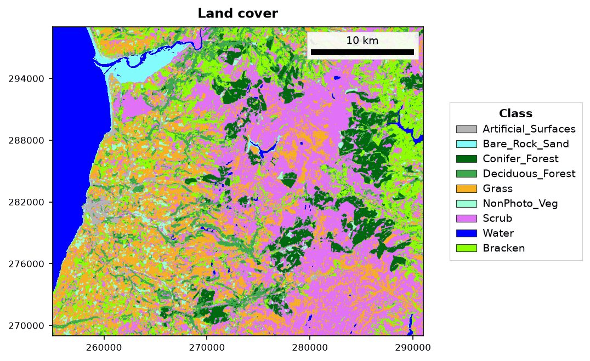

Pixel-based supervised classification
======================================

This guide walks through a supervised land cover classification in which
every pixel is classified on its own. A set of features (spectral bands,
spectral indices, terrain and, optionally, texture) is built for each pixel,
training pixels are extracted under labelled polygons, the features are
explored and selected, a machine learning model is trained and tuned, and the
model is applied to the whole image. The result is post-processed to a
minimum mapping unit, its accuracy and the class areas are estimated from an
independent stratified random sample, and it is drawn as a map.

The inputs are the same as in the object-based guide
(:doc:`segment_ml_workflow`): a Sentinel-2 surface reflectance image, a DEM
and training polygons for each land cover class, so the two approaches can
be compared directly. On this page they come from the rsgispy tutorials:
nine land cover classes around Aberystwyth, west Wales (see `The data on
this page`_).

Why classify pixels?

* It is the simplest workflow, with no segmentation parameters to tune, and
  every pixel gets its own class, so small or narrow features (roads, rivers,
  hedges) are not merged into larger objects.
* Training data are plentiful: every training polygon gives many pixels.
* The same configuration, training, interpretation and accuracy functions
  are shared with the segment workflow, so moving from one to the other is
  straightforward.

The main weakness is "salt and pepper" noise: isolated pixels classified
differently from their neighbours. Step 9 removes most of it. When the
objects of interest are much larger than a pixel, or their shape and
context matter, the segment workflow (:doc:`segment_ml_workflow`) usually
gives a cleaner map.

.. seealso::

   The rsgispy tutorials cover this in notebooks you can run:
   :tutorial:`Supervised pixel classification
   <04_image_classification/03_supervised_pixel_classification.ipynb>`
   (section 4, with the same Sentinel-2 image and training polygons as this
   page), and the rule-based and unsupervised classification notebooks
   before it in :tutorial-dir:`section 4 <04_image_classification>`.
   :tutorial:`Chaining indices, classification and filtering in a tile graph
   <09_tile_graph_workflows/01_indices_classification_filtering.ipynb>`
   (section 9) runs a pixel classification in one pass with a tile graph.
   See :doc:`../tutorials` for how to get the notebooks and their data.

.. contents:: Contents
   :local:
   :depth: 1

Installation
------------

The workflow needs the ``classification`` extra (``scikit-learn``,
``pyarrow``, ``optuna``, ``scipy``). The XGBoost/LightGBM/CatBoost models need
the ``gbdt`` extra, and SHAP, BorutaShap and SALib sensitivity analysis need
the ``modelling`` extra:

.. code-block:: bash

   pip install "rsgispy[classification,gbdt,modelling]"

``seaborn`` is used for nicer box plots and correlation matrices if it is
installed, but it is not required. Every step that needs an optional package
can be switched off with an argument of the example script (``use_gbdt``,
``use_boruta``, ``use_shap``, ``use_salib``).

Overview
--------

.. code-block:: text

   Sentinel-2 SREF stack           DEM (any resolution, projected)
            │                              │
            ▼                              ▼
   1. Bands, indices, texture ─┐   slope ─► resample to the S2 grid
                               ▼
                          features.vrt (one virtual stack)
            │
            ▼
   2. Config (JSON) ◄── training polygons per class (Water, Forest, …)
            │
            ▼
   3. Training samples ──► train / valid / test tables (+ x, y, polygon)
            │                (whole polygons in each table)
            ▼
   4. Explore features (box plots, correlation, VIF)
            │
            ▼
   5. Select features ──► config with the selected bands
            │
            ▼
   6. Train and tune (Random Forest, XGBoost) + nested spatial CV
            │
            ▼
   7. Interpret (importance, jackknife, response curves, SHAP, Sobol)
            │
            ▼
   8. Apply to the image ──► class raster + class probabilities
            │
            ▼
   9. Post-process (majority filter, minimum mapping unit)
            │
            ├─► 10. Accuracy assessment and area estimates
            ├─► 11. Map
            └─► 12. Unsupervised alternative (k-means)

The code in this guide comes from the example script
``docs/examples/pixel_classification_workflow.py`` (included below step by
step). The inputs are:

* a Sentinel-2 surface reflectance stack in the band order written by
  :func:`~rsgispy.imagecalibration.sensorlvl2data.create_stacked_sen2_esa_l2a_img`
  (B2, B3, B4, B5, B6, B7, B8, B8A, B11, B12; reflectance x ``refl_gain``,
  10000 by default; no data value 0). Bands 1, 2, 3, 7, 9 and 10 are used and named Blue,
  Green, Red, NIR, SWIR1 and SWIR2;
* a DEM in a projected coordinate system with metre units (it does not need
  to have the same resolution or extent as the image);
* one vector file of training polygons (or points) for each class.

Run it on your own data with:

.. code-block:: bash

   python docs/examples/pixel_classification_workflow.py --s2 s2_sref_10m.tif \
       --dem dem_30m.tif --train Water=water.gpkg Forest=forest.gpkg \
       Grass=grass.gpkg Urban=urban.gpkg --out-dir outputs

The data on this page
---------------------

The printed outputs and the map on this page come from the data of the
rsgispy tutorials, as used in the supervised pixel classification notebook:

* the 20 m Sentinel-2 image of 29 June 2018,
  :tutorial-data:`sen2_20180629_t30uvd_orb037_osgb_stdsref_20m.tif`
  (British National Grid, the band order above, reflectance x 1000, no data
  value 0), subset to a 36 x 30 km area around Aberystwyth (1800 x 1500
  pixels) inside the DEM: from the sea and the Dyfi estuary in the west to
  the conifer plantations and the uplands of Pumlumon in the east;
* the 10 m DEM :tutorial-data:`dem_10m_osgb.tif` (the sea is 0 m, so its
  slope is 0);
* the training polygons :tutorial-data:`cls_data/aber_sen2_cls_training.gpkg`,
  one layer per class. Only the polygons inside the area are used, and the
  long and short grass classes are merged into one Grass class, because
  only 3 small Grass_Long polygons are in the area: nine classes, with the
  class IDs and colours of the notebook.

The script ``docs/examples/pixel_classification_workflow_tutorial.py``
prepares these inputs and runs the example (about three minutes):

.. literalinclude:: ../examples/pixel_classification_workflow_tutorial.py
   :language: python
   :start-after: # [tutorial-data]
   :end-before: # [end-tutorial-data]
   :dedent: 4

The tutorial data has no independent reference sample, so the accuracy
assessment of step 10 is not run on it (the sample of points to label is
still created). The rsgispy test suite runs the same example end to end on
a small synthetic scene (``tests/pixel_ml_scene.py``: four classes, a DEM
and labelled accuracy points), so the code on this page is always tested.

Step 1 — Features
-----------------

The model can only separate classes that differ in its input features, so
this step decides most of the final accuracy. Typical features for land
cover are:

* **Spectral bands** — the reflectance values themselves. The bands to use
  are selected with a VRT
  (:func:`~rsgispy.imageutils.vrt.create_vrt_band_subset`), so they are not
  copied.
* **Spectral indices** —
  :func:`~rsgispy.imagecalc.calcindices.calc_indices` calculates many indices
  in one pass (here NDVI for vegetation, MNDWI for open water and NDBI for
  built-up areas; :func:`~rsgispy.imagecalc.calcindices.get_available_indices`
  lists them all). ``band_names`` maps band numbers to the canonical names
  (``'blue'``, ``'green'``, ``'red'``, ``'nir'``, ``'swir1'``, …) and
  ``in_gain=10000`` converts the scaled integers to reflectance. Indices
  are ratios, so they are less affected by illumination and topography than
  the bands.
* **Terrain** — :func:`~rsgispy.elevation.terrain.slope` (in degrees) helps
  to separate, for example, flat urban areas and water from forest on steep
  slopes. Calculate it on the DEM's own grid (so that the pixel spacing used
  for the gradient is the DEM's) and then put it on the image grid.
* **Texture** (optional) —
  :func:`~rsgispy.imagefilter.texture.apply_glcm_filter` computes grey-level
  co-occurrence (GLCM) statistics in a moving window (here homogeneity and
  energy of the NIR band in a 5 x 5 window). Texture helps with classes that
  are spectrally mixed but spatially distinctive (e.g. urban areas). Larger
  windows give smoother texture but blur class boundaries. GLCM works on every
  band of its input, so a one-band VRT
  (:func:`~rsgispy.imageutils.vrt.create_vrt_band_subset`) selects the NIR
  band without copying it. The texture image takes the input's no data value
  (``0``), so choose properties that are never ``0`` in valid areas:
  homogeneity and energy are 1 in a uniform window, but entropy, contrast
  and dissimilarity are 0, which would mask calm water.

**All feature images must be on exactly the same pixel grid** (CRS, pixel
size and alignment, extent). The indices and texture are derived from the
Sentinel-2 image, so they already are; the slope is resampled with
:func:`~rsgispy.imageutils.warp.resample_img_to_match`, using bilinear
interpolation because slope is continuous (use nearest neighbour,
``rsgispy.INTERP_NEAREST_NEIGHBOUR``, for categorical data such as a soil
map).

Finally, the Sentinel-2 bands and the derived layers are stacked into one
virtual image with :func:`~rsgispy.imageutils.vrt.create_stack_images_vrt`,
with a name for each band. A VRT is a small XML file that refers to the
source images, so nothing is copied, and each band keeps its own data type
(``uint16`` reflectance, ``float32`` indices, slope and texture) and its own
no data value (``0`` and ``-9999``). The sample extraction and the
classification functions read such mixed stacks; a pixel is removed from
the samples, or left unclassified, when any band is no data. To write a
real multi-band file instead, use
:func:`~rsgispy.imageutils.bands.stack_img_bands` (with ``datatype`` and
``no_data_val`` set so that every band shares one no data value).

.. literalinclude:: ../examples/pixel_classification_workflow.py
   :language: python
   :start-after: # [step-1-features]
   :end-before: # [end-step-1-features]
   :dedent: 4

**Check:** open the images in a GIS. Index values should be within -1 to 1
(no data is -9999), the slope should look like the terrain, without blocky
artefacts, and every layer should line up with the Sentinel-2 image.

Step 2 — The configuration
--------------------------

A :class:`~rsgispy.classification.classdata.ClassificationConfig` holds
everything the later steps need, and is saved as JSON with
:func:`~rsgispy.classification.classdata.write_cls_config` (and read back
with :func:`~rsgispy.classification.classdata.read_cls_config`), so most
functions accept either the object or the JSON file:

* the **image bands** — a list of
  :class:`~rsgispy.classification.classdata.ImageBandInfo`, one for each
  image (here just the feature stack), with the bands to use and their
  **feature names**. The names become the column names of the sample tables
  and the model's feature names, so keep them short and unique;
* the **classes** — a dictionary of
  :class:`~rsgispy.classification.classdata.ClassInfoObj` keyed by class
  name, with the training vector file, the output pixel value (``out_id``)
  and the colour (``'#rrggbb'`` or an RGB tuple) used for the classified
  image and the map. A consecutive 0-based ``internal_id`` is added
  automatically for training (some models, e.g. XGBoost, need 0-based
  labels); the classified image uses the ``out_id`` values.

.. literalinclude:: ../examples/pixel_classification_workflow.py
   :language: python
   :start-after: # [step-2-config]
   :end-before: # [end-step-2-config]
   :dedent: 4

which prints the feature names and the output IDs (in the order of the
class names):

.. code-block:: text

   ['Blue', 'Green', 'Red', 'NIR', 'SWIR1', 'SWIR2', 'NDVI', 'MNDWI', 'NDBI', 'slope', 'NIR_homogeneity', 'NIR_energy']
   {1: 'Artificial_Surfaces', 2: 'Bare_Rock_Sand', 10: 'Bracken', 3: 'Conifer_Forest', 4: 'Deciduous_Forest', 5: 'Grass', 7: 'NonPhoto_Veg', 8: 'Scrub', 9: 'Water'}

Step 3 — Training samples
-------------------------

:func:`~rsgispy.classification.classdata.extract_and_split_class_samples`
reads the pixels under each class's training polygons (or points) from every
image band, removes pixels that are no data in any band, and splits them, per
class, into **training**, **validation** and **test** tables (here 60/20/20 %).
The tables are written as Parquet (Snappy compressed) with the columns
``class_name``, ``out_cls_id``, ``internal_cls_id``, the source polygon of
each pixel (``train_grp``, e.g. ``'Forest:poly3'`` for the fourth polygon of
the Forest layer), the pixel centre coordinates ``x`` and ``y``
(``include_coords=True``) and one column per feature.

* The **training** set fits the model.
* The **validation** set is used to choose hyperparameters (or for early
  stopping of GBDT models) when cross-validation is not used.
* The **test** set is only used to report the performance of the final model.

**Class balance.** Large classes give many more pixels than small ones, and
a model trained on unbalanced data favours the large classes.
``max_cls_smpls`` caps the number of pixels per class (before splitting),
which also keeps training fast; ``n_train`` / ``n_test`` / ``n_valid`` set
the numbers per class (upper limits with ``group_col``, as whole polygons
are kept together). The models below also use
``class_weight='balanced'``.

**Spatial autocorrelation.** Neighbouring pixels, especially pixels inside
the same training polygon, are very similar. If the pixels were split at
random, the test pixels would have near-identical neighbours from the same
polygons in the training set, and the test accuracy would be
**optimistic**: it would measure how well the model recognises the training
polygons, not how well it maps new places. Three things reduce this problem:

* split by **polygon**. With ``group_col='train_grp'`` the source polygon
  of each pixel is recorded in that column and whole polygons go to the
  training, validation or test table, still stratified by class: for each
  class the polygons are dealt out so that the tables come as close to the
  requested proportions as the polygon sizes allow. Every table gets at
  least one polygon of each class when the class has at least three
  polygons; with fewer, a warning is given. Without ``group_col`` the
  pixels are split at random (``poly_id_col='train_grp'`` records the
  polygons without changing the split);
* use **spatially blocked cross-validation** for tuning and for estimating
  accuracy (step 6). :class:`~rsgispy.ml.cv.SpatialBlockKFold` divides the
  area into square blocks of ``block_size`` metres and assigns whole blocks
  to folds, so training and validation pixels in a fold are never close
  together. Choose a block size larger than the training polygons and than
  the distance over which the features are correlated (often 1–5 km for
  Sentinel-2 land cover). ``stratify=True`` balances the classes between
  folds. :class:`~rsgispy.ml.cv.PolygonGroupKFold` (with
  ``groups='train_grp'``) keeps each polygon in one fold instead, and
  :class:`~rsgispy.ml.cv.SpatialBufferCV` also removes training samples
  within a buffer distance of each validation fold;
* use an **independent accuracy assessment** (step 10), which is the only
  unbiased estimate of map accuracy.

The ``train_grp`` column is kept when the tables are written and read
(:func:`~rsgispy.classification.classdata.write_cls_samples`,
:func:`~rsgispy.classification.classdata.read_cls_samples`), and
:func:`~rsgispy.classification.classdata.split_class_samples` splits an
existing table by it (``group_col='train_grp'``).

.. literalinclude:: ../examples/pixel_classification_workflow.py
   :language: python
   :start-after: # [step-3-samples]
   :end-before: # [end-step-3-samples]
   :dedent: 4

For the tutorial data this prints:

.. code-block:: text

   class_name
   Bare_Rock_Sand         1580
   Scrub                  1466
   NonPhoto_Veg            662
   Conifer_Forest          512
   Water                   333
   Artificial_Surfaces     273
   Bracken                 254
   Grass                   239
   Deciduous_Forest        137
   Name: count, dtype: int64
   train 5456 pixels from {'Artificial_Surfaces': 20, 'Bare_Rock_Sand': 10, 'Bracken': 13, 'Conifer_Forest': 9, 'Deciduous_Forest': 3, 'Grass': 8, 'NonPhoto_Veg': 13, 'Scrub': 16, 'Water': 5} polygons
   valid 1728 pixels from {'Artificial_Surfaces': 5, 'Bare_Rock_Sand': 6, 'Bracken': 6, 'Conifer_Forest': 2, 'Deciduous_Forest': 1, 'Grass': 2, 'NonPhoto_Veg': 4, 'Scrub': 2, 'Water': 2} polygons
   test 1611 pixels from {'Artificial_Surfaces': 4, 'Bare_Rock_Sand': 6, 'Bracken': 2, 'Conifer_Forest': 4, 'Deciduous_Forest': 2, 'Grass': 2, 'NonPhoto_Veg': 5, 'Scrub': 3, 'Water': 1} polygons

Every class is in every table, but the classes are unbalanced (1580 training
pixels of Bare_Rock_Sand, 137 of Deciduous_Forest; ``max_cls_smpls`` does
not cap them, as no class has 20,000), and some classes have very few
polygons: the test set has only one Water polygon and two Deciduous_Forest
polygons, so the test accuracy of those classes rests on one or two places.
The proportions also differ from 60/20/20 % per class, because whole
polygons of different sizes are dealt out.

**Check:** every class has enough samples (at least a few hundred pixels from
several polygons), and every table has polygons of every class. Here
Deciduous_Forest, Grass and Water are below that; more polygons for them
would be the first improvement.

Step 4 — Exploring the features
-------------------------------

Before training, look at the features
(:mod:`rsgispy.classification.classfeatures`):

* :func:`~rsgispy.classification.classfeatures.comparison_box_plots` writes
  one plot per feature showing the distribution of each class (violin plots
  by default; ``box_plots=True`` for box plots). A feature separates two
  classes if their distributions overlap little. For example, MNDWI should
  separate Water from everything else, and NDVI should separate Forest and
  Grass from Urban.
* :func:`~rsgispy.classification.classfeatures.correlation_matrix` returns
  (and saves as CSV and a heat map) the correlation between every pair of
  features. Highly correlated features (\|r\| > 0.9, e.g. the visible bands)
  carry nearly the same information.
* :func:`~rsgispy.classification.classfeatures.calc_vif_multicollinearity`
  returns the variance inflation factor (VIF) of each feature: how well it is
  predicted by all the other features together. VIF > 10 means a feature is
  almost redundant.

Tree-based models (Random Forest, GBDT) are not harmed much by correlated
features, but redundant features make training slower and the
interpretation (step 7) harder, because importance is shared between them.

.. literalinclude:: ../examples/pixel_classification_workflow.py
   :language: python
   :start-after: # [step-4-explore]
   :end-before: # [end-step-4-explore]
   :dedent: 4

For the tutorial data, the visible bands are highly correlated (r = 0.95 to
0.97 between Blue, Green and Red), and so are the two texture features
(r = 0.94). Most VIFs are far above 10 (Green 196.5, Red 187.6, MNDWI
158.7, NDVI 142.7): the indices are calculated from the bands, so each is
nearly predicted by the others. Only the slope (3.5) is clearly independent:

.. code-block:: text

   Green              196.5
   Red                187.6
   MNDWI              158.7
   NDVI               142.7
   NDBI               113.0
   SWIR1               92.2
   Blue                68.3
   SWIR2               56.3
   NIR                 53.8
   NIR_homogeneity     13.6
   NIR_energy          11.5
   slope                3.5
   Name: VIF, dtype: float64

Step 5 — Feature selection
--------------------------

Feature selection removes features that are redundant or not useful, which
gives faster and more robust models and a simpler interpretation. The
methods in :mod:`~rsgispy.classification.classfeatures` answer different
questions, so it is worth comparing them:

* :func:`~rsgispy.classification.classfeatures.select_features_corr` —
  clusters the features by correlation and keeps one feature per cluster (the
  number of clusters is chosen by the silhouette score, from
  ``n_min_clusters`` up to, but not including, ``n_max_clusters``). The
  feature kept in each cluster is the one most correlated with the class ID;
  as the class IDs are categories, not quantities, treat that choice as
  arbitrary.
* :func:`~rsgispy.classification.classfeatures.select_features_vif` — removes
  the feature with the highest VIF until all are below ``vif_threshold``.
  Also ignores the labels; it is most useful for linear models.
* :func:`~rsgispy.classification.classfeatures.select_features_rfe` —
  recursive feature elimination: trains the model, removes the least
  important feature, and repeats. With ``use_cv=True`` the number of features
  is chosen by cross-validated accuracy (``min_features_to_select`` sets a
  lower limit; ``out_cv_plot`` plots accuracy against the number of
  features).
* :func:`~rsgispy.classification.classfeatures.select_features_from_model` —
  keeps the features whose model importance is above ``threshold``
  (``'mean'``, ``'median'`` or a number). Quick, but only as good as the
  importance measure.
* :func:`~rsgispy.classification.classfeatures.select_features_boruta_shap`
  (needs ``shap``) — compares each feature's SHAP importance with that of
  randomly shuffled "shadow" copies over ``n_trials`` runs and keeps the
  features that are significantly better than random. It is the most
  thorough, and the slowest.

Features chosen by several methods are a safe choice. Here the RFE result is
used (with the tutorial data it keeps all twelve features). To **apply the selection**, a new configuration is written that keeps
only the selected bands of each image (images with no selected bands are
dropped). Every later step reads this configuration, so the model, the
interpretation and the classified image use the same features in the same
order, and only the selected bands are read when the model is applied.

.. literalinclude:: ../examples/pixel_classification_workflow.py
   :language: python
   :start-after: # [step-5-select]
   :end-before: # [end-step-5-select]
   :dedent: 4

For the tutorial data the selections are:

.. code-block:: text

   corr: ['SWIR1', 'slope', 'MNDWI', 'Blue', 'NIR_energy']
   vif: ['Blue', 'NIR', 'NDVI', 'NDBI', 'slope', 'NIR_homogeneity', 'NIR_energy']
   rfe: ['Blue', 'Green', 'Red', 'NIR', 'SWIR1', 'SWIR2', 'NDVI', 'MNDWI', 'NDBI', 'slope', 'NIR_homogeneity', 'NIR_energy']
   model: ['Green', 'Red', 'NIR', 'SWIR1', 'NDVI', 'MNDWI']
   boruta: ['Blue', 'Green', 'Red', 'NIR', 'SWIR1', 'SWIR2', 'NDVI', 'MNDWI', 'NDBI', 'slope', 'NIR_homogeneity', 'NIR_energy']

The two methods that ignore the labels (``corr`` and ``vif``) remove the
correlated bands and indices, keeping one of each group. The two methods
that measure how much each feature helps the Random Forest (RFE with
cross-validation and BorutaShap) keep all twelve: with nine classes, each
feature helps to separate some pair of classes. ``model`` keeps the six
features above the median importance. Agreement is low, as is usual with
many correlated features; with a Random Forest, keeping all the features is
reasonable here.

Step 6 — Training and optimisation
----------------------------------

**Random Forest.**
:func:`~rsgispy.classification.classsklearn.perform_sklearn_classifier_param_search`
tries combinations of hyperparameters and returns the model with the best
cross-validated score, refitted on all the training data. ``search_method``
is ``'grid'`` (every combination), ``'random'`` (``n_iter`` random
combinations) or ``'optuna'`` (Bayesian optimisation with ``n_trials``
trials; with ``param_space=None`` a built-in space is used). Passing a
:class:`~rsgispy.ml.cv.SpatialBlockKFold` as ``cv``, with the names of the
coordinate columns of the training table as ``coords``, makes the search
choose parameters that work in new places rather than parameters that
memorise the training polygons. The folds are made once and used for every
combination. For polygon-grouped folds pass
``cv=PolygonGroupKFold(n_splits=4)`` with ``groups='train_grp'`` instead
(``groups`` and ``coords`` also accept arrays, and an integer ``cv`` with
``groups`` or ``coords`` gives grouped or spatial folds).
``balanced_accuracy`` (the mean recall of the classes) is a better score
than accuracy when the classes are unbalanced.

For a Random Forest the parameters that matter are ``max_features`` (the
number of features tried at each split; smaller values give more diverse,
less correlated trees) and ``min_samples_leaf`` (larger values give
smoother, less over-fitted predictions). More trees (``n_estimators``) are
never worse, only slower; a few hundred are usually enough.
:func:`~rsgispy.classification.classsklearn.train_sklearn_classifier` then
reports the training, validation and test metrics and saves the model (a
``.joblib`` file).

.. literalinclude:: ../examples/pixel_classification_workflow.py
   :language: python
   :start-after: # [step-6-train-rf]
   :end-before: # [end-step-6-train-rf]
   :dedent: 4

The metrics dictionary has ``train_accuracy``, ``train_bal_accuracy``,
``test_accuracy``, ``test_bal_accuracy`` and the same for ``valid_``. A
training accuracy close to 1 with a much lower test accuracy means the model
is over-fitted. For the tutorial data it prints:

.. code-block:: text

   {'train_accuracy': 0.998, 'train_bal_accuracy': 0.999, 'test_accuracy': 0.909, 'test_bal_accuracy': 0.862, 'valid_accuracy': 0.959, 'valid_bal_accuracy': 0.958}

The training accuracy says little (a Random Forest nearly memorises its
training pixels). The test accuracy is lower than the validation accuracy,
and the balanced test accuracy lower still, because some classes are
represented in the test table by one or two polygons (step 3): if one of
those polygons is hard, the class's recall falls a long way.

**Gradient boosted trees.** XGBoost, LightGBM and CatBoost
(:mod:`~rsgispy.classification.classxgboost`,
:mod:`~rsgispy.classification.classlightgbm`,
:mod:`~rsgispy.classification.classcatboost`) build trees one after another,
each correcting the errors of the previous ones. They have more
hyperparameters (learning rate, depth, regularisation), so they are
optimised with Optuna:
:func:`~rsgispy.classification.classxgboost.optimise_xgboost_multiclass_classifier`
scores each trial on the validation set (or by ``cv``-fold cross-validation
if no validation set is given), with ``early_stopping_rounds`` stopping the
addition of trees when the validation score stops improving.
:func:`~rsgispy.classification.classxgboost.train_xgboost_multiclass_classifier`
then evaluates the optimised model on the test set and saves it.

.. literalinclude:: ../examples/pixel_classification_workflow.py
   :language: python
   :start-after: # [step-6b-train-gbdt]
   :end-before: # [end-step-6b-train-gbdt]
   :dedent: 4

For the tutorial data XGBoost does a little better on the same test table:

.. code-block:: text

   {'train_accuracy': 0.998, 'train_bal_accuracy': 0.996, 'test_accuracy': 0.935, 'test_bal_accuracy': 0.908}

**Which model?** A Random Forest is a robust default: it has few important
parameters, is hard to over-fit badly and works well with a few thousand
samples. GBDT models are often slightly more accurate with plenty of
training data and careful tuning, handle missing values natively and are
faster to apply, but are easier to over-fit with small or spatially
clustered training sets. Compare them with the same spatial cross-validation
(below) rather than with the random test set.

**An unbiased estimate with nested spatial cross-validation.** The score of
the parameter search is optimistic, because the parameters were chosen to
maximise it. :func:`~rsgispy.ml.cv.nested_spatial_cv` repeats the whole
procedure inside each outer spatial fold: the hyperparameters are tuned
(with Optuna, ``n_trials`` trials and an inner spatial CV) on the outer
training blocks only, and the tuned model is scored on the outer validation
blocks it has never seen. It takes a function that builds the model from a
dictionary of parameters, the feature table, the labels and the coordinates,
and returns a :class:`~rsgispy.ml.cv.NestedCVResult` with the score of each
fold, its mean and standard deviation, the out-of-fold predictions and
``overall_metrics`` (accuracy and macro F1). A large standard deviation
between folds shows that accuracy varies across the area.

.. literalinclude:: ../examples/pixel_classification_workflow.py
   :language: python
   :start-after: # [step-6c-nested-cv]
   :end-before: # [end-step-6c-nested-cv]
   :dedent: 4

For the tutorial data this prints:

.. code-block:: text

   Spatial CV accuracy: 0.905 +/- 0.070
   {'accuracy': 0.9092666287663446, 'macro_f1': 0.788052816327451}

The standard deviation of the accuracy between the folds is 7 percentage
points, so some parts of the area are mapped much better than others, and the macro
F1 score (0.79), which weights every class equally, is much lower than the
accuracy: the large classes are mapped well and some small ones poorly.
That is the same message as the balanced test accuracy above, from an
estimate that does not depend on one test split.

Step 7 — Interpreting the model
-------------------------------

Interpretation checks that the model uses the features for sensible reasons
(e.g., water is identified by MNDWI, not by slope), and helps to explain the
map to others. The functions in
:mod:`~rsgispy.classification.classfeatures` give complementary views:

* :func:`~rsgispy.classification.classfeatures.calc_feature_importance` —
  ``method='model'`` gives the model's own (impurity) importance: how much
  each feature reduces impurity in the trees, measured on the training data.
  It is fast but biased towards continuous, high-cardinality features and
  shares importance among correlated features. ``method='permutation'``
  measures how much the test accuracy drops when a feature's values are
  shuffled (``n_repeats`` times), which reflects what the model needs to
  predict unseen data. ``'both'`` returns both (columns
  ``model_importance``, ``importance_mean``, ``importance_std``, ``rank``).
* :func:`~rsgispy.classification.classfeatures.calc_jackknife_feature_importance`
  — retrains the model leaving each feature out, and with each feature on its
  own. A feature whose removal lowers the test accuracy carries unique
  information; a feature that is accurate on its own but whose removal
  changes nothing is useful but redundant.
* :func:`~rsgispy.classification.classfeatures.calc_feature_response_curves`
  — how the predicted probability of ``target_class`` changes as one feature
  varies over its range while the others are held at their mean
  (``summary_stat``). With ``method='pdp'`` (partial dependence) the
  probability is instead averaged over a sample of real training rows
  (``pdp_background_samples``). ``out_grid_plot`` draws all the curves in one
  figure, ``multi_panel=True`` gives one panel per class, and
  ``plot_samples=True`` adds the training samples as 0/1 class membership.
  The CSV has columns ``<feature>_vals`` and
  ``<feature>_<class>_prob``. A curve should change where the class
  boundaries are expected (e.g., Forest probability rising with NDVI);
  steps at odd places can indicate over-fitting or training errors.
* :func:`~rsgispy.classification.classfeatures.calc_shap_feature_contributions`
  (needs ``shap``) — SHAP values split each prediction into the contribution
  of each feature. The summary plot shows, for ``target_class``, which
  features push the probability up or down and for which values.
  ``use_tree_explainer=True`` is much faster for tree models;
  ``subsample_n_smpls`` limits the number of samples explained.
* :func:`~rsgispy.classification.classfeatures.calc_salib_feature_sensitivity`
  (needs ``SALib``) — Sobol variance-based sensitivity of the
  ``target_class`` probability: the first-order index is the share of the
  output variance due to each feature alone, the total index (``ST``)
  includes its interactions with the other features. ``n_samples`` (a power
  of two) controls the accuracy and the run time.

When the methods disagree, it is usually because of correlated features (the
model can use either one, so importance is shared or moves between them) or
because they measure different things (training impurity versus test
accuracy versus sensitivity over the whole feature space). Prefer the
permutation and jackknife results on the test set for decisions about which
features to keep, and the response curves and SHAP values for checking that
the relationships make physical sense.

.. literalinclude:: ../examples/pixel_classification_workflow.py
   :language: python
   :start-after: # [step-7-interpret]
   :end-before: # [end-step-7-interpret]
   :dedent: 4

For the tutorial data the importance table is:

.. code-block:: text

               feature  model_importance  importance_mean  importance_std  rank
   0             MNDWI          0.129242         0.052762        0.004896     1
   1             Green          0.116710         0.025202        0.002737     2
   2              NDVI          0.124393         0.021353        0.001760     3
   3               NIR          0.101657         0.003911        0.000559     4
   4               Red          0.097960         0.001055        0.002777     5
   5             slope          0.036960        -0.000248        0.001337     6
   6              NDBI          0.068953        -0.000931        0.001249     7
   7        NIR_energy          0.020638        -0.002173        0.001648     8
   8             SWIR2          0.097266        -0.003538        0.002791     9
   9   NIR_homogeneity          0.017476        -0.004780        0.002545    10
   10            SWIR1          0.101742        -0.005525        0.002363    11
   11             Blue          0.087005        -0.020857        0.003018    12

The impurity importance (``model_importance``) is spread over all the
spectral features, as the trees use whichever of the correlated features
comes first. The permutation importance on the test table is clearer: only
MNDWI, Green and NDVI lower the test accuracy much when shuffled. Shuffling
most other features changes it by less than 1 %, because a correlated
feature carries the same information, and shuffling Blue even *raises* it by
2 %: the model has learnt something about Blue in the training polygons that
does not hold in the test polygons, a sign of over-fitting to particular
places. The texture and the slope add little here. The Sobol total indices
of the Water probability are dominated by NIR (0.50), in which open water
is much darker than land, and Green (0.42), the two bands of the NDWI water
index; every other feature is below 0.03.

Step 8 — Applying the classifier
--------------------------------

:func:`~rsgispy.classification.classsklearn.apply_sklearn_classifier`
classifies the image block by block, so images of any size can be classified
with little memory. Only pixels where ``in_msk_img`` equals ``img_msk_val``
are classified; the others are set to no data (``0``). A valid-data mask
(``1`` where every feature band has valid data) is created from the
configuration with
:meth:`ImageFeatureStack.create_valid_mask() <rsgispy.ml.stack.ImageFeatureStack.create_valid_mask>`;
any other mask, such as a study area boundary, can be used instead.

The outputs are:

* the class image, with the classes' ``out_id`` values (recoded from the
  internal IDs automatically), the smallest suitable unsigned integer type,
  and the class colours from the configuration as the colour table;
* with ``out_score_img``, a ``float32`` image with one band per class (named
  after the class) holding the class probabilities (0–1; ``-1`` is no data),
  or a single band with the maximum probability with
  ``score_max_only=True``. Low maximum probabilities show where the model is
  uncertain: a good place to add training data.

:func:`~rsgispy.classification.classxgboost.apply_xgboost_multiclass_classifier`
(and the LightGBM and CatBoost equivalents) work in the same way.

.. literalinclude:: ../examples/pixel_classification_workflow.py
   :language: python
   :start-after: # [step-8-apply]
   :end-before: # [end-step-8-apply]
   :dedent: 4

**Look at the maps, not only the scores.** With the tutorial data the
XGBoost model had the higher test accuracy (step 6), but its map
(``xgb_classes.tif``) agrees with the Random Forest map at only 54 % of the
pixels: it maps 94 % of the Random Forest's Water, almost all of it open
sea, as Bare_Rock_Sand, and 58 % of its Scrub as Grass. All the Water
training polygons in the area are on inland reservoirs, none in the sea, so
the sea is outside the training data and the two models extrapolate to it
differently. No test table drawn from
the training polygons can show this; looking at the map, and an independent
accuracy assessment (step 10), can.

For more control, :mod:`rsgispy.ml.predict`
(:func:`~rsgispy.ml.predict.predict_raster`,
:func:`~rsgispy.ml.predict.predict_proba_raster`, which can also write a
per-pixel entropy image) applies any estimator to an
:class:`~rsgispy.ml.stack.ImageFeatureStack` (``cls_cfg.to_feature_stack()``),
optionally scaling the features on the fly with a
:class:`~rsgispy.ml.scaling.FeatureScaler` (needed for models such as SVMs
or neural networks that are sensitive to feature scale).

Confidence maps
~~~~~~~~~~~~~~~

``out_conf_img`` writes a per-pixel **confidence** image alongside the class
image: ``float32``, from 0 (low confidence) to 1 (confident), ``-9999``
outside the mask. It is calculated from the same ``predict_proba`` call as
the class probabilities, so the image is read only once. It is available in
:func:`~rsgispy.classification.classsklearn.apply_sklearn_classifier`, the
XGBoost, LightGBM and CatBoost ``apply_*_classifier`` functions (binary and
multi-class) and :func:`~rsgispy.ml.predict.predict_proba_raster`
(``with_conf=True`` in
:func:`~rsgispy.ml.predict.predict_proba_raster_node`). ``conf_method``
chooses how it is calculated from the class probabilities (``K`` classes,
``p1`` and ``p2`` the largest and second-largest probabilities):

* ``'margin'`` (default): ``p1 - p2``, how far ahead the chosen class is of
  the runner-up (for a binary model ``|2p - 1|``). Low values mark pixels
  where two classes compete, usually mixed pixels or confused classes;
* ``'max_prob'``: ``(p1 - 1/K) / (1 - 1/K)``, the maximum probability
  rescaled so that a uniform prediction (``1/K`` for every class) is 0;
* ``'entropy'``: ``1 -`` the Shannon entropy normalised by ``log(K)``,
  which uses all the probabilities, not only the top two.

.. code:: python

    import rsgispy.classification.classsklearn as csk

    csk.apply_sklearn_classifier(
        cls_cfg=cls_cfg,
        sk_classifier=rf_clf,
        in_msk_img="valid_mask.tif",
        img_msk_val=1,
        output_img="rf_classes.tif",
        out_conf_img="rf_confidence.tif",
        conf_method="margin",
    )

**Confidence is not accuracy.** The confidence is only as good as the
probabilities, and the probabilities of Random Forests and gradient-boosted
trees are not calibrated: a Random Forest is rarely near 0 or 1 even when it
is always right, and boosted trees are often over-confident. A confidence of
0.8 therefore does not mean that 80 % of such pixels are correct; it ranks
pixels from least to most certain. Two steps make it more trustworthy:

1. **Calibrate** the classifier on samples that were not used to fit it, for
   example with scikit-learn's
   :class:`~sklearn.calibration.CalibratedClassifierCV`, and apply the
   calibrated model (it has ``predict_proba`` and ``classes_``, so it can be
   passed to ``apply_sklearn_classifier`` directly):

   .. code:: python

       from sklearn.calibration import CalibratedClassifierCV

       cal_clf = CalibratedClassifierCV(rf_clf, method="isotonic", cv=5)
       cal_clf.fit(x_train, y_train)  # internal IDs, as rf_clf was trained

   ``method="sigmoid"`` (Platt scaling) needs fewer samples than
   ``"isotonic"``. A calibrated model can change the class of a few pixels
   whose probabilities are close.
2. **Check the confidence against the reference points** of step 10 with
   :func:`~rsgispy.classification.classaccuracymetrics.calc_confidence_reliability`,
   which groups the points into confidence bins and returns the proportion
   classified correctly in each (a reliability table). Accuracy should rise
   with confidence; with calibrated probabilities and ``'max_prob'``, it
   should also be close to the confidence of the bin (``mean_abs_gap`` in
   ``df.attrs`` summarises the difference). ``ref_col`` must hold the
   class values of the map (``out_id``):

   .. code:: python

       import rsgispy.classification.classaccuracymetrics as cam

       rel_df = cam.calc_confidence_reliability(
           vec_file="acc_pts_labelled.gpkg",
           vec_lyr=None,
           ref_col="ref_out_id",
           conf_img="rf_confidence.tif",
           cls_img="rf_classes.tif",
           n_bins=5,
       )

Use the confidence map to target training data (add samples where it is
low), to flag areas for checking, or to mask the least certain pixels; do
not report it as the map's accuracy, which needs the assessment of step 10.
Post-processing (step 9) changes the classes of some pixels but not their
confidence.

Step 9 — Post-processing
------------------------

Pixel classifications contain isolated pixels and small groups of pixels
whose class differs from their surroundings, partly from noise and partly
from mixed pixels on class boundaries.
:func:`~rsgispy.classification.classpostprocess.apply_postprocess_pipeline`
cleans them up in one pass:

* a **majority (modal) filter** (``majority_sizes``) replaces each pixel by the
  most common class in its window. One 3 x 3 pass removes most single-pixel
  noise; larger or repeated windows also smooth boundaries and can remove
  narrow features, so use them with care;
* a **sieve** (``sieve_size_threshold``) merges connected regions smaller than
  the **minimum mapping unit** (MMU) into the neighbouring class they share
  most boundary with. The MMU is
  set by the map's purpose; for example 0.1 ha is 10 Sentinel-2 pixels of
  10 m (100 m² each). The tutorial run uses 5 pixels of 20 m (0.2 ha). ``sieve_connectivity=8`` counts diagonal neighbours as
  connected.

:func:`~rsgispy.classification.classpostprocess.apply_majority_filter` and
:func:`~rsgispy.classification.classpostprocess.apply_sieve_filter` run each
filter on its own. The colour table is copied to the output.

.. literalinclude:: ../examples/pixel_classification_workflow.py
   :language: python
   :start-after: # [step-9-postprocess]
   :end-before: # [end-step-9-postprocess]
   :dedent: 4

**Check:** compare the class areas before and after; a large change in a
class means the MMU or the filter is too aggressive for it. With the tutorial
data, the post-processing changes 11 % of the pixels. The small and narrow
classes lose most: Artificial_Surfaces (-6.2 %), Bare_Rock_Sand (-7.1 %)
and NonPhoto_Veg (-6.2 %), while Conifer_Forest (+4.2 %) and Scrub
(+1.9 %), which form large patches, gain.

Step 10 — Accuracy assessment
-----------------------------

The training/test split of step 3 is **not** an accuracy assessment: even
with whole polygons in each table, the test polygons are often close to the
training polygons, were drawn by the analyst (usually in easy, typical
places), and do not represent the map's classes in proportion to their
area. The
accuracy of the map, and unbiased estimates of the area of each class, need
an independent **probability sample** of reference points (Olofsson et al.,
2014, *Remote Sensing of Environment*, 148, 42–57):

1. :func:`~rsgispy.classification.classrefpts.create_stratified_random_ref_smpls_darts`
   draws a stratified random sample of points from the final map, using the
   mapped classes as strata. Points are allocated in proportion to class
   area, with at least ``min_cls_smpls`` per class (``eq_n_smpls=True``
   gives equal numbers) so that the accuracy of rare classes can be
   estimated. The output has the mapped class (``img_cls``), an empty
   reference column (``cls_ref``) and a ``Processed`` flag.
2. Label every point with its true class by photo-interpretation of very high
   resolution imagery or field visits, **without looking at the map**, and
   save the labels in a column (here ``ref_name``).
3. :func:`~rsgispy.classification.classrefpts.pop_class_info_accuracy_pts`
   adds the mapped class name at each point (useful when the map changes
   after the points were labelled).
4. :func:`~rsgispy.classification.classaccuracymetrics.calc_acc_stats_img`
   calculates the confusion matrix weighted by the mapped class areas
   (``norm_confusion_matrix``) and, from it, the area-weighted overall
   accuracy (``quantity_metrics['Proportion Correct (C)']``) and, importantly,
   the **area-adjusted estimate of the proportion of each class**
   (``est_prop_cls_area``; multiply by the total mapped area for the class
   areas). These estimates are unbiased even though the map is not, and are
   what should be reported instead of pixel counts (``class_area`` holds the
   mapped, unadjusted area of each class). The other metrics (``accuracy``,
   user's and producer's accuracy, F1 scores, kappa, and the Wald intervals
   ``accuracy_conf_interval`` and ``cls_confidence_intervals``) are
   calculated from the point counts without area weighting, so with a
   stratified sample they over-represent the rare classes.
5. :func:`~rsgispy.classification.classaccuracymetrics.calc_acc_stats_img_bootstrap_conf`
   repeats the calculation on ``bootstrap_n`` bootstrap samples and returns
   the mean, median and 90/95/99 % intervals of the metrics, including
   ``est_prop_cls_area`` and the area-weighted accuracy. By default each
   bootstrap sample has only 20 % of the points (``sample_frac=0.2``), which
   gives intervals for a sample a fifth of the size; ``sample_frac=1.0``
   gives the standard bootstrap.

In the example the points of step 1 are written to
``acc_pts_to_label.gpkg``; the assessment is run when a labelled point file
is given (``--acc-pts``).

.. literalinclude:: ../examples/pixel_classification_workflow.py
   :language: python
   :start-after: # [step-10-accuracy]
   :end-before: # [end-step-10-accuracy]
   :dedent: 4

For the tutorial map, 636 points are drawn: 50 for each of the six smallest
classes (``min_cls_smpls``) and the rest in proportion to area (158 for
Scrub, 99 for Grass, 79 for Bracken). The tutorial data has no labels for
them, so the assessment itself is not run on this page.

How many points? Fifty to one hundred per class is a common rule of thumb;
more are needed for classes whose user's accuracy is expected to be low or
whose area must be estimated precisely. Points outside the classified area
(no data) must be removed before the assessment.

Step 11 — Map
-------------

:func:`~rsgispy.mapping.raster.create_thematic_raster_map` draws the
classified image with the colours stored in its colour table, with a scale
bar and coordinates, and
:func:`~rsgispy.mapping.legend.add_categorical_legend` adds a legend built
from the configuration (``classes_info`` also accepts a JSON file or a
``{value: name}`` dictionary). Here the legend is drawn in its own panel
(``overlay=False``).

.. literalinclude:: ../examples/pixel_classification_workflow.py
   :language: python
   :start-after: # [step-11-map]
   :end-before: # [end-step-11-map]
   :dedent: 4

         classes and a legend: water in the sea, reservoirs and the Dyfi
         estuary, bare sand in the estuary, grass and bracken in the
         lowlands, scrub and conifer forest in the uplands.
   :width: 85%

   The post-processed Random Forest map (``land_cover_map.png``) of the
   tutorial data: the sea and the reservoirs are water, the sands of the
   Dyfi estuary bare, Aberystwyth on the coast artificial surfaces; grass
   and bracken dominate the lowlands, scrub (here moorland vegetation) and
   conifer plantations the uplands. Contains modified Copernicus Sentinel
   data (2018).

Step 12 — Unsupervised alternative
----------------------------------

When there are no training data, or to see which spectral groups exist
before collecting training data,
:func:`~rsgispy.classification.clustersklearn.img_pixel_sample_cluster` fits a
scikit-learn clusterer (e.g. k-means) to a systematic sample of the valid
pixels (every ``n_img_smpl``-th pixel, optionally capped with
``max_samples``) and labels every pixel with a cluster ID (``1..k``; ``0``
is no data), block by block. Choose more clusters than the classes you
expect (e.g. two or three times as many) and label and merge them
afterwards. Because k-means uses distances, features with large values (the
reflectance bands) dominate indices and slope; scale or select the features
first if that matters.

.. literalinclude:: ../examples/pixel_classification_workflow.py
   :language: python
   :start-after: # [step-12-cluster]
   :end-before: # [end-step-12-cluster]
   :dedent: 4

Performance and large datasets
------------------------------

* **Number of samples** — more than about 5,000–20,000 pixels per class
  rarely improves a model but makes training, tuning and interpretation
  slower. Use ``max_cls_smpls`` (or ``n_train``) to cap them, and prefer
  samples from many polygons over many pixels from a few.
* **Parallel processing** — ``n_jobs=-1`` on scikit-learn models and on
  :func:`~rsgispy.classification.classfeatures.select_features_rfe` /
  :func:`~rsgispy.classification.classfeatures.calc_feature_importance` uses
  every CPU core. Parameter searches multiply the cost: a grid of 9
  combinations with 4 folds fits 36 models, and nested CV multiplies again by
  the number of outer folds. Use ``search_method='optuna'`` with a limited
  ``n_trials`` (or ``timeout``) for large spaces.
* **Applying the model** — the apply functions read and classify the image in
  blocks; ``block_size`` sets the block size in pixels (larger blocks are
  faster but use more memory). The time is dominated by the model: Random
  Forests with many deep trees are slow to apply, GBDT models are faster.
  XGBoost can use a GPU (``use_gpu=True``).
* **VRTs** — VRTs avoid copying data
  (:func:`~rsgispy.imageutils.vrt.create_stack_images_vrt`,
  :func:`~rsgispy.imageutils.vrt.create_vrt_band_subset`) and can also mosaic
  tiles, but reading through many layers of VRTs is slower than reading one
  file; for very large areas write the features to tiled, compressed files
  (e.g. ``creation_opts`` for a COG) before classifying.
* **Tiling** — very large areas can be split into tiles, classified in
  parallel with the same model and configuration (change the image paths),
  and mosaicked; post-process after mosaicking to avoid edge effects.

Common problems
---------------

* **Images not on the same grid** — every image in the configuration must
  have the same CRS, pixel size and extent. Use
  :func:`~rsgispy.imageutils.warp.resample_img_to_match` with the Sentinel-2
  image as reference.
* **Training vectors in another CRS** — reproject them, or pass
  ``reproj_vec=True`` (and ``vec_def_epsg`` for vectors without a CRS) to
  :func:`~rsgispy.classification.classdata.extract_and_split_class_samples`.
* **No data in the features** — pixels that are no data in any band are
  removed from the samples and set to no data in the classification (via
  the valid-data mask). Check the no data value of each image (e.g. ``0``
  for the Sentinel-2 stack, ``-9999`` for the indices); a missing no data
  value lets fill values into the training data. GLCM texture uses the input
  no data value for its output, so a valid texture value equal to it would
  be masked: with GLCM entropy (0 in a uniform window) and no data value 0,
  the calm sea of the tutorial image was left unclassified (step 1).
* **"fewer than the 3 sets requested"** — a class has fewer training
  polygons than tables, so the grouped split cannot give every table a
  polygon of it. Add training polygons (several small polygons spread over
  the area are better than one large one), or reduce ``test_prop`` /
  ``valid_prop`` (e.g. ``valid_prop=0`` with cross-validation for tuning).
* **Feature names do not match when applying** — the model was trained with
  a different feature list (e.g. before feature selection). Apply it with
  the configuration used for training (here ``cls_config_selected.json``).
* **A class is never predicted** — check its box plots (step 4): if it
  overlaps another class in every feature, add features (texture, other
  dates) or more varied training data, or merge the classes.
* **Spatial CV fails or folds are empty** — the ``block_size`` is too large
  for the area (fewer blocks than folds) or a class occurs in only one place;
  use a smaller block size, fewer folds or more training polygons. A
  ``SpatialBlockKFold`` passed as ``cv`` needs ``coords`` (and a
  ``PolygonGroupKFold`` needs ``groups``), and the tables need the ``x`` /
  ``y`` (``include_coords=True``) and ``train_grp`` columns.
* **Optional dependencies** — XGBoost/LightGBM/CatBoost need the ``gbdt``
  extra; SHAP, BorutaShap and SALib need the ``modelling`` extra. The example
  script switches these steps off when a package is not installed.

Related guides
--------------

* :doc:`analysis_ready_data`
* :doc:`pixel_regression_workflow`
* :doc:`segment_ml_workflow`
* :doc:`change_detection`
* :doc:`making_maps`
