Plot gallery
============

Every rsgispy plotting function draws in the same house style: readable font
sizes, light grid lines and no top or right spines on charts, colour-blind
safe colours (Okabe–Ito for categories, ``viridis`` for sequential data and a
diverging map centred on zero for differences), constrained layout so labels
and colour bars do not overlap, and one box style for the scale bar, north
arrow, legends and panel labels on maps. The style is applied inside each
function, so it never changes your own Matplotlib settings; use
:func:`rsgispy.tools.plotting.rsgispy_plot_style` to give your own plots the
same look. All the functions follow the :ref:`plotting_conventions`.

The images below were drawn by ``docs/examples/plot_gallery.py`` from small
synthetic data (the scene of the :doc:`making_maps` guide). Regenerate them
from the repository root with:

.. code-block:: bash

   python docs/examples/plot_gallery.py --out-dir docs/guides/images/gallery --dpi 90

Histograms and thresholds
-------------------------

:func:`rsgispy.tools.plotting.plot_histogram_threshold`, e.g. a dNDVI
histogram with an automatic change threshold
(:doc:`change_detection`):

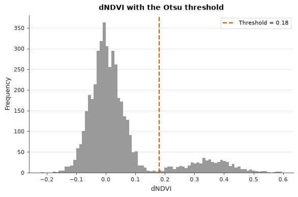

Regression accuracy
-------------------

:func:`rsgispy.regression.regmetrics.plot_pred_vs_obs`, for one target and
for two targets (one panel each):

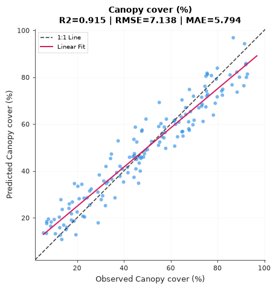

.. image:: images/gallery/plot_pred_vs_obs_multi.png
   :width: 100%

:func:`rsgispy.regression.regmetrics.plot_residuals`, for one and two
targets:

.. image:: images/gallery/plot_residuals.png
   :width: 70%

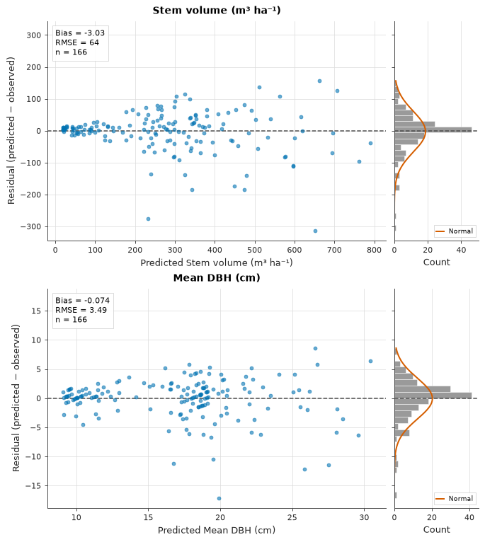

:func:`rsgispy.regression.regmetrics.plot_qq_residuals` (the same data
arguments) and :func:`rsgispy.tools.plotting.plot_qq` (any values; here
skewed values, which the Shapiro–Wilk test flags as not normal):

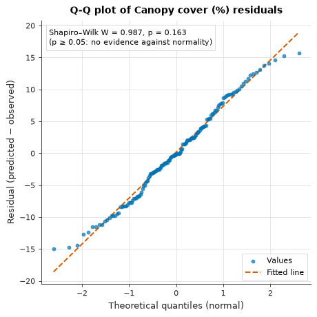

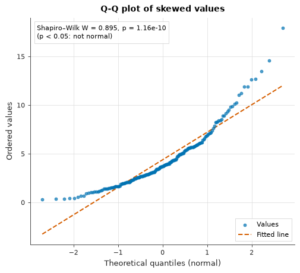

Classification and species distribution models
----------------------------------------------

:func:`rsgispy.modelling.species_distribution.plot_roc_curve`:

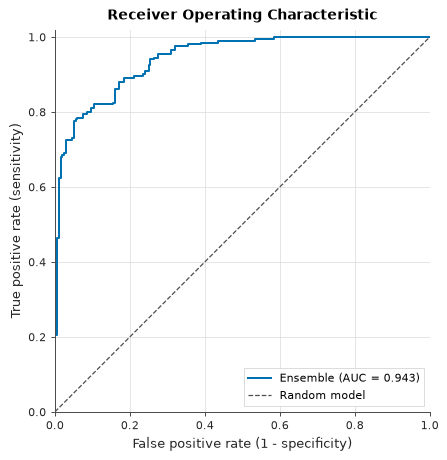

Feature diagnostics
-------------------

The plots written by the feature selection and importance functions (e.g.
``out_plt_file`` of ``correlation_matrix``, ``out_plot_file`` of
``calc_feature_importance``, the jackknife and BorutaShap plots of
:mod:`rsgispy.regression.regfeatures` and
:mod:`rsgispy.classification.classfeatures`):

.. image:: images/gallery/plot_correlation_heatmap.png
   :width: 65%

.. image:: images/gallery/plot_feature_importance_bars.png
   :width: 70%

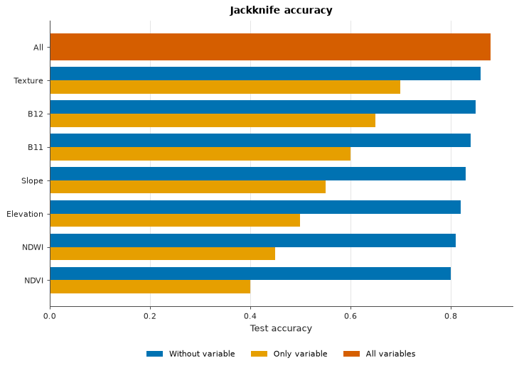

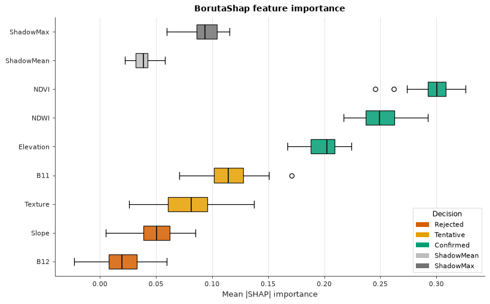

Spectra and spatial statistics
------------------------------

:func:`rsgispy.imagespectral.endmembers.plot_endmembers` and
:func:`rsgispy.tools.stats.plot_semivariogram`:

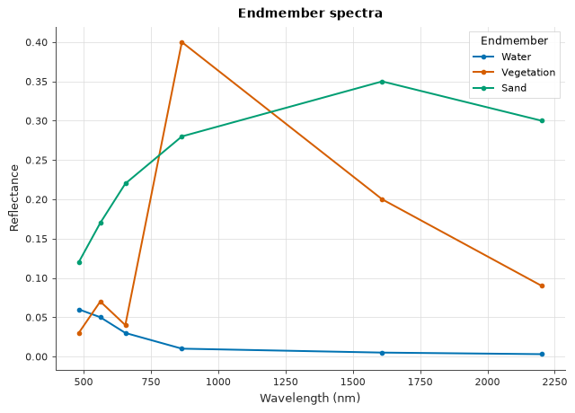

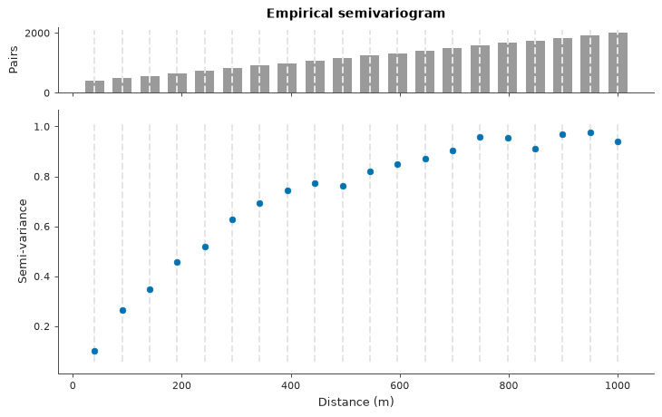

Maps
----

:func:`rsgispy.mapping.raster.create_raster_img_map`,
:func:`~rsgispy.mapping.raster.create_raster_cmap_img_map` (with
``show_colour_bar=True``) and
:func:`~rsgispy.mapping.raster.create_thematic_raster_map` (with its legend):

.. image:: images/gallery/create_raster_img_map.png
   :width: 60%

.. image:: images/gallery/create_raster_cmap_img_map.png
   :width: 60%

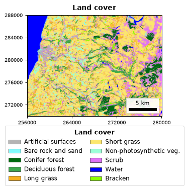

:func:`rsgispy.mapping.vector.create_vec_lyr_map` and
:func:`~rsgispy.mapping.vector.create_choropleth_vec_lyr_map`:

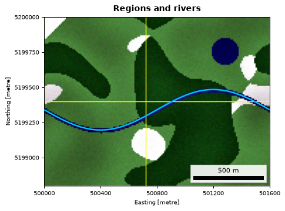

.. image:: images/gallery/create_choropleth_vec_lyr_map.png
   :width: 60%

The map elements of :mod:`rsgispy.mapping.elements` and
:mod:`rsgispy.mapping.legend` (scale bar, north arrow, a labelled bounding
box, a categorical legend and a panel label) share one box style:

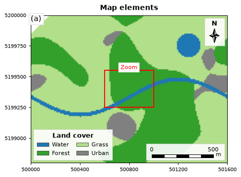

:func:`rsgispy.mapping.layout.create_map_panels` draws maps side by side over
one extent, with one legend for the thematic panels and one scale bar and
north arrow (here an image, a land cover map, and vector layers over the
image):

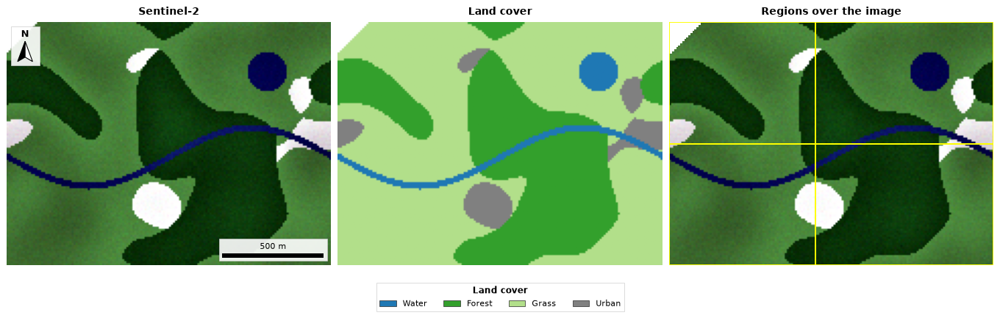
