Plot gallery
============

Every rsgispy plotting function draws in the same house style: readable font
sizes, light grid lines and no top or right spines on charts, colour-blind
safe colours (Okabe–Ito for categories, ``viridis`` for sequential data and a
diverging map centred on zero for differences), constrained layout so labels
and colour bars do not overlap, and one box style for the scale bar, north
arrow, legends and panel labels on maps. The style is applied inside each
function, so it never changes your own Matplotlib settings; use
:func:`rsgispy.tools.plotting.rsgispy_plot_style` to give your own plots the
same look. All the functions follow the :ref:`plotting_conventions`.

.. seealso::

   The rsgispy tutorials use these plots in notebooks you can run, e.g.
   :tutorial:`maps from EO data <02_making_maps/02_maps_from_eo_data.ipynb>`
   (section 2),
   :tutorial:`semivariograms <03_vector_data_and_zonal_stats/02_semivariograms.ipynb>`,
   :tutorial:`rule-based classification <04_image_classification/01_rule_based_classification.ipynb>`,
   :tutorial:`multivariate regression <05_regression/05_multivariate_regression.ipynb>`,
   :tutorial:`image-to-image change <06_change_detection/03_image_to_image_change.ipynb>`,
   :tutorial:`spectral analysis <07_spectral_analysis/01_spectral_analysis_intro.ipynb>` and
   :tutorial:`spectral unmixing <07_spectral_analysis/03_spectral_unmixing.ipynb>`.
   See :doc:`../tutorials` for how to get them and their data.

The images below were drawn by ``docs/examples/plot_gallery.py``. Where a
plot is about data, it shows real data from the rsgispy tutorials:

* the maps: the Aberystwyth area of the :doc:`making_maps` guide (the
  Sentinel-2 image
  :tutorial-data:`sen2_20180629_t30uvd_orb037_osgb_stdsref_20m.tif`, the land
  cover classified from it, its NDVI, the DEM :tutorial-data:`dem_10m_osgb.tif`
  and rivers derived from the DEM, and a 2 km grid);
* the histograms: the MNDWI of the same Sentinel-2 image, and the NDVI
  difference of two Landsat images of a mangrove coast
  (:tutorial-data:`chg_data/LS5TM_19970716_vmsk_mclds_topshad_rad_srefdem_stdsref_subset.tif`
  and
  :tutorial-data:`chg_data/LS8_20180608_vmsk_mclds_topshad_rad_srefdem_stdsref_subset.tif`);
* the spectra and the feature space: the HyMap image
  :tutorial-data:`hymap_injune_subset.tif` (with
  :tutorial-data:`hymap_wavelengths.json` and the endmember polygons
  :tutorial-data:`hymap_ppi_endmembers.geojson`);
* the semivariogram: elevations from the DEM;
* the regression plots and the correlation heatmap: the forest plots and
  their LiDAR metrics (:tutorial-data:`lidar/Forest_Plot_Metrics_LassoLars_Sel.csv`).

The other plots (the ROC curve, the feature importance, jackknife and
BorutaShap plots, and the Q-Q plot of skewed values) show synthetic values,
as real data would add nothing to them. The script
``docs/examples/plot_gallery_tutorial.py`` prepares the real data and draws
the gallery:

.. literalinclude:: ../examples/plot_gallery_tutorial.py
   :language: python
   :start-after: # [tutorial-data]
   :end-before: # [end-tutorial-data]
   :dedent: 4

Regenerate the images with the data folder of a clone of the rsgispy
tutorials (about a minute). From ``docs/examples``:

.. code-block:: bash

   python plot_gallery_tutorial.py --data-dir ~/rsgispy-tutorials/data \
       --out-dir ../guides/images/gallery

(the map images over 400 KB were then reduced to 256 colours). The test
suite draws the same gallery from synthetic data (``python plot_gallery.py
--out-dir plot_gallery``).

Histograms and thresholds
-------------------------

:func:`rsgispy.tools.plotting.plot_histogram_threshold` draws the
histogram of any values with a threshold, e.g. a change threshold
(:doc:`change_detection`). Here the NDVI difference (1997 − 2018) of two
Landsat images of a mangrove coast, with the threshold the image-to-image
change notebook uses for mangrove loss; most pixels changed little, and the
loss is the small tail above 0.35:

.. image:: images/gallery/plot_histogram_threshold.png
   :width: 70%

:func:`rsgispy.tools.plotting.plot_img_histogram` draws the histogram of an
image band in the same way, computed block by block (so for images of any
size), with any number of labelled thresholds. Here the MNDWI of the
Sentinel-2 image, with the water thresholds tried in the rule-based
classification notebook: the land is the large peak around −0.6, the sea
the values above 0.5, and the few pixels between are inland water and
mixed pixels:

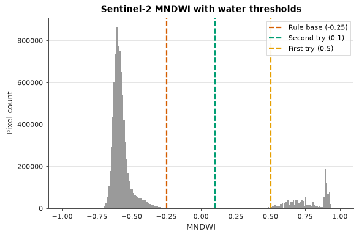

:func:`rsgispy.tools.plotting.plot_2d_img_histogram` draws the 2D histogram
(feature space) of two bands, here the NIR (band 42) against the red (band
13) reflectance of the HyMap image, with the endmembers (the mean spectra in
the PPI endmember polygons, :doc:`spectral_unmixing`) marked as points at the
edges of the feature space. The colour scale is logarithmic so sparse bins
at the edges show:

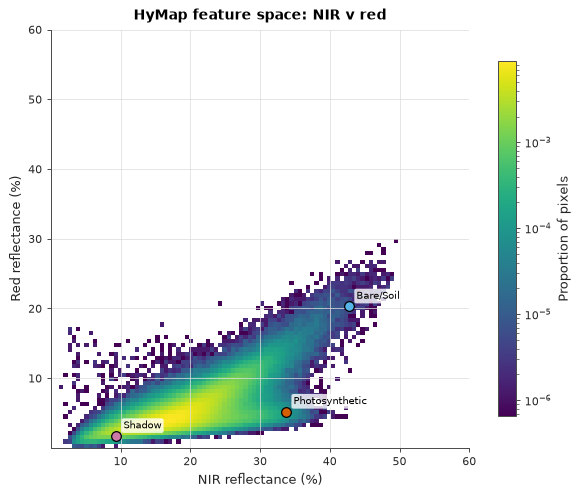

Regression accuracy
-------------------

:func:`rsgispy.regression.regmetrics.plot_pred_vs_obs`, for one target and
for two targets (one panel each). Here the stem volume and mean DBH of the
166 forest plots, predicted from LiDAR metrics by an Extra Trees regressor
(the parameters of the regression notebooks); each plot is predicted by a
model fitted without it (5-fold cross-validation):

.. image:: images/gallery/plot_pred_vs_obs.png
   :width: 60%

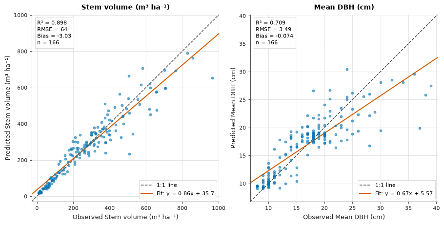

:func:`rsgispy.regression.regmetrics.plot_residuals`, for one and two
targets:

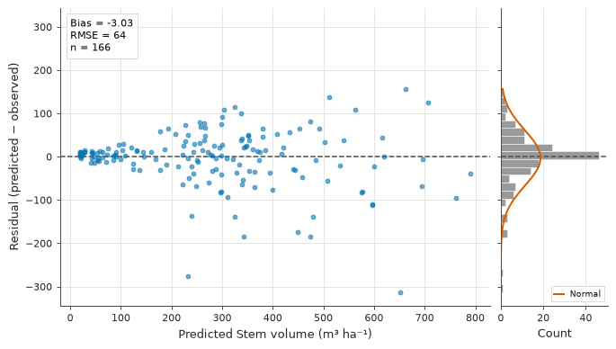

.. image:: images/gallery/plot_residuals_multi.png
   :width: 100%

:func:`rsgispy.regression.regmetrics.plot_qq_residuals` (the same data
arguments; the volume residuals are not normal, with a long tail of
under-predicted plots) and :func:`rsgispy.tools.plotting.plot_qq` (any
values; here synthetic skewed values, which the Shapiro–Wilk test also flags
as not normal):

.. image:: images/gallery/plot_qq_residuals.png
   :width: 55%

.. image:: images/gallery/plot_qq.png
   :width: 55%

Classification and species distribution models
----------------------------------------------

:func:`rsgispy.modelling.species_distribution.plot_roc_curve` (synthetic
scores):

.. image:: images/gallery/plot_roc_curve.png
   :width: 55%

Feature diagnostics
-------------------

The plots written by the feature selection and importance functions (e.g.
``out_plt_file`` of ``correlation_matrix``, ``out_plot_file`` of
``calc_feature_importance``, the jackknife and BorutaShap plots of
:mod:`rsgispy.regression.regfeatures` and
:mod:`rsgispy.classification.classfeatures`). The correlation heatmap shows
the correlations between the LiDAR metrics of the forest plots; the other
three show synthetic values:

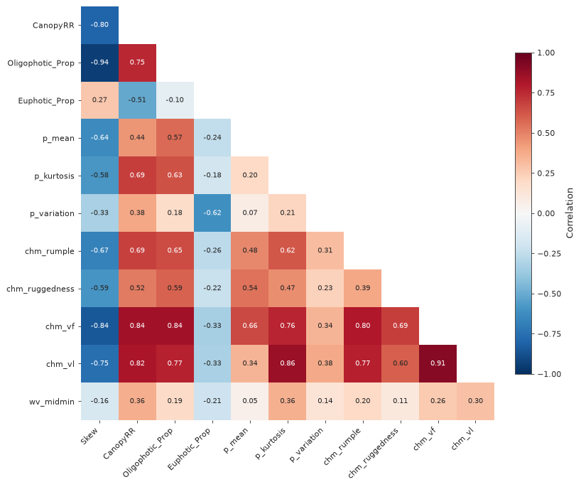

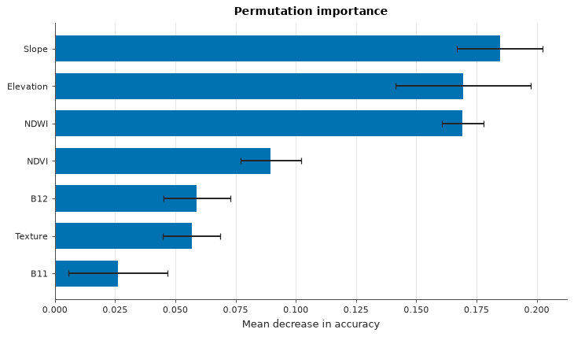

.. image:: images/gallery/plot_jackknife_bars.png
   :width: 70%

.. image:: images/gallery/plot_boruta_shap_boxplots.png
   :width: 75%

Spectra and spatial statistics
------------------------------

:func:`rsgispy.imagespectral.endmembers.plot_endmembers`, here the HyMap
endmembers (the mean spectra in the PPI endmember polygons, from
:func:`~rsgispy.imagespectral.endmembers.extract_avg_endmembers`):

.. image:: images/gallery/plot_endmembers.png
   :width: 70%

:func:`rsgispy.imagespectral.spectra.plot_spectra` (any spectra; here three
HyMap pixels of vegetation, bare soil and shadow; the gaps at about 1400 and
1900 nm are the water absorption bands, where the image has no bands) and
:func:`rsgispy.imagespectral.spectra.plot_continuum_removal` (the result of
:func:`~rsgispy.imagespectral.spectra.calc_continuum_removal`; here the
chlorophyll absorption, 530–760 nm, of the vegetation pixel):

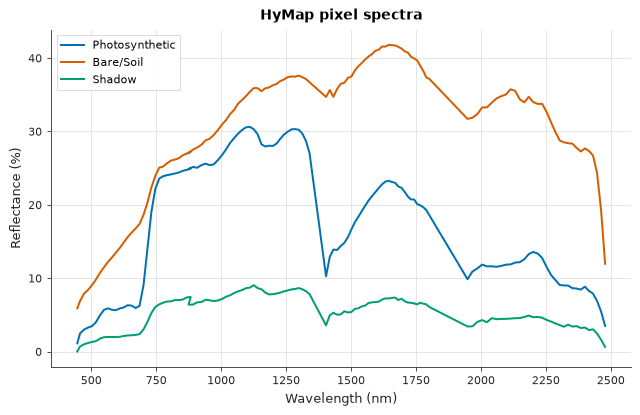

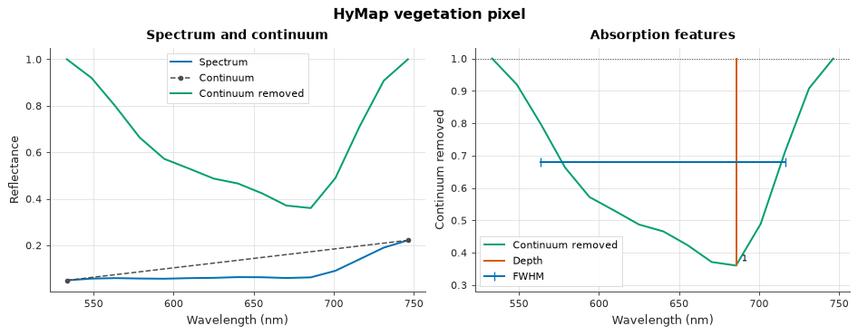

:func:`rsgispy.tools.stats.plot_semivariogram`, here the semivariogram
(:func:`~rsgispy.tools.stats.calc_semivariogram`) of the elevation of 2000
random points within 10 km of the Aberystwyth area: the semivariance keeps
rising up to the largest lag, as the land rises inland:

.. image:: images/gallery/plot_semivariogram.png
   :width: 75%

Maps
----

The maps show the Aberystwyth area of the :doc:`making_maps` guide and
contain modified Copernicus Sentinel data (2018).
:func:`rsgispy.mapping.raster.create_raster_img_map`,
:func:`~rsgispy.mapping.raster.create_raster_cmap_img_map` (with
``show_colour_bar=True``; here the NDVI) and
:func:`~rsgispy.mapping.raster.create_thematic_raster_map` (with its legend):

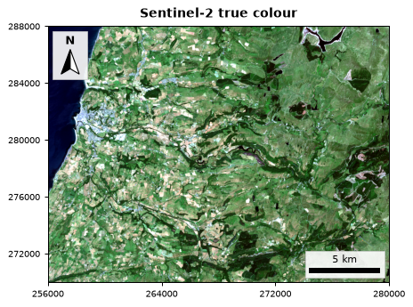

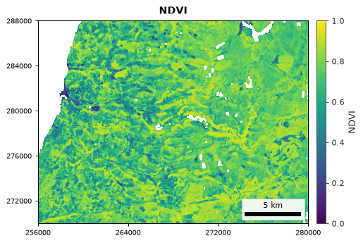

.. image:: images/gallery/create_thematic_raster_map.png
   :width: 60%

:func:`rsgispy.mapping.raster.create_shaded_cmap_img_map` (a colour-mapped
raster shaded by a hillshade, here the elevation itself) and
:func:`~rsgispy.mapping.raster.add_hillshade` (a hillshade over any map, here
the land cover); both make the hillshade in memory from a DEM:

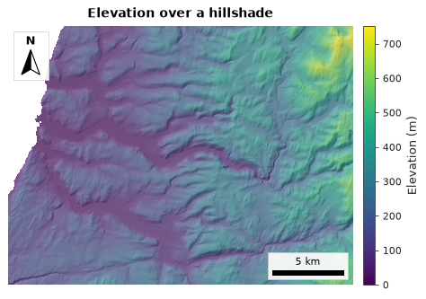

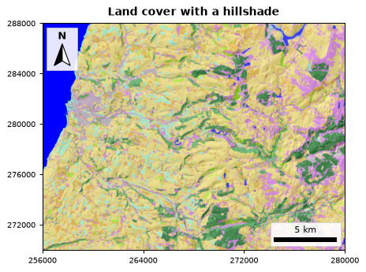

:func:`rsgispy.mapping.vector.create_vec_lyr_map` (a 2 km grid and the
rivers over the image) and
:func:`~rsgispy.mapping.vector.create_choropleth_vec_lyr_map` (the percentage
of forest in each square):

.. image:: images/gallery/create_vec_lyr_map.png
   :width: 60%

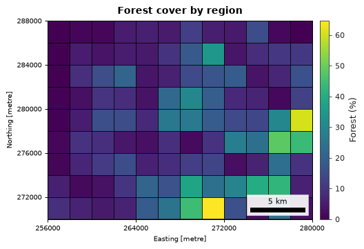

The map elements of :mod:`rsgispy.mapping.elements` and
:mod:`rsgispy.mapping.legend` (scale bar, north arrow, a labelled bounding
box, a categorical legend and a panel label) share one box style:

.. image:: images/gallery/map_elements.png
   :width: 60%

:func:`rsgispy.mapping.layout.create_map_panels` draws maps side by side over
one extent, with one legend for the thematic panels and one scale bar and
north arrow (here the image, the land cover, and the rivers over the
image):

.. image:: images/gallery/create_map_panels.png
   :width: 100%
