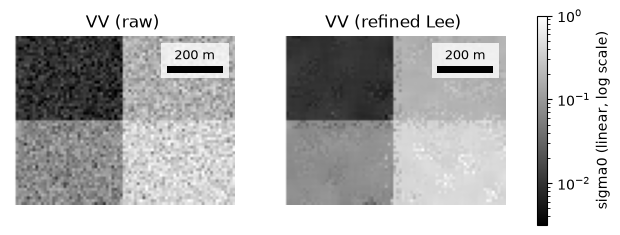

SAR backscatter processing
==========================

Synthetic aperture radar (SAR) sensors such as Sentinel-1 (C-band), ALOS
PALSAR (L-band) and NISAR see through cloud and work day and night, so SAR
backscatter is a valuable input for mapping water, forest, crops and
built-up areas, alone or together with optical data. SAR images need some
specific processing before they can be analysed:

* **Speckle.** Every SAR image has a grainy "salt and pepper" pattern called
  speckle, caused by interference between the many scatterers inside each
  resolution cell. It is not noise that can be removed exactly: it is
  multiplicative (brighter areas have stronger speckle) and makes single
  pixels unreliable. Speckle filters reduce it by averaging over a window
  while trying to keep edges and point targets.
* **Units.** Backscatter is delivered either as linear power (intensity,
  e.g. sigma0 or gamma0 between about 0.001 and 1) or in decibels (dB,
  ``10 * log10(power)``, about -30 to +5 dB). Averaging, filtering and
  ratios must be done on linear power; dB values are better for display,
  for differences between dates and as classification features, because
  their distribution is closer to normal.
* **Polarisation.** Dual-polarisation sensors measure two channels (VV and
  VH for Sentinel-1, HH and HV for ALOS PALSAR). Their ratios and
  combinations (SAR indices) separate surface, volume and double-bounce
  scattering, and therefore water, vegetation and buildings.
* **Texture.** Spatial patterns of backscatter (e.g. the regular structure
  of plantations or urban blocks) add information that single pixels do not
  have.

This guide starts from **analysis ready backscatter**: radiometrically
calibrated, terrain corrected (preferably terrain flattened, gamma0) images
in a projected CRS, such as Sentinel-1 RTC products, or GRD scenes processed
with ESA SNAP, pyroSAR, ISCE or Google Earth Engine. rsgispy does not
calibrate or terrain correct SAR data. The guide then covers speckle
filtering, checking the filter, converting between dB and linear power, SAR
indices, texture and building a feature stack for classification.

.. contents:: Contents
   :local:
   :depth: 1

Installation
------------

Everything in this guide uses the core rsgispy dependencies. ``numba`` (the
``numba`` extra) makes the GLCM texture much faster:

.. code-block:: bash

   pip install "rsgispy[numba]"

Classifying the features (see :doc:`pixel_classification_workflow`) needs
the ``classification`` extra.

Overview
--------

.. code-block:: text

   Sentinel-1 VV/VH backscatter (linear power or dB)
            │
            ▼
   1. Linear power ───────────────► s1_linear.tif (if the input is in dB)
            │
            ▼
   2. Speckle filters ────────────► Lee, refined Lee, Frost, Gamma MAP
            │
            ▼
   3. Check: ENL and mean in homogeneous areas ─► choose a filter
            │
            ├─► 4. dB conversion (band_maths) ─► VV_dB, VH_dB
            │            │
            │            └─► 6. GLCM texture ─► contrast, homogeneity, entropy
            ├─► 5. SAR indices ─► RVI, cross-pol ratio, DpRVIc, NDPI
            └─► 7. (alternative) filter + dB in one pass
                         │
                         ▼
   8. Feature stack (VRT) + class statistics ─► classification (guide A)
   9. Figure: raw vs filtered

The code in this guide comes from the example script
``docs/examples/sar_processing.py``, which the rsgispy test suite runs on a
small synthetic Sentinel-1 scene (simulated speckle with 4.4 looks, four
land cover classes). The inputs are:

* a dual-polarisation image (band 1 = VV, band 2 = VH) of sigma0 or gamma0
  in linear power with no data value 0, or in dB with no data value -9999;
* training polygons for the land cover classes (``cls_id`` and ``cls_name``
  columns), as in the :doc:`pixel_classification_workflow` guide;
* a few polygons over large, homogeneous areas (calm open water, a large
  uniform field; ``area_id`` column), used to measure how much each filter
  reduces the speckle.

Step 1 — dB or linear power?
----------------------------

Check the units of your data first: values that are mostly negative (about
-30 to +5) are dB; positive values mostly below 1 are linear power. The
product documentation will also say. Speckle filters, the SAR indices and
any averaging (resampling, zonal means, composites) assume linear power: the
mean of dB values is the log of the geometric mean, not of the mean power,
and it is biased low. So the example converts dB input to linear power first
with :func:`~rsgispy.imagecalc.maths.band_maths`:

.. literalinclude:: ../examples/sar_processing.py
   :language: python
   :start-after: # [step-1-linear]
   :end-before: # [end-step-1-linear]
   :dedent: 4

The expression ``10^(vv / 10)`` reverses ``10 * log10(vv)``. The ternary
(``condition ? a : b``) keeps no data pixels as no data: without it, the dB
no data value -9999 would become a tiny but valid power. One sub-expression
per band, separated by commas, writes a multi-band output in one pass.
:func:`~rsgispy.imageutils.stats.pop_img_stats` then sets the output no data
value (0) and computes statistics and pyramids.

If your data are amplitude rather than power (e.g. some older products),
square them first (``vv * vv``). If your file uses ``NaN`` as no data, use
``isnan``-safe conditions (e.g. ``vv > -1000``) or set a numeric no data
value first.

Step 2 — Speckle filters
------------------------

All the filters in :mod:`rsgispy.imagefilter.sar` estimate the local mean
and variance in a moving window and decide, pixel by pixel, how much to
smooth: in homogeneous areas (local variation close to what speckle alone
would give) they return the window mean; at edges and bright point targets
(much more variation) they keep values close to the original pixel.

* :func:`~rsgispy.imagefilter.sar.apply_lee_filter` — the classic Lee (1980)
  minimum mean square error filter; a good, fast default.
* :func:`~rsgispy.imagefilter.sar.apply_refined_lee_filter` — Lee et al.
  (1999): uses eight directional half-windows and smooths only on the side
  of an edge that contains the pixel, so edges (field boundaries,
  shorelines) stay sharp. Usually the best choice for mapping.
* :func:`~rsgispy.imagefilter.sar.apply_frost_filter` — Frost et al.
  (1982): an exponentially weighted average whose weights fall off faster
  in heterogeneous areas (``damping`` controls how fast).
* :func:`~rsgispy.imagefilter.sar.apply_gamma_map_filter` — Lopes et al.
  (1993): a maximum a posteriori estimate assuming gamma-distributed
  backscatter; strong smoothing in homogeneous areas while keeping strong
  targets.
* :func:`~rsgispy.imagefilter.sar.apply_enhanced_lee_filter`,
  :func:`~rsgispy.imagefilter.sar.apply_enhanced_frost_filter` and
  :func:`~rsgispy.imagefilter.sar.apply_kuan_filter` are also available and
  are used in the same way.

Every band is filtered separately and the output is ``float32`` linear
power with the input's band names and no data value.

.. literalinclude:: ../examples/sar_processing.py
   :language: python
   :start-after: # [step-2-speckle]
   :end-before: # [end-step-2-speckle]
   :dedent: 4

**Choosing the window size** (``filter_size``, odd, in pixels):

* larger windows remove more speckle but blur edges and remove small
  features, so match the window to the smallest objects you need to map: a
  7 x 7 window on 10 m pixels covers 70 x 70 m;
* 5 x 5 to 7 x 7 are typical for 10–20 m Sentinel-1 GRD data (the refined
  Lee filter defaults to 7 x 7, the window of the original method, because
  its directional half-windows need enough pixels);
* 3 x 3 removes little speckle and is mainly useful for already
  multi-looked, coarse data;
* windows of 9 x 9 and more suit large homogeneous targets (lakes, large
  fields, forests) or when the result is aggregated afterwards.

**n_looks** is the equivalent number of looks (ENL) of the input image, i.e.
how much speckle it already has: the filters use it to tell speckle from real
variation. Use the value in the product documentation (about 4.4 for
Sentinel-1 IW GRD high-resolution products) or measure it in a homogeneous
area as in step 3. Too small a value smooths edges and texture away; too
large a value leaves speckle.

Filter **before** converting to dB and before calculating indices or
texture. If your images are a time series, consider averaging several dates
(in linear power) instead of, or as well as, spatial filtering: this reduces
speckle without any loss of spatial detail.

Step 3 — Checking the filter
----------------------------

Two numbers in homogeneous areas tell how well a filter worked:

* **ENL** = ``mean² / variance`` of linear power. For unfiltered data it
  equals the number of looks; a filter increases it (more smoothing = higher
  ENL).
* **The mean** must not change: speckle filters should preserve the
  average backscatter (radiometric preservation).

The example rasterises the homogeneous area polygons onto the image grid
with :func:`~rsgispy.imageutils.rasterise.rasterise_vec_lyr` and computes the
mean and standard deviation of VV in each area, for the raw image and each
filter, with :func:`~rsgispy.zonalstats.labels.calc_label_zonal_stats` (the
input is described by a :class:`~rsgispy.ml.stack.BandSpec`).

.. literalinclude:: ../examples/sar_processing.py
   :language: python
   :start-after: # [step-3-check]
   :end-before: # [end-step-3-check]
   :dedent: 4

For the synthetic test scene (4.4 looks, 7 x 7 windows) this prints:

.. code-block:: text

        filter  area_id   mean      enl
           raw        1 0.0101   4.4960
           raw        2 0.0790   4.8668
           lee        1 0.0099 203.4247
           lee        2 0.0791 131.3104
   refined_lee        1 0.0099  97.9716
   refined_lee        2 0.0784  74.9837
         frost        1 0.0100 347.7117
         frost        2 0.0791 139.5306
     gamma_map        1 0.0098 195.1239
     gamma_map        2 0.0785 123.7117

The raw ENL is close to the simulated 4.4 looks, every filter increases it
many times and the means change by no more than about 3 %. ENL alone is not
the whole story, though: the filter with the highest ENL smooths the most,
which also blurs edges and small features. The refined Lee filter has a lower
ENL here because it uses only part of the window, but it keeps the class
boundaries and the bright point targets sharp. Always also look at the
filtered images near edges, narrow features (roads, rivers, hedges) and
bright targets (see the figure in step 9) and choose the filter that keeps
the features you need. The example continues with the refined Lee result.

Step 4 — Converting to dB
-------------------------

Convert the filtered linear power to dB for the classification features,
for display and for change detection (a difference in dB is a ratio of
powers):

.. literalinclude:: ../examples/sar_processing.py
   :language: python
   :start-after: # [step-4-db]
   :end-before: # [end-step-4-db]
   :dedent: 4

``log10`` of zero or a negative value is undefined, so the ternary writes
-9999 for those pixels (which includes the no data value 0), and
:func:`~rsgispy.imageutils.stats.pop_img_stats` records -9999 as the no data
value. The output has two bands, ``VV_dB`` and ``VH_dB``; for Sentinel-1,
typical values are about -25 dB or lower for calm water, -15 to -5 dB for
vegetation, and above -5 dB for built-up areas (VH is usually 5–10 dB lower
than VV).

The reverse conversion is ``10^(vv_db / 10)`` (step 1). Other useful
expressions are ``10 * log10(vh / vv)`` for the cross-polarisation ratio in
dB, and ``(vv_t2 > 0) && (vv_t1 > 0) ? 10 * log10(vv_t2 / vv_t1) : -9999``
for the change between two dates.

Step 5 — SAR indices
--------------------

:func:`~rsgispy.imagecalc.calcindices.calc_sar_indices` calculates many
polarimetric indices in one pass and writes one band per index, named after
the index. Give the polarisation of each band (``band_names``) and the units
of the input (``in_units='power'`` or ``'dB'``): the function converts to the
units each index needs, so you never compute a ratio of dB values by
mistake. :func:`~rsgispy.imagecalc.calcindices.get_available_sar_indices`
lists the indices, and :func:`~rsgispy.imagecalc.calcindices.get_sar_index_equation`,
:func:`~rsgispy.imagecalc.calcindices.get_sar_index_req_bands` and
:func:`~rsgispy.imagecalc.calcindices.get_sar_index_units` describe them.

.. literalinclude:: ../examples/sar_processing.py
   :language: python
   :start-after: # [step-5-indices]
   :end-before: # [end-step-5-indices]
   :dedent: 4

The equations printed are:

.. code-block:: text

   RVI_VV_VH = (4 * vh) / (vv + vh)
   CR_VH_VV_dB = vh_dB - vv_dB
   DpRVIc_VV_VH = (q * (q + 3)) / (q + 1)^2, q = vh / vv
   NDPI_VV_VH = (vv - vh) / (vv + vh)

* **RVI** (radar vegetation index, dual-pol form) increases with the share
  of cross-polarised (volume) scattering, so it is higher for dense
  vegetation canopies.
* **CR_VH_VV_dB** (the cross-polarisation ratio in dB) is also higher for
  vegetation; it is one of the most used Sentinel-1 features for crops and
  forest.
* **DpRVIc** is another dual-pol vegetation index based on the VH/VV ratio,
  ranging from 0 to 1.
* **NDPI** (normalised difference polarisation index) is higher where
  co-polarised (surface) scattering dominates and lower for vegetation.

In the synthetic scene the VH/VV ratio is similar for all classes except
forest, so these indices separate forest from the rest; on real data they
vary more between land cover types and with crop growth.

For HH/HV data (e.g. ALOS PALSAR) use the ``_HH_HV`` versions (for example
``RFDI``, the radar forest degradation index). Indices need the filtered
image: on raw data, the speckle in each channel makes the ratios very noisy.
Use ``out_gain``/``out_offset`` and an integer ``datatype`` to store the
indices as scaled integers if file size matters.

Step 6 — Texture
----------------

:func:`~rsgispy.imagefilter.texture.apply_glcm_filter` calculates grey-level
co-occurrence matrix (GLCM) texture measures in a moving window for every
band. The values in the window are first quantised to ``n_levels`` grey
levels; the GLCM counts how often pairs of grey levels occur next to each
other (at the given ``distances`` and ``angles``), and each property
summarises it: contrast (local variation), homogeneity (closeness to the
diagonal, i.e. smoothness), entropy (randomness) and others (see
:mod:`rsgispy.imagefilter.texture` for the full list).

.. literalinclude:: ../examples/sar_processing.py
   :language: python
   :start-after: # [step-6-texture]
   :end-before: # [end-step-6-texture]
   :dedent: 4

How to choose the parameters:

* **Input**: the speckle-filtered dB image. On raw data the texture mostly
  measures speckle; on linear power a few bright pixels dominate the grey
  levels.
* **filter_size**: larger than the speckle filter window and large enough to
  contain the pattern you want to describe; 7 x 7 to 11 x 11 at 10 m is
  common. Larger windows are smoother but blur boundaries between classes.
* **n_levels**: 16–64; 32 is a good default. More levels need larger windows
  to fill the matrix.
* **min_val / max_val**: set a fixed dB range (here -30 to +5 dB) so that a
  grey level means the same backscatter in every scene and every date.
  Otherwise the range is taken from each image's own minimum and maximum, and
  the texture values are not comparable between images.
* **properties**: a few properties are usually enough; many are strongly
  correlated (e.g. homogeneity and contrast).

The output has ``bands x properties`` bands named
``<band>_glcm_<property>`` (here ``VV_dB_glcm_contrast``,
``VV_dB_glcm_homogeneity``, …, ``VH_dB_glcm_entropy``), with the angles
averaged (``average_angles=True``) so the texture does not depend on the
orientation. GLCM texture is the slowest step in this guide: install
``numba`` for large images.

Step 7 — Filtering and converting in one pass
---------------------------------------------

The speckle filter and the dB conversion can also be fused into a single
pass with :func:`~rsgispy.imagefilter.chained.apply_filter_chain`, which
avoids writing the intermediate linear image (useful for large images; see
:doc:`large_rasters`). The ``'lee'`` step is the Lee filter; a
``'band_math'`` step then converts its result (``x``) to dB:

.. literalinclude:: ../examples/sar_processing.py
   :language: python
   :start-after: # [step-7-chain]
   :end-before: # [end-step-7-chain]
   :dedent: 4

Only the Lee filter is available as a chain step at present. Note that the
output keeps the input's no data value (0), and pixels that are no data in
the input stay 0, which is a valid dB value; if that matters for your
analysis, use separate steps as in steps 2 and 4.

Step 8 — A feature stack for classification
-------------------------------------------

The dB backscatter, the indices and the texture together make the SAR
feature set. :func:`~rsgispy.imageutils.vrt.create_stack_images_vrt` stacks
them into one multi-band virtual raster without copying the data, with the
band names collected with :func:`~rsgispy.imageutils.metadata.get_band_names`.
Before training a classifier, check that the features separate your
classes: rasterise the training polygons and compute the mean and standard
deviation of every feature in each class:

.. literalinclude:: ../examples/sar_processing.py
   :language: python
   :start-after: # [step-8-features]
   :end-before: # [end-step-8-features]
   :dedent: 4

For the synthetic scene, part of the printed table is (classes 1–4 are
Water, Forest, Grass and Urban):

.. code-block:: text

                                     0        1        2        3
   cls_id                           1.000    2.000    3.000    4.000
   pxl_count                      540.000  600.000  540.000  600.000
   VV_dB_mean                     -20.078   -7.490  -11.020   -3.777
   VV_dB_stddev                     0.477    0.575    0.530    0.842
   VH_dB_mean                     -26.963  -13.135  -17.976  -10.961
   VH_dB_stddev                     0.379    0.482    0.552    0.873
   RVI_VV_VH_mean                   0.684    0.863    0.678    0.651
   CR_VH_VV_dB_mean                -6.885   -5.645   -6.955   -7.184
   VV_dB_glcm_contrast_mean         0.467    0.508    0.444    1.173
   ...

Features whose class means differ by several standard deviations (here the
dB backscatter) separate those classes well; features with overlapping
values (here RVI for Water, Grass and Urban) help only for some classes, and
the Urban texture contrast stands out because of the bright point targets.
The :doc:`pixel_classification_workflow` guide shows how to explore
separability properly (box plots, correlation, feature selection) and how to
train and apply a classifier: use the feature VRT as an image in the
configuration, e.g.
``ImageBandInfo(feat_vrt, name="s1", bands=list(range(1, 13)), band_names=feat_names)``
(:class:`~rsgispy.imageutils.masking.ImageBandInfo`, also importable from
:mod:`rsgispy.classification.classdata`). SAR features
work well combined with optical features: put both on the same grid with
:func:`~rsgispy.imageutils.warp.resample_img_to_match` and stack them. The
same features can also be summarised per segment for object-based
classification (:doc:`segment_ml_workflow`).

Step 9 — Figure
---------------

A side-by-side map of the raw and filtered backscatter is the quickest visual
check of a filter. :func:`~rsgispy.mapping.raster.create_raster_cmap_img_map`
with a logarithmic colour scale shows linear power as it would look in dB:

.. literalinclude:: ../examples/sar_processing.py
   :language: python
   :start-after: # [step-9-figure]
   :end-before: # [end-step-9-figure]
   :dedent: 8

   Raw (left) and refined Lee filtered (right) VV backscatter of the
   synthetic test scene: water (top left), forest (top right), grass (bottom
   left) and urban with bright point targets (bottom right). The filter
   removes most of the speckle while keeping the class boundaries and the
   point targets.

The figure was made from the synthetic test scene with the example's command
line (``--figure docs/guides/images/sar_speckle_filter.png``).

Performance and large datasets
------------------------------

* **Block size and memory.** The speckle filters and GLCM texture are
  moving-window operations: their memory grows with the square of the block
  size and of the window size. With 7 x 7 windows, 512 pixel blocks need a
  few hundred MiB per process; set a smaller block size with
  :func:`rsgispy.imageprocess.set_default_block_size` (e.g. 256) when
  running large windows or several processes at once. See
  :doc:`large_rasters` for measurements.
* **numba** speeds up the GLCM texture and other window statistics; the first
  call compiles the code and takes a few seconds.
* **Avoid intermediate files** with a filter chain (step 7) and VRT feature
  stacks (step 8).
* **Many scenes**: process each scene (or each tile) as a separate job, e.g.
  with ``pb_process_tools``, and write tiled, compressed GeoTIFFs
  (:mod:`rsgispy.imageutils.envopts`) or COGs for the final products.
* **Data types**: keep the backscatter as ``float32``; to save space, dB
  values can be stored as ``int16`` scaled by 100 (``out_gain`` /
  :func:`~rsgispy.imagecalc.maths.band_maths` with ``datatype``).

Common problems
---------------

* **Filtering or averaging dB values** — speckle filters, resampling and
  zonal means must use linear power; convert dB to power first (step 1).
* **Ratios of dB values** — a ratio in linear power is a *difference* in dB;
  ``calc_sar_indices`` handles this if ``in_units`` is set correctly.
* **No data becomes data** — the dB no data value (e.g. -9999) converted to
  power gives a tiny valid value, and ``log10(0)`` gives ``-inf``; always use
  a ternary expression and set the output no data value. Check the no data
  value of the input (0, -9999 or ``NaN`` are all common) before starting.
* **Swath edges** — Sentinel-1 GRD scenes can have low-value "border noise"
  strips along the swath edges; mask them as no data before filtering, or
  they bleed into the window statistics.
* **Geographic CRS** — images exported in latitude/longitude (e.g. from
  Google Earth Engine) have non-square pixels in metres, so square windows
  are not square on the ground and texture depends on direction; reproject
  to a projected CRS first with
  :func:`~rsgispy.imageutils.warp.reproject_image`.
* **Different GLCM results between scenes** — set ``min_val`` and
  ``max_val`` to a fixed dB range.
* **Incidence angle effects** — backscatter decreases with incidence angle
  across the swath; terrain-flattened gamma0 reduces this. Compare dates from
  the same relative orbit, or normalise the backscatter, before change
  detection.
* **KEA outputs** — ``gdalformat="KEA"`` works with ``calc_stats=True``, but
  GDAL's KEA driver cannot replace a no data value once a file has one, so
  calling :func:`~rsgispy.imageutils.stats.pop_img_stats` or
  :func:`~rsgispy.imageutils.metadata.set_img_no_data_value` with a
  *different* value on an existing KEA file raises an error. Pass the no data
  value you want (``no_data_val``) when the file is written.

Related guides
--------------

* :doc:`pixel_classification_workflow`
* :doc:`large_rasters`
