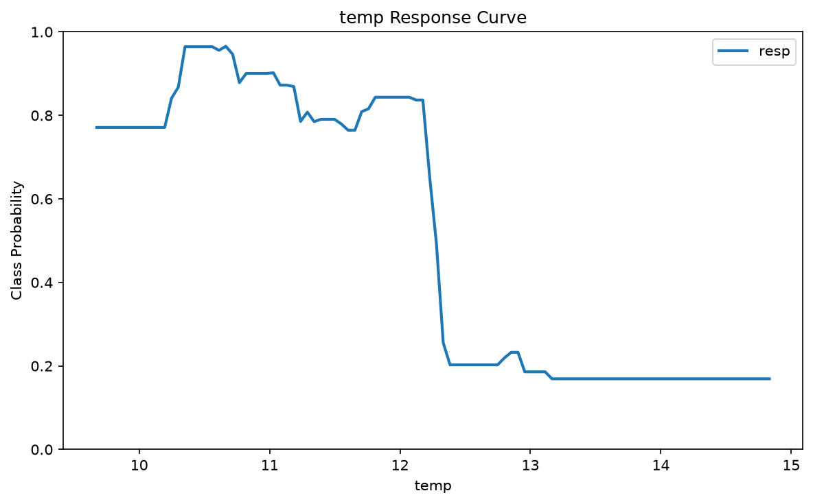

Species distribution modelling
==============================

A species distribution model (SDM) relates where a species has been recorded
to the environmental conditions at those places, and then uses that
relationship to predict how suitable every other place in a study area is.
The result is a map of relative habitat suitability, often turned into a
presence/absence map with a threshold. SDMs are used to find unsurveyed
populations, to plan surveys and protected areas, to assess invasion risk and
to project ranges under future climates.

This guide walks through a complete SDM workflow with
:mod:`rsgispy.modelling.species_distribution`: preparing the environmental
layers, generating pseudo-absences, extracting and checking the training
data, fitting an ensemble of scikit-learn models, evaluating them honestly
(including with spatial cross-validation), interpreting them and predicting a
suitability map.

Most species records are **presence-only** (herbarium and museum records,
citizen science and GBIF downloads): we know where the species was seen, but
not where it was looked for and not found. The workflow here therefore
contrasts the presences with *pseudo-absences* (also called background
points) sampled from the study area. Keep in mind what that means for the
output: the model learns how presence locations differ from the study area as
a whole, so the predicted value is a *relative* suitability index between 0
and 1, not the probability that the species occurs in a pixel. If you have
real absences from systematic surveys, use them instead of pseudo-absences
(see step 3).

.. contents:: Contents
   :local:
   :depth: 1

Installation
------------

The workflow needs the ``modelling`` extra, which installs ``scikit-learn``,
``scipy``, ``SALib`` and ``shap``:

.. code-block:: bash

   pip install "rsgispy[modelling]"

``SALib`` (Sobol sensitivity analysis) and ``shap`` (SHAP explanations) are
only used in step 9; the example script skips those parts if the packages are
not installed.

Overview
--------

.. code-block:: text

   Presence points + environmental rasters (one grid) + study area mask
            │
            ▼
   1. Environmental variables ──► EnvVarInfo per layer; valid_mask.tif
            │
            ▼
   2. Pseudo-absences ──────────► pseudo_absences.gpkg (random background)
            │
            ▼
   3. Extract & combine ────────► sdm_samples.gpkg: covariates + clsid (1/0)
            │
            ▼
   4. Explore & check collinearity (violin plots, correlation, VIF)
            │
            ▼
   5. Train / test split ───────► sdm_train.gpkg, sdm_test.gpkg
            │
            ▼
   6. Fit a model and an ensemble (random forest)
            │
            ├─► 7. Evaluate (AUC, Brier score, ROC curve)
            ├─► 8. Spatial cross-validation (random vs spatial blocks)
            ├─► 9. Interpret (response curves, jackknife, SHAP, Sobol)
            ▼
   10. Predict ─────────────────► sdm_probability.tif, sdm_agreement.tif
            │
            ▼
   11. Threshold ───────────────► sdm_presence_absence.tif (0/1/2)

The code in this guide comes from the example script
``docs/examples/species_distribution_modelling.py`` (included below step by
step), which is run by the rsgispy test suite on synthetic data. The scenario
is a plant species with presence records (for example a GBIF download, or your
own survey points) and four environmental layers at 100 m resolution in a
projected (metre) coordinate system:

* elevation from a DEM;
* mean annual temperature and annual precipitation (e.g. WorldClim or CHELSA
  layers, as two bands of one file);
* NDVI from a cloud-free Sentinel-2 or Landsat composite.

All layers, and the study area mask (``1`` inside the study area, ``0``
outside), must be on **the same pixel grid** (CRS, resolution and extent).
Resample them first if necessary, with
:func:`rsgispy.imageutils.warp.resample_img_to_match` (bilinear for
continuous layers, nearest neighbour for categorical ones).

Step 1 — Environmental variables
--------------------------------

Each environmental layer is described by an
:class:`~rsgispy.modelling.species_distribution.EnvVarInfo`: the column name
used in the sample tables and by the model (``name``), the raster file and
band, and the variable type. Continuous variables
(``rsgispy.VAR_TYPE_CONTINUOUS``) can be z-score normalised later;
categorical variables (``rsgispy.VAR_TYPE_CATEGORICAL``, e.g. a soil or land
cover class) are passed to the model unchanged as integer codes, which tree
models handle well. ``min_vld_val`` and ``max_vld_val`` optionally define a
valid range, so that values outside it (e.g. negative precipitation in a badly
interpolated climate layer) are treated as missing.

:func:`~rsgispy.modelling.species_distribution.create_finite_mask` then writes
a ``uint8`` mask that is ``1`` where the pixel is inside the study area **and**
every variable is finite, not the raster's no data value and inside its valid
range, and ``0`` elsewhere. This mask is used for the pseudo-absences and the
prediction, so neither ever lands on missing data.

.. literalinclude:: ../examples/species_distribution_modelling.py
   :language: python
   :start-after: # [step-1-env-vars]
   :end-before: # [end-step-1-env-vars]
   :dedent: 4

The **study area** matters more than any model setting. Pseudo-absences are
drawn from it, so a study area much larger than the region the species could
have reached (for example a whole continent for a species of one mountain
range) makes presences trivially easy to tell apart from the background:
AUC is high, but the model has only learnt "mountains versus lowlands" and
says little about habitat within the range. Restrict the study area to the
region accessible to the species (e.g. the ecoregions with records, or a
buffer of some tens of kilometres around them).

Step 2 — Pseudo-absences
------------------------

:func:`~rsgispy.modelling.species_distribution.gen_pseudo_absences_smpls`
draws random points inside the valid mask. It first creates
``n_smpls + xtra_n_smpls`` random candidate points over the mask's bounding
box, removes those outside the mask (value ``img_msk_val``) and, if presence
points are given, those within ``presence_smpls_dist_thres`` metres of any
presence, and keeps a random ``n_smpls`` of the rest. If many candidates are
rejected (a small study area inside a large bounding box, or a large exclusion
distance), increase ``xtra_n_smpls``; check the printed number of
pseudo-absences in step 3.

.. literalinclude:: ../examples/species_distribution_modelling.py
   :language: python
   :start-after: # [step-2-pseudo-absences]
   :end-before: # [end-step-2-pseudo-absences]
   :dedent: 4

Choosing the pseudo-absence strategy:

* **How many?** For models that estimate a smooth density over the
  background (MaxEnt-like methods, GLMs/GAMs), use many (around 10,000) so the
  background is well described. For classification trees and random forests,
  a large excess of pseudo-absences makes the model predict "absent" almost
  everywhere; use a similar number to the presences (``equalise_smpls=True``
  in :func:`~rsgispy.modelling.species_distribution.combine_presence_absence_data`),
  or keep more and balance the classes with ``class_weight='balanced'`` as in
  step 6. A good compromise is several replicate sets of pseudo-absences, each
  giving one model of an ensemble.
* **Exclusion distance** (``presence_smpls_dist_thres``). A buffer of one or
  two pixels around presences avoids pseudo-absences in the same pixel as a
  presence (contradictory training data). Large buffers (several kilometres)
  remove suitable habitat from the background, which makes the problem easier
  and inflates evaluation scores; use them only if you have a reason (e.g.
  dispersal limitation).
* **Sampling bias.** Records cluster along roads, near towns and in well-known
  sites. Random pseudo-absences then teach the model the survey effort as well
  as the habitat. Mitigations are thinning the presences (step 3) and, when
  records of related species collected with the same methods are available,
  using those locations as "target-group" background (load them as the
  absence layer in step 3 instead of the random points).

Step 3 — Extracting and combining the samples
---------------------------------------------

:func:`~rsgispy.modelling.species_distribution.extract_env_var_data` adds one
column per environmental variable to a point layer, reading the value of the
pixel under each point (all bands of one file are read in one pass). Points
outside the rasters, or on no data or out-of-range values, get
``out_no_data_val`` (default ``-9999``); those rows are dropped here. Points
in another CRS can be reprojected on the fly with ``reproj_vec=True``.

:func:`~rsgispy.modelling.species_distribution.combine_presence_absence_data`
then stacks the presences (``clsid = 1``) and pseudo-absences
(``clsid = 0``) into one layer with only the variable columns, the class
column and the geometry, and returns the ordered list of variable names
(``analysis_vars``) used by every later step. With ``out_vec_file=None`` it
returns ``(GeoDataFrame, analysis_vars)`` instead of writing a file. If you
have true absences from surveys, pass them as the absence layer instead of the
pseudo-absences.

.. literalinclude:: ../examples/species_distribution_modelling.py
   :language: python
   :start-after: # [step-3-extract]
   :end-before: # [end-step-3-extract]
   :dedent: 4

.. code-block:: text

   80 presences and 300 pseudo-absences
   ['elevation', 'temp', 'precip', 'ndvi']

**Thin the presences** before this step if records are clustered: several
records in one pixel are duplicates as far as the model is concerned, and a
dense cluster of records from one well-surveyed site makes that site dominate
the model. Keeping one record per pixel (or per few pixels) is a simple and
effective first step.

Step 4 — Exploring the data and checking collinearity
-----------------------------------------------------

Before modelling, look at how the presences differ from the background, and
check for strongly correlated variables:

* :func:`~rsgispy.modelling.species_distribution.comparison_box_plots` writes
  one violin plot (or box plot with ``box_plots=True``) per variable,
  comparing the presences and pseudo-absences. Variables where the two
  distributions overlap completely are unlikely to help.
* :func:`~rsgispy.modelling.species_distribution.correlation_matrix` returns
  (and saves as CSV and a heatmap) the Pearson correlations between the
  variables.
* :func:`~rsgispy.modelling.species_distribution.calc_vif_multicollinearity`
  returns the variance inflation factor (VIF) of each variable: how well it
  is predicted by all the others together. VIF catches collinearity between
  combinations of variables that pairwise correlations miss.

.. literalinclude:: ../examples/species_distribution_modelling.py
   :language: python
   :start-after: # [step-4-explore]
   :end-before: # [end-step-4-explore]
   :dedent: 4

.. code-block:: text

              elevation  temp  precip  ndvi
   elevation       1.00 -0.97    0.20 -0.20
   temp           -0.97  1.00   -0.41  0.03
   precip          0.20 -0.41    1.00  0.60
   ndvi           -0.20  0.03    0.60  1.00
   elevation     90.0
   temp         100.8
   precip         5.9
   ndvi           2.0

Common rules of thumb are to keep only one of each pair with ``|r| > 0.7`` and
to remove variables until every VIF is below 10 (or 5 for a stricter check).
Here temperature is calculated from elevation (a lapse rate), so the two are
almost perfectly correlated. Collinear variables do not reduce the predictive
accuracy of a random forest much, but they split the importance between them,
make response curves hard to interpret, and make the model unreliable when it
is applied to places or times where the correlation is different (e.g. future
climates). When you choose which variable of a pair to keep, prefer the one
with the more direct ecological effect: here temperature, not elevation, so the
example is run with ``drop_vars=['elevation']``.

Step 5 — Training and test sets
-------------------------------

:func:`~rsgispy.modelling.species_distribution.create_train_test_sets` splits
the samples into training and test sets, separately for presences and
pseudo-absences so both sets have the same class proportions (here 70 % of
each class for training). The test set is used to evaluate the models in
steps 6, 7 and 11.

.. literalinclude:: ../examples/species_distribution_modelling.py
   :language: python
   :start-after: # [step-5-split]
   :end-before: # [end-step-5-split]
   :dedent: 4

This is a *random* split: test points can be a few metres from training
points. Step 8 explains why that gives an optimistic estimate of accuracy, and
how to get a more honest one.

Step 6 — Fitting the models
---------------------------

Any scikit-learn classifier with ``predict_proba`` can be used. A random
forest is a robust default: it captures non-linear responses and interactions,
needs no normalisation and handles categorical codes. ``min_samples_leaf``
above 1 gives smoother, less over-fitted responses, and
``class_weight='balanced'`` compensates for unequal numbers of presences and
pseudo-absences.

* :func:`~rsgispy.modelling.species_distribution.fit_sklearn_mdl` fits one
  model on the training set and returns the training and test accuracy and
  the test ROC AUC (``roc_curve_plot`` also writes the model's ROC curve).
  With ``return_model=True`` the fitted model is also returned (as the first
  value) and the estimator you passed in is left unchanged.
* :func:`~rsgispy.modelling.species_distribution.fit_kfold_sklearn_mdls` fits
  ``n_kfolds`` models, each on a random ``fold_prop`` fraction of the
  training samples (drawn with replacement by default, like bagging), and
  prints the minimum, median and maximum ROC AUC and accuracies of the models
  on the test set. The ensemble is used for the prediction; the median of
  its members is more stable than any single model, and the spread between
  them shows how sensitive the result is to the training data. (Despite the
  name, these are not cross-validation folds: every model is evaluated on the
  same test set.)

.. literalinclude:: ../examples/species_distribution_modelling.py
   :language: python
   :start-after: # [step-6-model]
   :end-before: # [end-step-6-model]
   :dedent: 4

.. code-block:: text

   Single model: train acc 0.925, test acc 0.886, test AUC 0.945
   ROC: 0.912 - 0.929 - 0.933
   Train: 0.937 - 0.943 - 0.969
   Test: 0.868 - 0.886 - 0.904

To tune the hyperparameters, wrap the model in a scikit-learn search object and
use :func:`~rsgispy.modelling.species_distribution.search_mdl_params`, e.g.
``best_rf, params = sdm.search_mdl_params(GridSearchCV(rf, {"min_samples_leaf":
[1, 3, 10]}, scoring="roc_auc"), train_vec, "train", analysis_vars)``, then use
``best_rf`` in place of ``rf``. Other options:

* **Models that need scaled inputs** (logistic regression, SVMs, neural
  networks): compute the mean and standard deviation of each continuous
  variable from the training data with
  :func:`~rsgispy.modelling.species_distribution.pop_normalise_coeffs`
  (stored on the ``EnvVarInfo`` objects), normalise the sample tables with
  :func:`~rsgispy.modelling.species_distribution.apply_normalise_coeffs`, and
  pass ``normalise_data=True`` to the prediction functions in step 10 so the
  rasters are scaled in the same way.
* **Presence-only (one-class) models** such as ``IsolationForest`` or
  ``OneClassSVM`` are fitted to the presences alone with
  :func:`~rsgispy.modelling.species_distribution.fit_sklearn_sgl_cls_mdl` /
  :func:`~rsgispy.modelling.species_distribution.fit_kfold_sklearn_sgl_cls_mdls`
  and applied with the ``*_sgl_cls_*`` prediction functions. They need no
  pseudo-absences, but usually discriminate less well.

Step 7 — Evaluating the ensemble
--------------------------------

The ensemble prediction for a sample is the median of its members' presence
probabilities (the same rule used for the raster in step 10).
:func:`~rsgispy.modelling.species_distribution.get_positive_class_probs`
returns a model's presence probabilities: the ``predict_proba`` column of
class ``1``, whatever the order of the classes.
:func:`rsgispy.tools.accuracy.bin_accuracy_scores_prob` compares the ensemble
prediction with the test labels:

* **Test AUC** — the area under the ROC curve: the probability that a randomly
  chosen presence gets a higher score than a randomly chosen pseudo-absence.
  0.5 is no better than random, 1 is perfect. With pseudo-absences the
  maximum achievable AUC is below 1, because some pseudo-absences fall in
  suitable habitat.
* **Point-biserial r** — the correlation between the labels and the scores.
* **Average precision** — the area under the precision–recall curve; more
  informative than AUC when presences are rare.
* **Brier score** and **log-loss** — errors of the probabilities themselves
  (0 is perfect); lower is better.

.. literalinclude:: ../examples/species_distribution_modelling.py
   :language: python
   :start-after: # [step-7-evaluate]
   :end-before: # [end-step-7-evaluate]
   :dedent: 4

.. code-block:: text

   {'Test AUC': 0.936, 'Point-Biserial r': 0.726, 'Av. Precision': 0.750,
    'Brier Score': 0.084, 'Log-Loss Score': 0.276}

:func:`~rsgispy.modelling.species_distribution.calc_binary_roc_auc` returns
the ensemble's ROC curve and AUC, and
:func:`~rsgispy.modelling.species_distribution.plot_roc_curve` writes the
curve to ``plots/roc_curve.png``. It shows the trade-off between the true
positive rate (sensitivity) and the false positive rate (1 − specificity) over
all thresholds; a curve close to the top-left corner is good.

Step 8 — Spatial cross-validation
---------------------------------

**Why random cross-validation inflates AUC.** Environmental conditions are
spatially autocorrelated: points close to each other have similar values, and
presence records are usually clustered. With a random split, most test points
have a training point nearby with almost the same covariate values, so a
flexible model such as a random forest can score well by *remembering* the
training data rather than by learning a relationship that transfers to new
places. The test score then measures interpolation between nearby samples,
not prediction into unsampled areas, which is what the map is used for. The
result is optimistic AUCs and, when tuning, a preference for over-fitted
models.

Spatial cross-validation keeps nearby samples in the same fold.
:class:`rsgispy.ml.cv.SpatialBlockKFold` divides the study area into square
blocks of ``block_size`` metres and assigns whole blocks to folds; with
``stratify=True`` the blocks are assigned so that the folds have similar
numbers of presences (a fold can still have none if the presences are in few
blocks).
Its splits can be passed to any scikit-learn function that takes a ``cv``
argument. Here the same random forest is evaluated with 5-fold random and
5-fold spatial block cross-validation on all the samples:

.. literalinclude:: ../examples/species_distribution_modelling.py
   :language: python
   :start-after: # [step-8-spatial-cv]
   :end-before: # [end-step-8-spatial-cv]
   :dedent: 4

.. code-block:: text

   Random CV AUC  0.945 +/- 0.012
   Spatial CV AUC 0.941 +/- 0.047

The synthetic data have smooth covariates and scattered presences, so the gap
is small; with real, clustered records, spatial AUCs 0.05–0.2 lower than random
ones are common. The larger standard deviation of the spatial scores is
expected: blocks differ in how hard they are to predict. Report the spatial
cross-validation score as the accuracy of the model.

Choosing ``block_size``: blocks should be larger than the distance over which
the covariates (or the model residuals) are autocorrelated, which can be
estimated from an empirical semivariogram
(:func:`rsgispy.vector.stats.calc_empirical_semivariogram`), but small enough
that there are several blocks per fold. Blocks that are too large leave whole
environmental zones out of the training data and make the score pessimistic.
With ``block_size=None`` a size is chosen from the sample extent. Other
splitters in :mod:`rsgispy.ml.cv` are k-means clusters of the sample locations
(``method='kmeans'``), a buffer around each test point
(:class:`~rsgispy.ml.cv.SpatialBufferCV`), and
:func:`~rsgispy.ml.cv.nested_spatial_cv`, which tunes hyperparameters in an
inner spatial loop so the outer score is not biased by the tuning.

Step 9 — Interpreting the model
-------------------------------

A model that predicts well can still be ecologically implausible (e.g. by
relying on a sampling bias). Four complementary tools show what the model has
learnt:

* **Response curves** —
  :func:`~rsgispy.modelling.species_distribution.sklearn_mdl_variable_response_curves`
  varies one variable over its range (``n_samples`` steps) while holding the
  others at their mean value at the presences, and records the predicted
  probability. The returned table (also written as CSV) has ``<var>_vals`` and
  ``<var>_resp`` columns, and a plot per variable is written to the plots
  directory. Check that the shapes make sense (e.g. a temperature optimum,
  increasing response to precipitation). Responses beyond the range of the
  training data are extrapolation; random forests simply stay flat there.
* **Jackknife importance** —
  :func:`~rsgispy.modelling.species_distribution.sklearn_jackknife_var_importance`
  refits the model leaving each variable out (``*_leave_var_out`` columns)
  and with each variable alone (``*_only_var``), and reports training and
  test accuracy and test AUC for each. A variable with a high AUC on its own
  carries a lot of information; a variable whose removal lowers the AUC most
  carries information that no other variable has.
* **SHAP** —
  :func:`~rsgispy.modelling.species_distribution.shap_sklearn_mdl_explainer`
  (optional ``shap`` package) splits each prediction into contributions of the
  variables; the summary plot shows which variables matter most and in which
  direction, sample by sample.
* **Sobol sensitivity** —
  :func:`~rsgispy.modelling.species_distribution.salib_sklearn_mdl_sensitivity`
  (optional ``SALib`` package) samples the variables over their training
  ranges and decomposes the variance of the predicted probability. ``S1`` is a
  variable's effect on its own, ``ST`` its total effect including
  interactions; ``ST`` much larger than ``S1`` indicates strong interactions.
  The model is evaluated ``n_samples × (2 × n_vars + 2)`` times, and
  ``n_samples`` should be a power of 2. Wide ``ST_conf`` intervals mean
  ``n_samples`` is too small.

.. literalinclude:: ../examples/species_distribution_modelling.py
   :language: python
   :start-after: # [step-9-interpret]
   :end-before: # [end-step-9-interpret]
   :dedent: 4

.. code-block:: text

           roc_test_acc_leave_var_out  roc_test_acc_only_var
   temp                      0.924537               0.719907
   precip                    0.888889               0.857407
   ndvi                      0.941667               0.742130

   Temperature response curve of the random forest for the synthetic data:
   high suitability between about 10 and 12 °C, falling sharply above 12 °C
   (the simulated optimum is 11 °C). Random forest responses are step-like and
   flat outside the training range. (Regenerate it by running the example
   script; it is written to ``plots/response_curves/temp_response_curve.png``
   in the output directory.)

Here precipitation is the most informative variable alone, and removing it
lowers the AUC most (from 0.945 to 0.889). **When the methods disagree**, it is
usually because of correlated variables (jackknife "leave out" scores barely
change when a correlated partner can take over, while SHAP and Sobol may split
the effect between them) or interactions (which Sobol ``ST`` and SHAP capture
but one-at-a-time response curves do not). Use the jackknife for "what can I
remove?", response curves and SHAP for "how does the suitability change?", and
Sobol indices for "which variable drives the variation of the prediction
across the study area?".

Step 10 — Predicting the suitability map
----------------------------------------

:func:`~rsgispy.modelling.species_distribution.pred_ensemble_sklearn_mdls_prob`
applies every model of the ensemble to every valid pixel (``valid_mask.tif ==
1``) and writes the **median presence probability** as a ``float32`` raster
with values from 0 to 1 and no data value ``-1`` outside the mask. The rasters
are read block by block, so the size of the study area is limited only by
disk space and time.

:func:`~rsgispy.modelling.species_distribution.pred_ensemble_sklearn_mdls_cls`
writes the **proportion of models predicting presence** (each with its default
0.5 cut-off). It is a simple measure of agreement: values near 0 or 1 mean
the models agree; values near 0.5 mark areas where the prediction depends on
which training samples were used and should be treated with caution.

.. literalinclude:: ../examples/species_distribution_modelling.py
   :language: python
   :start-after: # [step-10-predict]
   :end-before: # [end-step-10-predict]
   :dedent: 4

The variable names passed as ``analysis_vars`` must be in the same order as
for training. Single models are applied with
:func:`~rsgispy.modelling.species_distribution.pred_sklearn_mdl_prob` and
:func:`~rsgispy.modelling.species_distribution.pred_sklearn_mdl_cls`. For
anything these functions do not cover (e.g. the mean instead of the median of
the ensemble, or a hand-written suitability index),
:func:`~rsgispy.modelling.species_distribution.predict_raster_from_env_vars`
applies your own function to the variable table of each block of valid pixels.
To display the map, use
:func:`rsgispy.mapping.raster.create_raster_cmap_img_map` with a sequential
colour map.

Step 11 — Thresholding to presence/absence
------------------------------------------

Many uses (area of suitable habitat, overlap with protected areas, survey
planning) need a binary map. The threshold should be chosen from the data, not
fixed at 0.5: with unequal numbers of presences and pseudo-absences, or
balanced class weights, 0.5 has no special meaning. Common choices are:

* **maximum TSS** — the threshold that maximises the true skill statistic
  (sensitivity + specificity − 1), equivalent to the point of the ROC curve
  furthest above the diagonal. TSS, unlike kappa, does not depend on
  prevalence. This is used in the example.
* **sensitivity = specificity** — balances omission and commission errors.
* **10th percentile training presence** — the probability exceeded by 90 % of
  the training presences (``numpy.percentile(train_probs, 10)``); a
  conservative choice that accepts 10 % omission, common with presence-only
  data.
* **minimum training presence** — the lowest probability at any presence;
  very inclusive, sensitive to outliers.

The example computes the maximum-TSS threshold from the ensemble predictions
of the test set (step 7) with
:func:`~rsgispy.modelling.species_distribution.calc_binary_threshold`
(``method="max_tss"``; ``method="sens_eq_spec"`` gives the sensitivity =
specificity threshold), reports the binary accuracy at that threshold with
:func:`rsgispy.tools.accuracy.accuracy_scores_binary` (the "Hanssen-Kuiper
skill" is the TSS), applies it to the probability raster with
:func:`rsgispy.imagecalc.maths.band_maths` and computes the proportion of the
study area predicted suitable with
:func:`rsgispy.imagecalc.maths.calc_prop_true_exp`. The output is a ``uint8``
thematic raster: ``0`` outside the study area, ``1`` unsuitable, ``2``
suitable, with statistics and a colour table added by
:func:`rsgispy.imageutils.stats.pop_thmt_img_stats`.

.. literalinclude:: ../examples/species_distribution_modelling.py
   :language: python
   :start-after: # [step-11-threshold]
   :end-before: # [end-step-11-threshold]
   :dedent: 4

.. code-block:: text

   Threshold 0.327: TSS 0.817
   26.4 % of the study area is predicted suitable

The threshold is chosen and evaluated on the same test set here, which flatters
the TSS slightly; for a strict assessment choose it on one set (e.g. the
out-of-fold predictions of spatial cross-validation) and report the accuracy on
another. Multiply ``suit_prop`` by the valid area (number of pixels with
``valid_mask.tif == 1`` × pixel area) to get the suitable area in m².

Performance and large datasets
------------------------------

* **Prediction** — the cost is roughly (number of models) × (number of valid
  pixels) × (cost of one prediction). Rasters are processed in blocks
  (``block_size`` argument of the prediction functions), so memory is bounded;
  use ``n_jobs=-1`` in the random forest to use all cores, fewer trees
  (200–500 is usually enough) and fewer ensemble members (5–10) for large
  areas. Test the workflow on a coarser grid or a small subset first.
* **Covariate layers** — every ``EnvVarInfo`` can point to a different file;
  they are read together, so they must be on the same grid. A VRT stack
  (:func:`rsgispy.imageutils.vrt.create_stack_images_vrt`) avoids copying the
  data when bands are spread over many files. Store large layers as tiled,
  compressed GeoTIFFs (COGs) for fast block reads.
* **Number of samples** — extraction and model fitting scale with the number
  of points. Tens of thousands of pseudo-absences are rarely needed for tree
  models.
* **Interpretation** — jackknife importance fits ``2 × n_vars + 1`` models;
  Sobol analysis evaluates ``n_samples × (2 × n_vars + 2)`` predictions;
  SHAP is slow for large forests (use ``subsample_n_smpls``). Run them on a
  single model, not the ensemble.

Common problems
---------------

* **"No pseudo-absence samples fell within the specified mask region"** or
  far fewer pseudo-absences than requested — the mask value is wrong (it is
  ``img_msk_val``, usually ``1``), the mask covers a small part of its
  bounding box (increase ``xtra_n_smpls``), or the exclusion distance is too
  large for the study area.
* **Presence points in a different CRS** —
  :func:`~rsgispy.modelling.species_distribution.gen_pseudo_absences_smpls`
  reprojects the presences to the mask's CRS, but
  :func:`~rsgispy.modelling.species_distribution.extract_env_var_data` needs
  ``reproj_vec=True`` (and ``vec_def_epsg`` for files without a CRS);
  otherwise it raises an exception saying that the raster and vector layers
  have different projections. Check that the printed number of
  presences in step 3 is what you expect.
* **Rasters on different grids** — resample them to one grid first with
  :func:`rsgispy.imageutils.warp.resample_img_to_match`; the prediction reads
  the intersection of the inputs, block by block, and assumes they align.
* **No data values** — every layer must have its no data value set in the
  file (or use ``min_vld_val`` / ``max_vld_val``), otherwise fill values such
  as ``-3.4e38`` or ``-32768`` are treated as real data. The ``-9999`` used for
  missing values in the sample tables must not be a valid value of any
  variable; change ``out_no_data_val`` if it is.
* **Every prediction is close to 0 (or 1)** — very unbalanced classes; use
  ``class_weight='balanced'`` or ``equalise_smpls=True``, and choose the
  threshold from the data (step 11).
* **AUC near 1 with a large study area** — see the study area discussion in
  step 1 and spatial cross-validation in step 8.
* **"Computed fold size is smaller than the number of classes"** — too few
  training samples for ``fold_prop``; increase ``fold_prop`` or the number of
  samples.
* **Optional dependencies** — ``shap`` and ``SALib`` raise an exception naming
  the missing package and the ``modelling`` extra; install them with
  ``pip install "rsgispy[modelling]"``.
* **Variable order** — the prediction functions build the feature table in
  the order of ``analysis_vars``; pass the same list used for training.

Related guides
--------------

* :doc:`pixel_classification_workflow`
* :doc:`pixel_regression_workflow`
* :doc:`making_maps`
