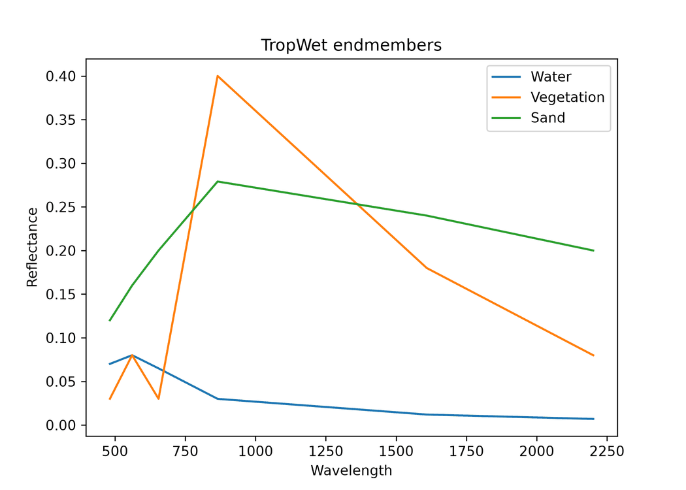
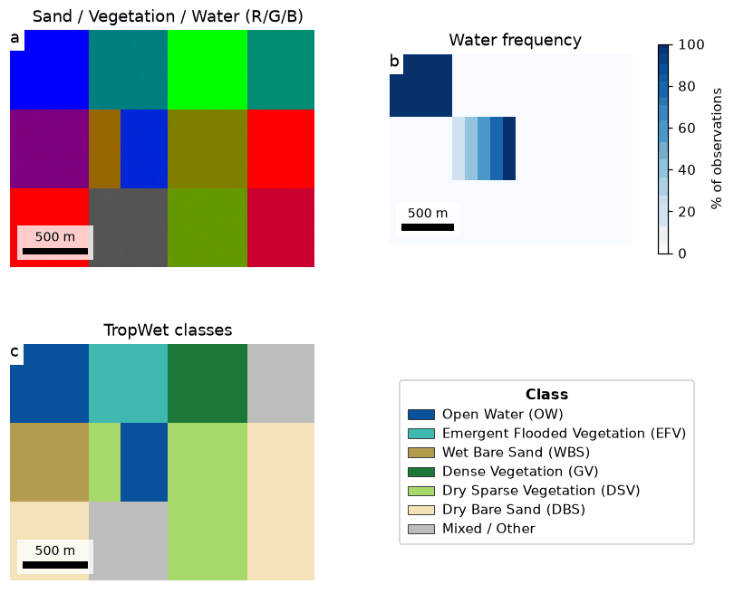

Spectral unmixing for wetland mapping (TropWet)
===============================================

Wetlands are hard to map with a per-pixel classifier: at 30 m most wetland
pixels are a mixture of open water, emergent vegetation and bare sand or
soil, and that mixture changes through the season as the floods come and go.
**Linear spectral unmixing** estimates the *fraction* of each surface type
(an *endmember*) in every pixel, assuming the pixel's reflectance is the
fraction-weighted sum of the endmember spectra:

.. math::

   \rho_b = \sum_{k=1}^{m} f_k \, e_{k,b} + \varepsilon_b

where :math:`\rho_b` is the pixel reflectance in band :math:`b`,
:math:`e_{k,b}` the reflectance of endmember :math:`k`, :math:`f_k` its
fraction and :math:`\varepsilon_b` the error. Fractions describe the
mixtures directly ("60 % water, 40 % vegetation" is flooded grassland), and
simple rules on them give wetland classes that do not need training data.

This guide follows the **Tropical Wetland (TropWet) mapping tool**
(Hardy, Oakes and Ettritch, 2020), which was written for Google Earth Engine
and calibrated in the Barotse floodplain, Zambia. It reproduces the method
with rsgispy on your own images:

1. a median composite of cloud-masked Landsat surface reflectance;
2. NDVI and MNDWI;
3. **automatic endmember selection**: pixels passing index thresholds are
   taken as pure water, vegetation and sand, and their mean spectra are the
   endmembers;
4. linear unmixing into water, vegetation and sand fractions (%), with the
   model error as a quality check;
5. a correction for burn scars, which otherwise look like water;
6. a slope mask so wetlands are only mapped on flat ground;
7. a thematic classification of the fractions;
8. the frequency of open water across all the dates;
9. maps of the results.

.. note::

   Every threshold in this guide (the endmember thresholds, the 75 % and
   25 % class limits, the burn rule and the 2.5 degree slope) comes from
   Hardy et al. (2020), where they were derived from 900 regions of interest
   in Barotseland, Zambia. They are a good starting point, but outside that
   area they are **illustrative**: check them against your own data (see
   `Checking the results`_) before trusting the maps.

.. contents:: Contents
   :local:
   :depth: 1

Installation
------------

The unmixing solvers need ``scipy``; the ``unmixing`` extra installs it with
the optional ``pysptools``, ``cvxopt`` and ``pyMCR`` backends, and the
``mapping`` extra is used for the figures:

.. code-block:: bash

   pip install "rsgispy[unmixing,mapping]"

The TropWet method
------------------

TropWet unmixes each pixel into three endmembers: **water**,
**photosynthetic (green) vegetation** and **sand**, where "sand" stands for
all bright non-vegetated surfaces (bare soil, rock, urban). With six bands
and three endmembers the problem is over-determined, so the fractions are a
least squares fit and the remaining error can be used to check the model.

The endmembers are chosen automatically from two indices,
NDVI = (NIR − Red) / (NIR + Red) and
MNDWI = (Green − SWIR1) / (Green + SWIR1) (Hardy et al., 2020, Table 1):

.. list-table::
   :header-rows: 1
   :widths: 20 80

   * - Endmember
     - Pure pixel rule
   * - Water
     - MNDWI > 0.5
   * - Vegetation
     - NDVI > 0.7
   * - Sand
     - 0.16 < NDVI < 0.17 and −0.28 < MNDWI < 0.26

The fractions (W, V and S, in %) are then classified (Table 3 of the paper;
WV = W + V, WS = W + S, VS = V + S):

.. list-table::
   :header-rows: 1
   :widths: 40 60

   * - Class
     - Rule
   * - Open Water (OW)
     - W ≥ 75
   * - Emergent Flooded Vegetation (EFV)
     - WV ≥ 75, 25 ≤ V < 75 and 25 ≤ W < 75
   * - Wet Bare Sand (WBS)
     - WS ≥ 75, 25 ≤ W < 75 and 25 ≤ S < 75
   * - Dense Vegetation (GV)
     - V ≥ 75
   * - Dry Sparse Vegetation (DSV)
     - VS ≥ 75, 25 ≤ V < 75 and 25 ≤ S < 75
   * - Dry Bare Sand (DBS)
     - S ≥ 75
   * - Mixed / Other
     - anything else (and cloud-masked pixels)

OW, EFV and WBS are the wetland classes. Two corrections are applied before
classifying: burn scars (Step 5) and steep slopes (Step 6).

Overview
--------

.. code-block:: text

   surface reflectance, one image per date            DEM (e.g. SRTM 90 m)
     │                                                        │
     ▼                                                        │
   1. median composite ──► 2. NDVI, MNDWI                     │
     │                        │                               │
     │                        ▼                               │
     │              3. pure pixel masks ──► endmember spectra │
     │                                          │             │
     ▼                                          ▼             │
   4. FCLS unmixing ──► W, V, S (%) + RMSE check              │
     │                                                        ▼
     ▼                                              6. slope ► 2.5° mask
   5. burn correction (BAI, NDWS) ─────────────┐              │
                                               ▼              │
                                   7. TropWet classes ◄───────┘
                                               │
   each date ──► 4. unmixing ──► 8. water frequency (%)
                                               │
                                               ▼
                                         9. maps

The code in this guide comes from the example script
``docs/examples/spectral_unmixing.py`` (included below step by step), which
the rsgispy test suite runs on a synthetic floodplain with known fractions
(``tests/unmix_scene.py``). The inputs are:

* **surface reflectance images**, one per date, each with six bands in the
  order Blue, Green, Red, NIR, SWIR1 and SWIR2 (for Landsat 8/9 OLI bands
  2–7; for Landsat 5/7 TM/ETM+ bands 1–5 and 7), stored as reflectance x
  10000 with clouds, shadows and fill set to the no data value 0 in every
  band. A single image that is already a composite also works. See
  :doc:`analysis_ready_data` for cloud masking and stacking. Landsat
  Collection 2 Level-2 products are scaled differently (reflectance =
  DN x 0.0000275 − 0.2): rescale them first, or pass ``refl_scale`` and
  check the index values in Step 2;
* a **DEM** in metres (TropWet uses the ~90 m SRTM), in any projection and
  resolution covering the area.

The synthetic scene is 60 x 80 pixels of 30 m on five dates, with blocks of
known mixtures: a lake, emergent flooded vegetation, a forest, a wet-looking
mixture on a hillside, wet sand, a flood that covers parts of the
floodplain on one to five of the dates, sparse vegetation, scrub, dunes, a
freshly burned area, a mixed area, and a no data strip; one date has a cloud
over part of the lake.

Step 1 — Median composite
-------------------------

TropWet works on a **median composite** of all the cloud-free observations
in a date range (e.g. the peak of the flood season). The median removes
remaining clouds, shadows and noise that the cloud mask missed, without the
blur of a mean. Choose the date range carefully: a composite over a whole
year mixes flooded and dry conditions.

:func:`~rsgispy.imagecalc.percentiles.calc_img_band_pxl_percentiles`
computes the per-pixel, per-band median, ignoring the no data value, so a
pixel cloudy on some dates still gets a value from the others. Pixels with no
valid observation keep the no data value.

The function ``prep_refl`` then sets the no data value and band names, and
clips valid values to a minimum of 1. This matters for water: dark water
often has SWIR reflectance of zero or slightly below after atmospheric
correction, and the unmixing functions skip any pixel with a band ``<= 0``
(see `Common problems`_), which would leave holes in the lakes.

.. literalinclude:: ../examples/spectral_unmixing.py
   :language: python
   :start-after: # [step-1-composite]
   :end-before: # [end-step-1-composite]
   :dedent: 4

Check the composite in a GIS: look for cloud edges or stripes (a cloud mask
that missed something on many dates) and for pixels that are no data because
every date was cloudy.

Step 2 — NDVI and MNDWI
-----------------------

:func:`~rsgispy.imagecalc.calcindices.calc_indices` calculates both indices
in one pass. ``band_names`` maps the band numbers to the canonical names the
index registry uses (``'green'``, ``'red'``, ``'nir'``, ``'swir1'``, …), and
``in_gain`` converts the stored values to reflectance (0–1) first; for
normalised differences the gain cancels out, but setting it keeps the step
correct for indices that need reflectance. The output bands are named
``NDVI`` and ``MNDWI``, with no data −999.

.. literalinclude:: ../examples/spectral_unmixing.py
   :language: python
   :start-after: # [step-2-indices]
   :end-before: # [end-step-2-indices]
   :dedent: 4

Check the ranges: NDVI of dense vegetation should be about 0.7–0.9 and MNDWI
of open water above 0.5. If nothing reaches these values, the scaling or the
band order is wrong.

Step 3 — Automatic endmember selection
--------------------------------------

The thresholds from the table in `The TropWet method`_ are applied with
:func:`~rsgispy.imagecalc.maths.band_maths` to make one mask image (1 =
water, 2 = vegetation, 3 = sand, 0 = not pure). The water and vegetation
rules pick the clearly wet and the clearly green pixels. The sand rule is
very narrow (NDVI between 0.16 and 0.17): it picks bright, unvegetated
surfaces with a slight red edge, and excludes both wet soil (higher MNDWI)
and anything with more than a trace of vegetation. In the synthetic scene
the sand spectrum has an NDVI of 0.165; with real data the window may catch
few pixels, or the wrong surface, so look at where the pixels are.

:func:`~rsgispy.imagecalc.stats.count_pxls_of_val` counts the pure pixels
per endmember; the script stops with an error if any endmember has fewer than
``min_em_pxls``, because a mean of a handful of pixels is not a reliable
spectrum. :func:`~rsgispy.imageutils.sampling.extract_img_pxl_vals_in_msk`
reads the reflectance of each set of pixels, and the endmember is their mean
(the "spectral averaging" of the GEE implementation). The table (bands as
rows, endmembers as columns, in the units of the image) is written with
:func:`~rsgispy.imagespectral.endmembers.write_endmembers_df` and plotted
with :func:`~rsgispy.imagespectral.endmembers.plot_endmembers`; ``gain``
plots it as reflectance and ``wavelengths`` (Landsat 8 OLI band centres, in
nm) sets the x axis.

.. literalinclude:: ../examples/spectral_unmixing.py
   :language: python
   :start-after: # [step-3-endmembers]
   :end-before: # [end-step-3-endmembers]
   :dedent: 4

.. code-block:: text

   Pure pixels per endmember: {'Water': 400, 'Vegetation': 400, 'Sand': 296}
          Water  Vegetation    Sand
   band
   Blue   700.0       301.0  1200.0
   Green  800.0       800.0  1600.0
   Red    649.0       300.0  2000.0
   NIR    300.0      4000.0  2791.0
   SWIR1  120.0      1799.0  2400.0
   SWIR2   70.0       800.0  2000.0

         against wavelength.

   The endmembers selected automatically from the synthetic scene, plotted
   with :func:`~rsgispy.imagespectral.endmembers.plot_endmembers`.

How to check the endmembers:

* **Where are the pure pixels?** Open the mask over the composite. Water
  pixels should be in open lakes and rivers, vegetation pixels in dense
  forest or crops, sand pixels on dunes, bare fields or rock. Sand pixels
  scattered along field edges or settlements mean the sand window is
  catching mixtures.
* **Do the spectra look right?** Water dark and decreasing into the SWIR;
  vegetation with a low red and a high NIR; sand bright and fairly flat.
* **Mixed pixels in the selection.** NDVI saturates, so a pixel with 85 %
  vegetation can still pass NDVI > 0.7; the vegetation endmember is then a
  little "softer" than pure canopy, and pure canopy gets fractions slightly
  outside the expected range (handled by the constraints, Step 4). The same
  applies to turbid or vegetated water and MNDWI. In the synthetic scene the
  thresholds select only the pure blocks, so the endmembers match the true
  spectra; with real data expect some contamination.

Step 4 — Unmixing and quality check
-----------------------------------

Hardy et al. (2020) use the Earth Engine linear unmixing and do not state
whether the sum-to-one or non-negativity constraints were used. This example
uses **fully constrained least squares** (FCLS,
:func:`~rsgispy.imagespectral.unmixing.spec_unmix_fcls`): the fractions are
non-negative and sum to one, so they can be read directly as percentages and
the 75 % and 25 % class limits mean what they say. The other solvers differ
only in the constraints:

* :func:`~rsgispy.imagespectral.unmixing.spec_unmix_ucls` — unconstrained:
  fractions can be negative or above one and need not sum to one. Fast, and
  useful as a diagnostic, but a fraction of −8 % or 112 % cannot be
  classified with Table 3.
* :func:`~rsgispy.imagespectral.unmixing.spec_unmix_nnls` — non-negative,
  but the sum is free, so brightness differences (illumination, moisture)
  change the total. Use it when you want the sum as a brightness factor.
* :func:`~rsgispy.imagespectral.unmixing.spec_unmix_fcls` — non-negative and
  summing to one. The usual choice when the endmember set is complete, as
  TropWet assumes.

The local function ``unmix_pct`` runs FCLS and converts the fractions to
percentages with no data −999 (the unmixing output uses 0 for pixels it did
not unmix, which is also a valid fraction; see `Common problems`_). It is
reused for every date in Step 8, so all dates are unmixed with the same
endmembers.

As a quality check, the script compares FCLS with the unconstrained model
and calculates the model error with
:func:`~rsgispy.imagespectral.unmixing.calc_unmixing_rmse_residual_err`
(band 1 RMSE in image units, band 2 RMSPE in %, band 3 mean absolute
residual):

.. literalinclude:: ../examples/spectral_unmixing.py
   :language: python
   :start-after: # [step-4-unmix]
   :end-before: # [end-step-4-unmix]
   :dedent: 4

.. code-block:: text

         neg_pct  sum_min  sum_max  rmse_median  rmse_p99
   fcls     0.00     1.00     1.00         9.20    267.68
   ucls    58.01     0.32     1.05         7.21     73.17

How to read this:

* Without constraints, 58 % of the pixels have at least one negative
  fraction: wherever an endmember is absent, noise pushes its fraction a
  little below zero. The sums go down to 0.32, in the burned area, which is
  darker than any mixture of the endmembers.
* The unconstrained RMSE is always lower, because the model has more
  freedom; that does not make its fractions better. Compare errors between
  models with the same constraints.
* The **median** FCLS RMSE (9.2, i.e. 0.0009 reflectance) is close to the
  noise of the data, so most pixels are explained by the three endmembers.
  The **99th percentile** is much higher: map the RMSE (``*_fcls_err.tif``)
  and look for patterns. Here every pixel with an RMSE above 30 is in the
  burned area (where it is 250 or more), a
  surface that is not a mixture of water, vegetation and sand. With real
  data, look for clouds, shadows, burn scars, crops at a different stage, or
  urban areas.

:func:`~rsgispy.imagespectral.unmixing.predict_refl_linear_unmixing`
writes the modelled reflectance, to compare with the image band by band.

Step 5 — Burn scar correction
-----------------------------

Freshly burned pasture is dark in every band. Unmixed, it looks like a
mixture of water and sand with no vegetation, so it would be mapped as wet
sand or open water. TropWet removes these false positives with the Burned
Area Index (BAI; Chuvieco et al., 2002), which is largest for pixels close to
the reflectance of charcoal (Red ≈ 0.1, NIR ≈ 0.06):

.. math::

   \mathrm{BAI} = \frac{1}{(0.1 - \rho_{red})^2 + (0.06 - \rho_{NIR})^2}

and the normalised difference of the water and sand fractions,
NDWS = (W − S) / (W + S). A pixel is a burn false positive when

* BAI > mean(BAI) + one standard deviation (the image statistics, from
  :func:`~rsgispy.imagecalc.stats.calc_basic_img_band_stats`), **and**
* −0.5 < NDWS < 0.5 (water and sand fractions of similar size), **and**
* V < 10 %.

For those pixels the water fraction is reassigned to sand. The flag is
written as its own image (``composite_burn_flag.tif``) so you can check
which pixels were changed.

.. literalinclude:: ../examples/spectral_unmixing.py
   :language: python
   :start-after: # [step-5-burn]
   :end-before: # [end-step-5-burn]
   :dedent: 4

.. code-block:: text

   BAI threshold (mean + 1 sd): 3852.0
   400 pixels corrected for burn scars

All 400 corrected pixels are in the burned patch, where the water fraction
was about 70 %; the genuine wet sand (50 % water, 50 % sand) has a much lower
BAI and is not changed. The threshold is relative to the image: in a scene
with no burn scars the mean plus one standard deviation still passes the
pixels with the highest BAI (open water is also high), which is why the NDWS
and vegetation conditions are needed too. Check the flagged pixels against fire products (e.g. MODIS burned
area) or a later image.

Step 6 — Slope mask
-------------------

Floodwater and wetlands collect on flat ground. On slopes, shadows and dark
rock can produce water-like fractions, so TropWet excludes slopes steeper
than 2.5 degrees from the wetland classes.
:func:`~rsgispy.elevation.terrain.slope` calculates the slope on the DEM's
own grid (degrees; the DEM must be in a projected CRS with metre units, or
reproject it first), and
:func:`~rsgispy.imageutils.warp.resample_img_to_match` resamples it to the
image grid with bilinear interpolation. Calculating the slope first and then
resampling avoids the artificial steps that resampling the DEM to a finer
grid would create.

.. literalinclude:: ../examples/spectral_unmixing.py
   :language: python
   :start-after: # [step-6-slope]
   :end-before: # [end-step-6-slope]
   :dedent: 4

A 90 m DEM smooths small features: levées, banks and narrow channels have a
slope below 2.5 degrees at that resolution even if they are steep on the
ground. That is usually what you want for a floodplain mask, but a finer
DEM changes the result for the same threshold.

Step 7 — TropWet classification
-------------------------------

The rules of Table 3 are written as one nested
:func:`~rsgispy.imagecalc.maths.band_maths` expression on the corrected
fractions, tested in order (Open Water first); a pixel that matches no rule
is Mixed / Other. Wetland classes (OW, EFV, WBS) on slopes steeper than
``max_slope`` become Mixed / Other. The output is an 8-bit image with 0 as
no data, a colour table
(:func:`~rsgispy.imageutils.colourtable.define_colour_table`) and thematic
metadata (:func:`~rsgispy.imageutils.colourtable.set_img_thematic`), so GIS
software shows the classes in their colours. The class names and colours
are defined once at the top of the script:

.. literalinclude:: ../examples/spectral_unmixing.py
   :language: python
   :start-after: # [step-7-class-table]
   :end-before: # [end-step-7-class-table]

.. literalinclude:: ../examples/spectral_unmixing.py
   :language: python
   :start-after: # [step-7-classify]
   :end-before: # [end-step-7-classify]
   :dedent: 4

The area of each class (pixel count x pixel area) is written to
``tropwet_class_areas.csv``:

.. code-block:: text

                                      class  pixels  area_ha  percent
   value
   1                        Open Water (OW)     640     57.6     13.9
   2      Emergent Flooded Vegetation (EFV)     400     36.0      8.7
   3                    Wet Bare Sand (WBS)     400     36.0      8.7
   4                  Dense Vegetation (GV)     400     36.0      8.7
   5            Dry Sparse Vegetation (DSV)     960     86.4     20.8
   6                    Dry Bare Sand (DBS)    1080     97.2     23.4
   7                          Mixed / Other     740     66.6     16.0

In the synthetic scene every block gets its expected class: the burned
patch is Dry Bare Sand (it would be Wet Bare Sand without Step 5), and the
wet-looking hillside (45 % water, 55 % vegetation) is Mixed / Other instead
of Emergent Flooded Vegetation because of the slope mask. GeoTIFF has no
attribute table for class names, so keep ``TROPWET_CLASSES`` (or the CSV)
with the image.

Step 8 — Water frequency
------------------------

A single composite shows one state of the floodplain. TropWet's water
frequency tool counts, for every cloud-free observation in a date range,
whether the pixel was open water, and expresses the count as a percentage
of the observations. Here each date is prepared and unmixed with the
**same endmembers** as the composite (so a change in the fractions is a
change on the ground, not a change of endmember), a pixel is water when
W ≥ 75 % (the Open Water rule), and the per-date results are summed with
:func:`~rsgispy.imagecalc.maths.band_maths`. The output has three bands:
the number of valid observations, the number of water observations and the
frequency (%), with −1 where there was no valid observation.

.. literalinclude:: ../examples/spectral_unmixing.py
   :language: python
   :start-after: # [step-8-water-freq]
   :end-before: # [end-step-8-water-freq]
   :dedent: 4

Always look at the number of observations next to the frequency: 100 % from
one observation is much weaker evidence than 100 % from twenty, and cloudy
seasons are often the wet seasons, so wet conditions can be under-sampled.
In the synthetic scene the flood strips give 20, 40, 60, 80 and 100 % as
designed, and the cloud-covered corner of the lake has four observations
instead of five but is still water in all of them. Burn scars are rarely
above 75 % water, so the per-date maps are not burn corrected; apply Step 5
to each date if burned areas reach that level in your data.

Step 9 — Maps
-------------

The figure shows (a) the corrected fractions as an RGB image with a fixed
0–100 % stretch (Sand red, Vegetation green, Water blue), so a colour always
means the same mixture, (b) the water frequency and (c) the classes, drawn
from the image's colour table with
:func:`~rsgispy.mapping.raster.create_thematic_raster_map`, with a legend
from :func:`~rsgispy.mapping.legend.add_categorical_legend`. See
:doc:`making_maps` for the options.

.. literalinclude:: ../examples/spectral_unmixing.py
   :language: python
   :start-after: # [step-9-map]
   :end-before: # [end-step-9-map]
   :dedent: 4

         synthetic floodplain.

   (a) Sand, vegetation and water fractions as red, green and blue, (b)
   water frequency across the five dates and (c) TropWet classes of the
   synthetic scene. The no data strip on the right is left blank.

The figures on this page were made by running the example on the default
synthetic scene (``make_unmix_scene`` in ``tests/unmix_scene.py``), halving
the size of the endmember plot and reducing both PNGs to 128 colours with
Pillow (``Image.quantize(colors=128)``).

Checking the results
--------------------

Hardy et al. (2020) assessed TropWet with 10,800 stratified random points
interpreted from 3 m PlanetScope imagery, with the classes merged into sand,
vegetation, flooded vegetation and open water, and report a mean overall
accuracy of 91 % (standard deviation 2.6 %). That figure applies to their
sites and thresholds, not to a new area. To check your own maps:

* Collect reference points from imagery acquired close to the composite
  dates (wetlands change within weeks), stratified by class, and use the
  same merged classes if you want to compare with the paper. The accuracy
  assessment functions in :mod:`rsgispy.classification` (see
  :doc:`pixel_classification_workflow`) work on the class image.
* Look at the pure pixel masks (Step 3), the RMSE map (Step 4) and the burn
  flag (Step 5) before the classes: most problems start there.
* If the classes are consistently wrong, adjust the thresholds for your
  area, e.g. by looking at the NDVI and MNDWI of known water, vegetation
  and bare areas, and record the values you used.

Other ways to choose endmembers
-------------------------------

The index thresholds make TropWet automatic, but other approaches are
available when they fail (e.g. no sand pixels in the narrow NDVI window):

* **Pixel Purity Index on MNF components.**
  :func:`~rsgispy.imagespectral.transforms.calc_mnf` (or
  :func:`~rsgispy.imagespectral.transforms.calc_pca`) shows how many
  endmembers the data can support, and
  :func:`~rsgispy.imagespectral.endmembers.calc_ppi` finds the purest pixels
  at the corners of the data cloud.
* **Polygons over known pure areas**, averaged per class with
  :func:`~rsgispy.imagespectral.endmembers.extract_avg_endmembers`, or a
  spectral library read with
  :func:`~rsgispy.imagespectral.endmembers.read_endmembers_df` (in the same
  units as the image).
* **Multiple endmember sets** (MESMA): unmix with several smaller sets
  (e.g. water–vegetation and vegetation–sand) and keep, per pixel, the model
  with the lowest error, with
  :func:`~rsgispy.imagespectral.unmixing.summarise_multi_endmember_linear_unmixing`.

Differences from the published tool
-----------------------------------

* **Constraints.** The paper does not state the unmixing constraints; this
  example uses FCLS (non-negative, sum to one) so the percentages can be
  classified directly with Table 3.
* **Clipping.** Valid reflectance is clipped to at least 1 (0.0001
  reflectance) because the rsgispy solvers skip pixels with a band ``<= 0``.
* **Pixels without observations** are no data (0) in the class image; the
  paper puts cloud-masked pixels in Mixed / Other. Count them as Mixed /
  Other if you need the paper's convention.
* **Slope mask.** Wetland classes on slopes above 2.5 degrees are set to
  Mixed / Other; other classes are kept.
* **Water frequency** uses the same endmembers for every date and the Open
  Water rule (W ≥ 75 %) on each date, without the burn correction.

Performance and large datasets
------------------------------

* **Streaming.** Every step (compositing, indices, band maths, unmixing,
  statistics, slope) processes the images in blocks, so memory does not grow
  with the image size. The pure pixel values (Step 3) are held in memory,
  but they are a small part of the image.
* **Compositing** reads every date for every block; its cost grows with the
  number of dates. For long time series, composite shorter periods (e.g.
  months) and process them separately.
* **Unmixing cost** grows with pixels x bands x endmembers, and Step 8
  unmixes every date: with three endmembers FCLS is fast, but for many dates
  over a large area run the dates in parallel (separate processes, one
  output folder per date).
* **Mask first.** ``valid_msk_img`` on the unmixing functions skips pixels
  outside the study area; pixels outside the mask are not solved at all.
* **Large areas** cross many landscapes: one endmember set for a whole
  country is a compromise. Derive endmembers per region (e.g. per tile or
  per floodplain) and check the pure pixel counts for each. See
  :doc:`large_rasters` for tiling.
* **Output format.** ``gdalformat`` sets the format of each output (e.g.
  ``'KEA'`` or ``'GTIFF'``), and ``calc_stats=False`` on the unmixing and
  slope functions skips statistics and pyramids for intermediate files.

Common problems
---------------

* **"Too few pure pixels for ['Sand']"** — the sand window (NDVI 0.16–0.17)
  is very narrow. Check the reflectance scaling (Step 2), look at the NDVI
  and MNDWI of known bare areas, and widen the window for your area if
  needed, or choose the sand endmember another way (see
  `Other ways to choose endmembers`_).
* **Holes in water bodies** — pixels with any band ``<= 0`` (common for
  water in the SWIR, or partial no data) are not unmixed and are 0 in every
  band. Clip valid values to a small positive value as ``prep_refl`` does,
  and make sure masked pixels are no data in *every* band.
* **Fractions of 0 shown as no data** — the unmixing outputs (and
  :func:`~rsgispy.imagespectral.unmixing.rescale_unmixing_results`) set the
  image no data value to 0, which is also a valid fraction, so a fraction of
  exactly 0 is treated as no data by statistics and the mapping functions.
  Convert to percentages with a separate no data value, as ``unmix_pct``
  does, before summarising or mapping.
* **"Input image … has N bands, expected M"** — the endmember table must
  have one row per image band, in the same order. Subset the image (e.g.
  with :func:`rsgispy.imageutils.bands.select_img_bands`) or the table.
* **Everything is water, or nothing is** — the bands are in the wrong order
  or the scaling is wrong (e.g. Landsat Collection 2 digital numbers used as
  reflectance x 10000); NDVI and MNDWI then have the wrong range.
* **Burn scars or dark shadows mapped as wet sand or water** — check the
  burn flag (Step 5) and the RMSE map; terrain shadows outside the slope
  mask need a finer DEM or a hillshade mask.
* **High RMSE in some areas** — a surface is not a mixture of the three
  endmembers (cloud, shadow, burn, urban); mask it or treat its fractions
  with caution.
* **"scipy is required"** — install the ``unmixing`` extra.

References
----------

* Chuvieco, E., Martín, M. P., Palacios, A. (2002). Assessment of different
  spectral indices in the red-near-infrared spectral domain for burned land
  discrimination. *International Journal of Remote Sensing*, 23(23),
  5103–5110.
* Hardy, A., Oakes, G., Ettritch, G. (2020). Tropical Wetland (TropWet)
  Mapping Tool: The Automatic Detection of Open and Vegetated Waterbodies in
  Google Earth Engine for Tropical Wetlands. *Remote Sensing*, 12(7), 1182.
  https://doi.org/10.3390/rs12071182

Related guides
--------------

* :doc:`analysis_ready_data`
* :doc:`making_maps`
