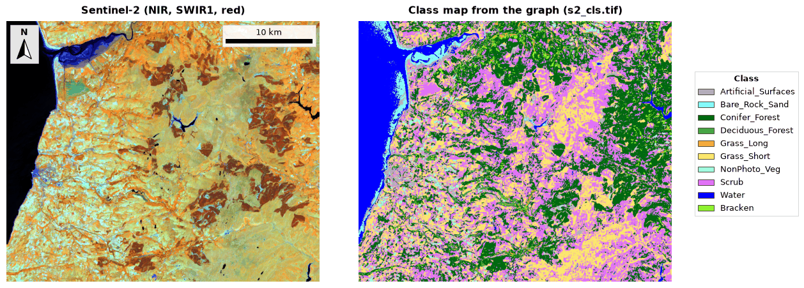

Chaining operations in memory with a tile graph
===============================================

Most raster workflows are chains of steps: calculate indices, filter them,
add a texture, classify, smooth the classification. Run one function after
another and every step writes a file that the next step reads again. On
large images that takes disk space, and on slow or network disks the
reading and writing can take longer than the calculations. A *tile graph* (:class:`~rsgispy.imageprocess.TileGraph`) runs
the whole chain tile by tile in memory and writes only the outputs you ask
for.

This guide explains:

* how a tile graph works, and when it helps;
* its building blocks, and the node builders that make almost every
  tile-local rsgispy operation chainable;
* a worked chain, from a Sentinel-2-like image to a smoothed land cover map,
  with a DEM branch in the same pass;
* filter chains, the no-data convention, halos and block sizes;
* writing your own window and pixel-wise operations, and your own nodes;
* statistics without writing a raster;
* running tiles in parallel;
* checking that a graph gives the same result as running the steps one after
  another;
* the operations that cannot be chained, and common problems.

Step 5 of :doc:`large_rasters` is a short introduction; this guide goes
further. The reference for every class and the full table of chainable
operations is :ref:`tilegraph-chainable` in :mod:`rsgispy.imageprocess`.

.. seealso::

   The rsgispy tutorials cover this in a notebook you can run:
   :tutorial:`Chaining indices, classification and filtering in a tile graph
   <09_tile_graph_workflows/01_indices_classification_filtering.ipynb>`
   (section 9), which classifies the same Sentinel-2 image with a random
   forest, compares the filtered and unfiltered maps and times the graph with
   ``n_jobs``. See :doc:`../tutorials` for how to get the notebooks and their
   data.

.. contents:: Contents
   :local:
   :depth: 1

Installation
------------

Tile graphs only need the core rsgispy dependencies. The worked example also
trains a scikit-learn model (the ``classification`` extra), and ``numba``
(the ``numba`` extra) compiles the slow loops of some filters, such as the
majority (mode) filter:

.. code-block:: bash

   pip install "rsgispy[classification,numba]"

Why chain in memory
-------------------

A tile graph is a directed acyclic graph of three kinds of node:

* **sources** read a raster (or a NumPy array);
* **operations** compute a new raster from one or more inputs;
* **sinks** consume a node: write it to a file, return it as an array, or
  accumulate statistics.

When the graph runs, the image is split into tiles (256 x 256 pixels by
default). For each tile, every source reads its pixels, every operation
computes its result from its inputs' tiles, and every sink receives its
tile. No intermediate image is written, and only a few tiles are in memory at
any time, so a chain runs on images much larger than the computer's memory.

A moving-window operation, such as a 5 x 5 median filter, needs pixels from
outside the tile: a *halo* of 2 pixels on each side. The graph works out the
halo each node needs from everything downstream of it and reads the sources
with that halo, so the result is identical to running the steps one after
another on the whole image:

.. code-block:: text

            image (split into tiles)              graph for one tile
   ┌──────┬──────┬──────┐
   │      │      │      │         RasterSource (tile + 3 px halo)
   ├──────┼──────┼──────┤                │
   │      │┌────┐│      │         calc_indices_node   (halo 3)
   │      ││tile││      │            │          │
   │      │└────┘│      │    median 3x3 (r=1)  stddev 5x5 (r=2)
   ├──────┼──────┼──────┤            └────┬─────┘
   │      │      │      │            StackBands       (halo 1)
   └──────┴──────┴──────┘                 │
     the halo is read around         predict_raster_node
     every tile, so window                │
     filters see their whole         majority 3x3 (r=1)
     neighbourhood                        │
                                       DiskSink

A tile graph helps when:

* there are **several tile-local steps** (filters, indices, terrain,
  prediction, …) on a large image: each intermediate file you avoid saves
  a write and a read of the whole image, and its disk space;
* you want **several outputs from the same inputs** (one read, many sinks);
* you want **statistics** of an intermediate product without writing it;
* you want to **use several CPUs** (``n_jobs``).

It does not help for a single step (call the file-based function, which
builds the same graph for you) or for operations whose result depends on the
whole image, such as segmentation or flow accumulation (see
`Operations that cannot be chained`_).

Overview
--------

.. code-block:: text

   Sentinel-2 SREF stack        DEM          training labels
            │                    │                 │
   1. Sources ───────────────────┴─────────────────┘
            │
   2. Features: NDVI, NDWI → median 3x3 + std. dev. 5x5
            │
   3. Train a decision tree (samples from a SampleSink)
            │
   4. One graph: classify → majority filter ─► s2_cls.tif
            │      features ─────────────────► s2_features.tif
            │      DEM → slope, hillshade ───► slope.tif, hillshade.tif
            │
   5. Filter chains: unsharp mask, difference of Gaussians, DEM edges
   6. No data: from the metadata, explicit, or ignored
   7. Halos and block size
   8. Your own operations: WindowOp, PointwiseOp, a TileNode subclass
   9. Statistics: StatsSink, ZonalStatsSink, two-pass z-score
  10. Parallel tiles (n_jobs)
  11. Check the graph against the file-based functions

The code comes from the example script ``docs/examples/tile_graph.py``
(included below step by step). The scenario is a Sentinel-2 surface
reflectance image with no data value 0 (e.g. the 10 m stack from
:func:`~rsgispy.imagecalibration.sensorlvl2data.create_stacked_sen2_esa_l2a_img`),
a DEM resampled to the same grid (e.g. with
:func:`~rsgispy.imageutils.warp.resample_img_to_match`) and a raster of
training class IDs (e.g. rasterised training polygons, 0 = unlabelled).

**The data on this page.** The printed outputs and the figure on this page
come from the data of the rsgispy tutorials: the 20 m Sentinel-2 image of
29 June 2018, :tutorial-data:`sen2_20180629_t30uvd_orb037_osgb_stdsref_20m.tif`
(British National Grid, reflectance x 1000, no data value 0), subset to a
36 x 30 km area around Aberystwyth, west Wales (1800 x 1500 pixels); the
10 m DEM :tutorial-data:`dem_10m_osgb.tif`, resampled to the image's grid;
and the training polygons of ten land cover classes,
:tutorial-data:`cls_data/aber_sen2_cls_training.gpkg` (one layer per class),
rasterised onto the same grid. The script
``docs/examples/tile_graph_tutorial.py`` prepares these inputs and runs the
example (under a minute):

.. literalinclude:: ../examples/tile_graph_tutorial.py
   :language: python
   :start-after: # [tutorial-data]
   :end-before: # [end-tutorial-data]
   :dedent: 4

The rsgispy test suite runs the same example on a small synthetic scene
(``tests/tile_graph_scene.py``: four classes, a no data strip at the image
edge and a DEM), with several block sizes and ``n_jobs``, so the code on this
page is always tested.

Step 1 — Sources, grids and metadata
------------------------------------

A :class:`~rsgispy.imageprocess.RasterSource` reads bands of a file: all of
them, or the 1-based ``bands`` you give. By default it reads them as
``float64`` (``dtype``); ``nodata`` overrides the file's no data value, and
``border`` (a :class:`~rsgispy.imageprocess.HaloBorder`: ``'edge'``,
``'constant'``, ``'reflect'`` or ``'symmetric'``) sets how a halo is filled
beyond the edge of the image. An :class:`~rsgispy.imageprocess.ArraySource`
does the same for a NumPy array already in memory, with a ``transform`` and
``crs`` if it has a location.

.. literalinclude:: ../examples/tile_graph.py
   :language: python
   :start-after: # [step-1-sources]
   :end-before: # [end-step-1-sources]
   :dedent: 4

For the tutorial image this prints:

.. code-block:: text

   NodeMeta(n_bands=10, band_names=('Blue', 'Green', 'Red', 'RE_B5', 'RE_B6',
   'RE_B7', 'NIR_B8', 'NIR_B8A', 'SWIR1', 'SWIR2'), dtype=dtype('float64'),
   nodata=0.0)

Every node carries metadata, a :class:`~rsgispy.imageprocess.NodeMeta`: the
number of bands, the band names, the data type and the no data value.
:func:`~rsgispy.imageprocess.infer_node_meta` shows it for any node, and the
builders and sinks use it: a filter skips the source's no data pixels, and a
:class:`~rsgispy.imageprocess.DiskSink` writes the band names and no data
value of its input unless you give others.

When a graph is built, it checks that **all sources are on the same pixel
grid**: the same number of rows and columns, the same transform and the same
CRS (within a small tolerance). If they are not, the error names the two
rasters, for example *"TileGraph sources must be on the same pixel grid; the
transform of dem_shifted.tif (…) differs from that of dem.tif (…)"*. A tile
graph does not resample on the fly: align the inputs first, e.g. with
:func:`~rsgispy.imageutils.warp.resample_img_to_match`, or use a VRT.

The graph reads the header of every input when it is built, so the files must
already exist (in a two-pass workflow, build the second graph after the first
has run). Several ``RasterSource`` nodes on the same file share one open file
and are read together for each tile.

Step 2 — Node builders: rsgispy operations as nodes
---------------------------------------------------

Almost every rsgispy operation whose output pixel depends only on input
pixels within a fixed distance has a **node builder**: a function that takes
input nodes and the processing parameters and returns a node. Its name is the
file-based function's name, without ``apply_``, plus ``_node``:

==========================================================  ==========================================================
File-based function                                          Node builder
==========================================================  ==========================================================
:func:`~rsgispy.imagecalc.calcindices.calc_indices`         :func:`~rsgispy.imagecalc.calcindices.calc_indices_node`
:func:`~rsgispy.imagefilter.stats.apply_median_filter`      :func:`~rsgispy.imagefilter.stats.median_filter_node`
:func:`~rsgispy.elevation.terrain.slope`                    :func:`~rsgispy.elevation.terrain.slope_node`
:func:`~rsgispy.ml.predict.predict_raster`                  :func:`~rsgispy.ml.predict.predict_raster_node`
==========================================================  ==========================================================

The file-based functions are themselves thin wrappers: they build
``RasterSource`` → builder → ``DiskSink`` and run the graph. A builder used
in your own graph therefore gives exactly the same result as its file-based
function.

The builders cover:

* **filters** — window statistics (mean, median, mode, standard deviation,
  …), smoothing (Gaussian, Kuwahara, kernels), edges (Sobel, Prewitt,
  Laplacian, Gaussian derivatives), the SAR speckle filters (Lee, Frost, Kuan,
  Gamma MAP, refined Lee) and GLCM texture;
* **indices and value transforms** — optical and SAR indices, rescaling,
  normalisation, recoding and one-hot encoding, multi-date percentiles;
* **masks and change detection** — masking, valid and finite masks, image
  differencing and ratios;
* **spectral** — Tasseled Cap, PCA and MNF projection, spectral angle and
  correlation mappers, linear unmixing;
* **terrain and illumination** — slope, aspect, hillshade, local incidence
  and exitance angles;
* **morphology** — dilation, erosion, opening, closing, top hats, gradient,
  local minima;
* **classification and machine learning** — the majority filter, and
  prediction of classes, probabilities and quantiles from any fitted model.

:ref:`tilegraph-chainable` lists every file-based function with its builder
(and its :class:`~rsgispy.imagefilter.chained.FilterStep` kind). All
builders take the input node(s) first and the keyword arguments
``no_data_val`` (see `Step 6 — No data`_) and ``name``.

Two **band nodes** connect builders: :class:`~rsgispy.imageprocess.SelectBands`
picks bands of a node (1-based) and :class:`~rsgispy.imageprocess.StackBands`
stacks the bands of several nodes, keeping their names. Here NDVI and NDWI
are calculated once and used by two filters, and the four filtered bands are
stacked as the features of a classifier. A filter keeps its input's band
names, so the stack would have two bands called ``NDVI`` and two called
``NDWI``; ``band_names`` gives them unique names, which the later sinks and
the training samples use. (Both band nodes take ``band_names``, and
:class:`~rsgispy.imageprocess.SetBandNames` renames the bands of any node.)

.. literalinclude:: ../examples/tile_graph.py
   :language: python
   :start-after: # [step-2-features]
   :end-before: # [end-step-2-features]
   :dedent: 4

Nothing has been read or calculated yet: these are only the nodes of a
graph. Nodes can be used by several later nodes and in several graphs.

Step 3 — Training samples for a model
-------------------------------------

A :class:`~rsgispy.imageprocess.SampleSink` collects the feature values of the
labelled pixels while the graph runs, tile by tile, without writing the
features. It returns a table (a pandas ``DataFrame``, under the sink's
``name``) with the class ID and name, the pixel coordinates and one column per
feature band, the layout of the classification sample tables, so it also
works with :func:`~rsgispy.classification.classdata.write_cls_samples` and
the split functions of :mod:`rsgispy.classification.classdata`. With
``max_per_class`` it keeps a random sample of at most that many pixels per
class, so memory use stays small on any image, and the sample is the same
for any block size and ``n_jobs`` (``rnd_seed`` chooses another). A small
decision tree on four index features keeps the example short, but it is too
simple to separate ten land cover classes well (see the map in step 4); with
real data use more features, a stronger model and the training, feature
selection and accuracy assessment tools of
:doc:`pixel_classification_workflow`.

.. literalinclude:: ../examples/tile_graph.py
   :language: python
   :start-after: # [step-3-train]
   :end-before: # [end-step-3-train]
   :dedent: 4

To get whole arrays instead, a :class:`~rsgispy.imageprocess.MemorySink`
returns its node as a NumPy array from
:meth:`~rsgispy.imageprocess.TileGraph.run`. It holds the whole image in
memory, so use it for small images, subsets or debugging, and a
``SampleSink`` or a statistics sink (`Step 9 — Statistics without writing a
raster`_) for large images.

Step 4 — A worked chain
-----------------------

One graph now classifies the image and smooths the classification, writes
the features, and, from a second input, writes the slope and a hillshade of
the DEM: four outputs in one pass over the data.

.. literalinclude:: ../examples/tile_graph.py
   :language: python
   :start-after: # [step-4-graph]
   :end-before: # [end-step-4-graph]
   :dedent: 4

``describe()`` prints (the paths are shortened here):

.. code-block:: text

   TileGraph: 15 node(s), 4 sink(s), block_size=256
     grid: 1500 rows x 1800 columns, crs=EPSG:27700, transform=(20.0, 0.0, 254997.3321426216, 0.0, -20.0, 299002.255157026)
     [0] RasterSource 's2' (path='sen2_20180629_aber_20m.tif' bands=all)
         halo=(3, 3) radius=(0, 0) bands=10 names=['Blue', 'Green', 'Red', 'RE_B5', 'RE_B6', 'RE_B7', 'NIR_B8', 'NIR_B8A', 'SWIR1', 'SWIR2'] dtype=float64 nodata=0.0
     [1] IndicesNode 'calc_indices' <- [0] (indices=['NDVI', 'NDWI'] dtype=float32)
         halo=(3, 3) radius=(0, 0) bands=2 names=['NDVI', 'NDWI'] dtype=float32 nodata=-999.0
     [2] FilterWindowOp 'median_filter' <- [1] (radius=(1, 1) border=edge)
         halo=(1, 1) radius=(1, 1) bands=2 names=['NDVI', 'NDWI'] dtype=float64 nodata=-999.0
     [3] FilterWindowOp 'stddev_filter' <- [1] (radius=(2, 2) border=edge)
         halo=(1, 1) radius=(2, 2) bands=2 names=['NDVI', 'NDWI'] dtype=float64 nodata=-999.0
     [4] StackBands <- [2], [3] (band_names=['NDVI_med', 'NDWI_med', 'NDVI_sd', 'NDWI_sd'])
         halo=(1, 1) radius=(0, 0) bands=4 names=['NDVI_med', 'NDWI_med', 'NDVI_sd', 'NDWI_sd'] dtype=float64 nodata=-999.0
     [5] PredictionOp 'predict_raster' <- [4] (estimator=DecisionTreeClassifier outputs=1 mask=no)
         halo=(1, 1) radius=(0, 0) bands=1 names=['class'] dtype=uint8 nodata=0.0
     [6] WindowOp 'majority_filter' <- [5] (radius=(1, 1) border=constant)
         halo=(0, 0) radius=(1, 1) bands=1 names=['class'] dtype=float64 nodata=0.0
     [7] Cast 'majority_filter_cast' <- [6] (dtype=uint8)
         halo=(0, 0) radius=(0, 0) bands=1 names=['class'] dtype=uint8 nodata=0.0
     [8] DiskSink <- [7] (output='s2_cls.tif' format=GTIFF datatype=uint8 (from input) thematic classes=10)
         halo=(0, 0) radius=(0, 0) bands=1 names=['class'] dtype=uint8 nodata=0.0
     [9] DiskSink <- [4] (output='s2_features.tif' format=GTIFF datatype=float32 (from input))
         halo=(0, 0) radius=(0, 0) bands=4 names=['NDVI_med', 'NDWI_med', 'NDVI_sd', 'NDWI_sd'] dtype=float64 nodata=-999.0
     [10] RasterSource 'dem' (path='dem_20m.tif' bands=all)
         halo=(1, 1) radius=(0, 0) bands=1 dtype=float64 nodata=-32768.0
     [11] Horn3x3Node 'slope' <- [10] (slope unit=degrees no_data_val=from input)
         halo=(0, 0) radius=(1, 1) bands=1 dtype=float64 nodata=-32768.0
     [12] DiskSink <- [11] (output='slope.tif' format=GTIFF datatype=float32 (from input))
         halo=(0, 0) radius=(0, 0) bands=1 dtype=float64 nodata=-32768.0
     [13] Horn3x3Node 'hillshade' <- [10] (hillshade azimuth=315.0 zenith=45.0 no_data_val=from input)
         halo=(0, 0) radius=(1, 1) bands=1 dtype=uint8 nodata=0.0
     [14] DiskSink <- [13] (output='hillshade.tif' format=GTIFF datatype=uint8 (from input))
         halo=(0, 0) radius=(0, 0) bands=1 dtype=uint8 nodata=0.0

         ten-class map written by the graph (right), with a legend.
   :width: 100%

   The tutorial Sentinel-2 image (NIR, SWIR1 and red as red, green and blue)
   and the smoothed class map written by the graph (``s2_cls.tif``). The map
   shows what one pass of the chain produces, not a good land cover map: a
   depth-6 decision tree on NDVI and NDWI features maps the sea, the Dyfi
   estuary and the reservoirs as water and finds the urban area of
   Aberystwyth, but confuses the vegetation classes, for example mapping
   much of the upland vegetation in the east as conifer forest. Contains modified
   Copernicus Sentinel data (2018).

Points to note:

* :func:`~rsgispy.ml.predict.predict_raster_node` predicts every pixel where
  all features are valid; with ``thematic=True`` the other pixels are ``0``,
  and the result is ``uint8`` when every class fits in it.
  :func:`~rsgispy.classification.classpostprocess.majority_filter_node` then
  replaces each class by the most common class in a 3 x 3 window; with
  ``dtype=np.uint8`` its result is ``uint8`` too.
* :class:`~rsgispy.imageprocess.DiskSink` writes a tiled, DEFLATE-compressed
  GeoTIFF by default (or a COG with ``gdalformat='COG'``). Without
  ``datatype`` it writes the data type of its input node: integer and
  ``float32`` nodes keep their type (the class map and the hillshade are
  ``uint8`` here), and ``float64`` nodes, the type of most filters and
  indices, are written as ``float32``. Pass ``datatype`` (e.g.
  ``rsgispy.TYPE_64FLOAT``) to choose another. It also takes the band names
  and no data value from its input unless you give ``band_names`` or
  ``nodata``. The class map nodes name their band ``class`` (unless you give
  ``band_names``).
* For a class map, give the ``DiskSink`` its classes, as the example does
  with ``CLASSES`` (``{1: ("Water", "#1f78b4"), 2: ("Forest", "#33a02c"),
  ...}``, defined at the top of the script): this marks the file thematic,
  writes the colour table and the class names (read them with
  :func:`~rsgispy.imageutils.colourtable.get_thematic_classes`) and builds
  thematic statistics and pyramids when it closes, so no
  ``set_img_thematic`` / ``define_colour_table`` / ``pop_thmt_img_stats``
  calls are needed afterwards. ``colour_table={...}`` gives the colours
  only, and ``thematic=True`` alone marks the file thematic with thematic
  statistics.
* :meth:`~rsgispy.imageprocess.TileGraph.describe` prints the grid, the
  block size and every node with its inputs, parameters, halo and metadata.
  For this graph the Sentinel-2 source is read with a 3-pixel halo: 2 for the
  5 x 5 standard deviation plus 1 for the majority filter after the
  prediction.

Step 5 — Filter chains
----------------------

:func:`~rsgispy.imagefilter.chained.build_filter_chain_node` adds a
sequence of filters to a graph and returns the last node. Each
:class:`~rsgispy.imagefilter.chained.FilterStep` has a ``kind``, a
``filter_size`` and ``params``. A ``'band_math'`` step calculates an
expression of ``x`` (the result of the previous step), ``input`` (the node
the chain started from) and any earlier step given a ``name``. That gives an
unsharp mask (sharpening) and a difference of Gaussians (a band-pass filter
that highlights features of a chosen size) in a few lines.
:func:`~rsgispy.imagefilter.chained.apply_filter_chain` builds and runs the
graph for a chain from one file to another.

.. literalinclude:: ../examples/tile_graph.py
   :language: python
   :start-after: # [step-5-filter-chains]
   :end-before: # [end-step-5-filter-chains]
   :dedent: 4

The kinds are:

* window statistics: ``mean``, ``median``, ``min``, ``max``, ``mode``,
  ``range``, ``total``, ``stddev``, ``variance``, ``coeff_of_var``,
  ``norm_var``, ``norm_var_sqrt``, ``norm_var_ln``, ``mean_diff``,
  ``mean_diff_abs``, ``total_diff``, ``total_diff_abs``, ``kuwahara``;
* SAR speckle filters: ``lee``, ``enhanced_lee``, ``frost``,
  ``enhanced_frost``, ``kuan``, ``gamma_map``, ``refined_lee``;
* edges: ``sobel``, ``sobel_x``, ``sobel_y``, ``prewitt``, ``prewitt_x``,
  ``prewitt_y``, ``laplacian``, ``gaussian_1st_deriv``,
  ``gaussian_2nd_deriv``;
* smoothing, texture and kernels: ``gaussian``, ``glcm``, ``kernel``,
  ``kernel_correlation``;
* other: ``band_math``, ``pointwise``.

The parameters of each kind are listed in
:class:`~rsgispy.imagefilter.chained.FilterStep`; each kind calls the same
builder as the corresponding filter function, so a chain gives the same
result as the builders used directly.

Step 6 — No data
----------------

Every node carries a no data value, and all builders follow one rule (see
:ref:`tilegraph-nodata`):

* ``no_data_val=None`` (the default) uses the no data value of the input
  node's metadata (a ``RasterSource`` has the file's value);
* ``no_data_val=<value>`` uses that value instead;
* to treat every finite pixel as valid, even where the file declares a no
  data value, wrap the input in ``SetNoData(src, None)``; to declare a value
  for an input without one, use ``SetNoData(src, value)`` or
  ``RasterSource(path, nodata=value)``.
  :class:`~rsgispy.imageprocess.SetNoData` changes only the metadata, not the
  pixels.

.. literalinclude:: ../examples/tile_graph.py
   :language: python
   :start-after: # [step-6-nodata]
   :end-before: # [end-step-6-nodata]
   :dedent: 4

The first two results are identical: the NIR band's no data value (0) comes
from the file. In the third, ``0`` is an ordinary value, so the median filter
mixes no data pixels (e.g. outside the swath of a Sentinel-2 tile, or masked
clouds) into the valid pixels next to them. The tutorial image has no pixels
with the value 0 in this area, so all three results are the same here; the
synthetic scene of the test suite has a no data strip at its edge, and the
test checks that the third result differs next to it.

A few builders keep the meaning of their file-based function's parameter
instead: ``gen_valid_mask_node`` and the percentile nodes default to ``0``
and check only that values are finite when it is ``None``, and for the
prediction nodes ``no_data_val`` is the value written where no prediction is
made. :func:`~rsgispy.imageprocess.resolve_input_nodata` applies the rule in
your own builders.

A stack has one no-data value. When the inputs of a
:class:`~rsgispy.imageprocess.StackBands` have different ones (e.g.
Sentinel-2 bands with ``0`` and an index with ``-999``), give
``no_data_val``: ``StackBands([s2, ndvi], no_data_val=-999)`` writes
``-999`` into every band of a pixel where any input is invalid, so the
training samples and the predictions skip those pixels
(``no_data_val='auto'`` uses the first input's value, or NaN). Without it
the bands are stacked unchanged, the stack has no no-data value and a
warning says so (see :ref:`tilegraph-nodata`).

Step 7 — Halos and block size
-----------------------------

A window filter of size ``n`` needs a halo of ``(n - 1) / 2`` pixels. The
halos add up along a chain: a 3 x 3 median, then a 5 x 5 mean, then a Sobel
filter (3 x 3) need 1 + 2 + 1 = 4 pixels around each tile of the source.
When branches meet, the larger halo wins. The graph computes this for you,
reads each source tile with its halo once, and crops each node's result to
what the next node needs. Pixels outside the image are filled with the
``border`` mode of the window node that reads them (``'edge'`` by default;
set with the ``border_mode`` option of the filter, texture and morphology
builders, see :ref:`filter-border-mode`), the same padding the file-based
functions use, so **the result does not depend on the block size**:

.. literalinclude:: ../examples/tile_graph.py
   :language: python
   :start-after: # [step-7-halos]
   :end-before: # [end-step-7-halos]
   :dedent: 4

``describe()`` shows the halo of every node (here ``halo=(4, 4)`` for the
source). The cost of a halo is the extra pixels read and processed for each
tile, ``(B + 2h)² / B²`` for a block size ``B`` and halo ``h``:

=============  =========  =========  ==========  ==========
Block size     h = 1      h = 4      h = 10      h = 25
=============  =========  =========  ==========  ==========
128            1.03       1.13       1.34        1.93
256            1.02       1.06       1.16        1.43
512            1.01       1.03       1.08        1.20
1024           1.00       1.02       1.04        1.10
=============  =========  =========  ==========  ==========

The default block size is 256, a good balance for typical halos, memory use
and parallel tiles. Use a larger block for chains with large halos (e.g. a
GLCM texture or several large windows). Set it for one graph with
``TileGraph(sinks, block_size=512)``, for the whole session with
:func:`~rsgispy.imageprocess.set_default_block_size`, or with the
``RSGISPY_BLOCK_SIZE`` environment variable (see :doc:`large_rasters`,
step 2).

Step 8 — Writing your own operations
------------------------------------

Three generic operations accept your own functions.

:class:`~rsgispy.imageprocess.WindowOp` is a moving-window operation with a
halo ``radius``. Your function receives the tile with its halo as a
``(bands, rows, columns)`` array and returns the tile without the halo (or
the same size, which is cropped for you). With ``pass_ctx=True`` it also
receives a :class:`~rsgispy.imageprocess.TileContext`, which gives the
tile's position and the input's no data value. ``meta_fn`` gives the
output's metadata; :func:`~rsgispy.imageprocess.same_bands_meta` keeps the
input's bands and names with a new data type and no data value. Here, the
fraction of vegetated pixels (NDVI > 0.5) in each 5 x 5 window, using
:func:`numpy.lib.stride_tricks.sliding_window_view`:

.. literalinclude:: ../examples/tile_graph.py
   :language: python
   :start-after: # [step-8-windowop]
   :end-before: # [end-step-8-windowop]
   :dedent: 4

:class:`~rsgispy.imageprocess.PointwiseOp` combines one or more inputs pixel
by pixel; its function receives one array per input. Here the vegetation
fraction and the slope from step 4 flag steep, mostly vegetated land:

.. literalinclude:: ../examples/tile_graph.py
   :language: python
   :start-after: # [step-8-pointwiseop]
   :end-before: # [end-step-8-pointwiseop]
   :dedent: 4

Its ``meta_fn`` declares the output as ``uint8`` with no data value 255, so
the ``DiskSink`` writes a ``uint8`` file.
:class:`~rsgispy.imageprocess.BandMathOp` evaluates a band maths expression
over named inputs.

When an operation is worth reusing, subclass
:class:`~rsgispy.imageprocess.TileNode`. A node overrides:

* ``evaluate(inputs, halo_y, halo_x, ctx, state)`` — calculate the tile from
  the input :class:`~rsgispy.imageprocess.TileTensor` tiles; crop them to the
  halo the graph asks for with ``crop(halo_y, halo_x)``;
* ``infer_meta(inputs)`` — the output metadata from the inputs';
* ``halo_radius`` — for a moving window, the pixels it needs on each side;
* ``start_run(resources, halo_y, halo_x)`` — anything that has to be
  prepared once per run (e.g. an open file or a lookup table). Return it and
  the graph passes it to ``evaluate`` as ``state``. Do not store per-run state on the node itself:
  with ``n_jobs > 1`` several threads call ``evaluate`` at the same time.

.. literalinclude:: ../examples/tile_graph.py
   :language: python
   :start-after: # [step-8-tilenode]
   :end-before: # [end-step-8-tilenode]
   :dedent: 4

A new sink subclasses :class:`~rsgispy.imageprocess.TileSink` and implements
``open``, ``write`` and ``close``. A new node or sink works in any graph
without changes to the graph.

Step 9 — Statistics without writing a raster
--------------------------------------------

Two sinks reduce a node to statistics in the same pass, without writing it:

* :class:`~rsgispy.imageprocess.StatsSink` returns a
  :class:`~rsgispy.imageprocess.RasterStats` with the count of valid pixels,
  the minimum, maximum, mean and standard deviation of each band and, with
  ``bins`` and ``hist_range``, a histogram (``.to_dataframe()`` gives a
  table);
* :class:`~rsgispy.imageprocess.ZonalStatsSink` returns a
  pandas ``DataFrame`` with the count, mean, minimum, maximum and
  standard deviation of each band for every value of a label raster (a
  classification, a segmentation or rasterised polygons).

Both skip non-finite and no data pixels (the input's no data value by
default). Here they give the NDVI and NDWI statistics of the whole image and
of each class of the map from step 4:

.. literalinclude:: ../examples/tile_graph.py
   :language: python
   :start-after: # [step-9-stats]
   :end-before: # [end-step-9-stats]
   :dedent: 4

For the tutorial image this prints:

.. code-block:: text

           count       min       max      mean       std
   band
   NDVI  2700000 -0.730769  0.958810  0.671663  0.270267
   NDWI  2700000 -0.922958  0.831325 -0.587673  0.367985
          NDVI_count  NDVI_mean  NDVI_min  ...  NDWI_min  NDWI_max  NDWI_std
   label                                   ...
   1           63778   0.325974 -0.092784  ... -0.807692  0.606557  0.232031
   2           44851   0.061664 -0.412698  ... -0.739796  0.740741  0.304173
   3          747797   0.853616  0.308475  ... -0.890196 -0.288462  0.029612
   4           53939   0.909040  0.479412  ... -0.898601 -0.512346  0.015836
   5           14398   0.924664  0.722543  ... -0.922958 -0.650970  0.012552
   6          575991   0.679372  0.006227  ... -0.842932 -0.177650  0.033473
   7           59829   0.461079  0.222535  ... -0.817556 -0.288136  0.034086
   8          864642   0.739924  0.125964  ... -0.853659 -0.011236  0.052642
   9          229386  -0.046142 -0.730769  ... -0.771930  0.831325  0.198524
   10          45389   0.907111  0.601476  ... -0.851351 -0.610390  0.013497

   [10 rows x 10 columns]

All 2.7 million pixels are valid. The labels are the class IDs of the map:
water (9) has a mean NDVI below 0, artificial surfaces (1) and bare rock and
sand (2) are low, and the forest, long grass and bracken classes (3, 4, 5
and 10) are above 0.85. The counts are the pixels of each class in the map,
so (at 0.04 ha per 20 m pixel) Scrub (8) covers about 346 km² of the
1080 km² area.

Some operations need whole-image parameters, such as a mean and standard
deviation for a z-score. These take **two passes**: calculate the
statistics first, then give them to a node. Here
:func:`~rsgispy.imagecalc.rescale.norm_params_from_stats` turns the
``StatsSink`` result into normalisation parameters (the same as
:func:`~rsgispy.imagecalc.rescale.calc_img_norm_params` calculates from a
file) for :func:`~rsgispy.imagecalc.rescale.img_norm_params_node`. It supports
the stretches, z-scores, decimal scaling and the standard, min-max and
max-abs scalers exactly, and the percentile methods (``cumulative``,
``robust_zscore``, ``robust_scaler``) approximately, from a histogram. A
:class:`~rsgispy.imageprocess.BandMathOp` with the statistics in its
expression, or a builder parameter such as the ``std_params`` of
:func:`~rsgispy.changedetect.imgchngmthds.image_difference_node`, works in
the same way.

.. literalinclude:: ../examples/tile_graph.py
   :language: python
   :start-after: # [step-9-two-pass]
   :end-before: # [end-step-9-two-pass]
   :dedent: 4

Step 10 — Parallel tiles
------------------------

``graph.run(n_jobs=4)`` evaluates the tiles on four threads (``None`` or
``-1`` uses every CPU; the default is 1). Each thread has its own open files
and per-run state, and all the tiles are written by the calling thread in
order, so the outputs and statistics are **identical** for any ``n_jobs``.
:func:`~rsgispy.imageprocess.run_tile_graph` takes the same option. The
file-based functions always use one thread, so build the graph yourself to
use more.

.. literalinclude:: ../examples/tile_graph.py
   :language: python
   :start-after: # [step-10-parallel]
   :end-before: # [end-step-10-parallel]
   :dedent: 4

Threads help because NumPy, GDAL reads and the numba kernels release
Python's global interpreter lock. On a 4096 x 4096 image (block size 256,
Apple M2 Max), ``n_jobs=8`` made typical chains 4.7–7.2 times faster than
one thread: median → mean x7.2, refined Lee → dB → SAR indices x4.8, slope +
hillshade x4.7, random forest prediction → majority filter x5.4. For the
worked chain of step 4, see `Performance`_.

Parallel tiles help less when:

* the graph is limited by reading or writing (simple calculations, slow or
  network disks);
* the image is small: there are few tiles to share out;
* the steps are numba kernels that run in parallel themselves (the mode and
  majority filters, GLCM texture, the shadows of the illumination functions)
  and numba's threading layer is ``workqueue``. That layer, used when neither
  TBB nor OpenMP is installed (e.g. with the pip packages on macOS), cannot
  run parallel kernels from several threads at once, so rsgispy runs these
  kernels one at a time. The results are the same, but those steps do not
  speed up. ``numba.threading_layer()`` shows the layer once a parallel
  kernel has run (``tbb``, ``omp`` or ``workqueue``). Installing TBB (e.g.
  ``conda install -c conda-forge tbb``, or ``pip install tbb`` where a
  package exists for your platform) makes numba use it.

Step 11 — Checking a graph
--------------------------

Because the builders are the file-based functions' own nodes, a graph should
give exactly the same result as running the file-based functions one after
another. It is worth checking your own graphs on a small image that includes
the edges of the image and no data:

.. literalinclude:: ../examples/tile_graph.py
   :language: python
   :start-after: # [step-11-check]
   :end-before: # [end-step-11-check]
   :dedent: 4

The features and the class maps are bit-for-bit identical, and the example's
test runs this check with several block sizes and with ``n_jobs=2``. The
moving-window statistics are always calculated in ``float64``, so it does not
matter that the graph passes the indices to the filters as ``float32`` values
in memory while the file-based filters read them from a file. Where steps
write intermediate files in a smaller data type than the graph keeps in
memory (e.g. integers), compare with :func:`numpy.testing.assert_allclose`
instead.

To find where a graph goes wrong, add a ``MemorySink`` on intermediate
nodes and compare them step by step, or print ``graph.describe()`` to check
each node's inputs, halo, band names, data type and no data value.

Performance
-----------

To measure what avoiding intermediate files is worth, the worked chain of
step 4 (indices, median and standard deviation filters, prediction, majority
filter, slope and hillshade; four outputs) was run on a synthetic
4096 x 4096 scene, as a tile graph and as the same file-based functions one
after another, each writing a tiled, DEFLATE-compressed GeoTIFF that the
next one reads. The timings (Apple M2 Max, 12 CPUs, local SSD, block size
256, numba with TBB, best of two runs) were:

==========================================  ============  ==========
Run                                          Time          Speed-up
==========================================  ============  ==========
File-based functions, one after another      21.8 s        1.0
Tile graph, ``n_jobs=1``                     21.0 s        1.04
Tile graph, ``n_jobs=4``                     5.4 s         4.0
Tile graph, ``n_jobs=8``                     4.4 s         5.0
==========================================  ============  ==========

On one thread the graph is only a little faster: on a fast local disk this
chain is limited by the calculations (mostly the filters and the
prediction), not by the intermediate files. The graph still avoids writing
about 400 MB (uncompressed) of intermediate indices, filtered bands and
classes, and the gain from the files grows on slower or network disks. The
large gain comes from running the tiles in parallel, which the file-based
functions do not do.

Results vary with the disk, the compression, the data types and the
operations; time your own chain on a subset before processing a large area.

Operations that cannot be chained
---------------------------------

An operation can be a node only if each output pixel depends on input pixels
within a fixed distance. These cannot (see :ref:`tilegraph-chainable`):

* **whole-image operations** — segmentation, hydrological flow routing and
  accumulation, distance transforms
  (:func:`~rsgispy.imagecalc.distance.calc_dist_to_img_vals`), sieve filters
  (connected components), region-growing fills, shadow masks (rays of
  unbounded length) and sequentially numbered local minima
  (``image_local_minima(sequencial_out=True)``);
* **operations that change the pixel grid** — warping, resampling and
  reprojection: resample first, then build the graph;
* **operations that fit parameters to the whole image** — PCA and MNF
  fitting, whitening, histogram matching and normalisation without
  parameters. Use two passes: fit first, then apply the parameters with a
  node (``pca_projection_node``, ``img_norm_params_node``, …), as in step 9.
  The same applies to the scene statistics some indices need
  (``Brightness_Scaled``, ``DPSVI``), the categories of one-hot encoding and
  the grey-level range of GLCM texture;
* **optional backends** — unmixing with ``pysptools`` or ``pyMCR`` keeps its
  file-based functions.

A few file-based functions keep their own processing loop although a builder
exists: :func:`~rsgispy.ml.predict.predict_raster` and the other prediction
functions (their feature stacks can come from rasters on different grids),
the first pass of :func:`~rsgispy.imagecalc.calcindices.calc_indices` and
:func:`~rsgispy.imagecalc.calcindices.calc_sar_indices` for
``Brightness_Scaled`` and ``DPSVI``, and
:func:`~rsgispy.imagecalc.rescale.calc_img_rescale` (its inputs can have
different extents).

Common problems
---------------

**"TileGraph sources must be on the same pixel grid"** (or *matching
dimensions*, *the same CRS*). The sources differ in size, transform or CRS.
Resample them to one grid first (e.g.
:func:`~rsgispy.imageutils.warp.resample_img_to_match`).

**A file is not found when the graph is built.** The graph reads every
source's header when it is built, not when it runs. In a two-pass workflow,
build the second graph after the first has written its output.

**Unexpected no data, or no data values used as data.** Builders use the
input's no data value by default. Check it with ``infer_node_meta`` or
``describe()``, and set it with ``SetNoData`` or ``RasterSource(path,
nodata=...)``; ``SetNoData(src, None)`` turns it off.

**GLCM texture asks for a grey-level range.** The range must be known before
the first tile is processed: give ``min_val`` and ``max_val``, or
``band_bounds`` from :func:`~rsgispy.imagefilter.texture.calc_glcm_band_bounds`.

**An index needs ``index_params``.** ``Brightness_Scaled`` and ``DPSVI``
use whole-image values; calculate them first and pass them as
``index_params`` to :func:`~rsgispy.imagecalc.calcindices.calc_indices_node`.

**Wrong or changing results with ``n_jobs > 1``** in your own nodes. The node
keeps per-run state on itself; move it to the object returned by
``start_run``.

**Majority, mode or GLCM steps don't speed up with ``n_jobs``.** numba's
threading layer is probably ``workqueue``; install TBB (see `Step 10 —
Parallel tiles`_).

**Repeated band names.** Filters keep their input's band names, so stacking
two filters of the same bands repeats them. Name the bands with
``StackBands(..., band_names=[...])`` or
:class:`~rsgispy.imageprocess.SetBandNames`; a ``SampleSink`` raises an
error for repeated names.

**Integer outputs written as float.** Before rsgispy 0.4 a ``DiskSink``
without ``datatype`` always wrote ``float32``. It now writes the input
node's type, so a class map from ``majority_filter_node(..., dtype=np.uint8)``
or a thematic ``predict_raster_node`` is ``uint8``. If an output is still
``float32``, check its node's data type with ``describe()``, and use
:class:`~rsgispy.imageprocess.Cast` or ``datatype``.

**A large halo makes the graph slow.** Large windows, or many window steps
in a row, add up to a large halo that is read again for every tile. Use a
larger block size (`Step 7 — Halos and block size`_), or write an
intermediate file before the largest window step.

Related guides
--------------

* :doc:`large_rasters` — block processing, block sizes, VRTs, tiling and
  output formats for large data.
* :doc:`sar_processing` — speckle filters, SAR indices and texture, which
  chain in the same way.
* :doc:`pixel_classification_workflow` — training, feature selection and
  accuracy assessment for the model applied here.
* :doc:`analysis_ready_data` — producing the Sentinel-2 input.
* :doc:`hydrology_workflow` — terrain analysis, including the whole-image
  operations that cannot be chained.
